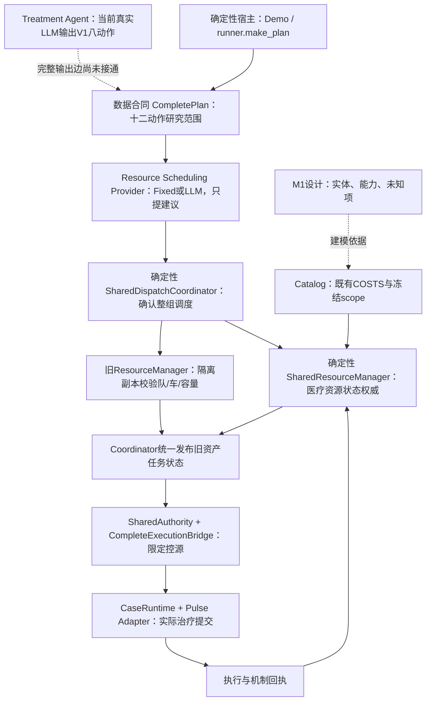
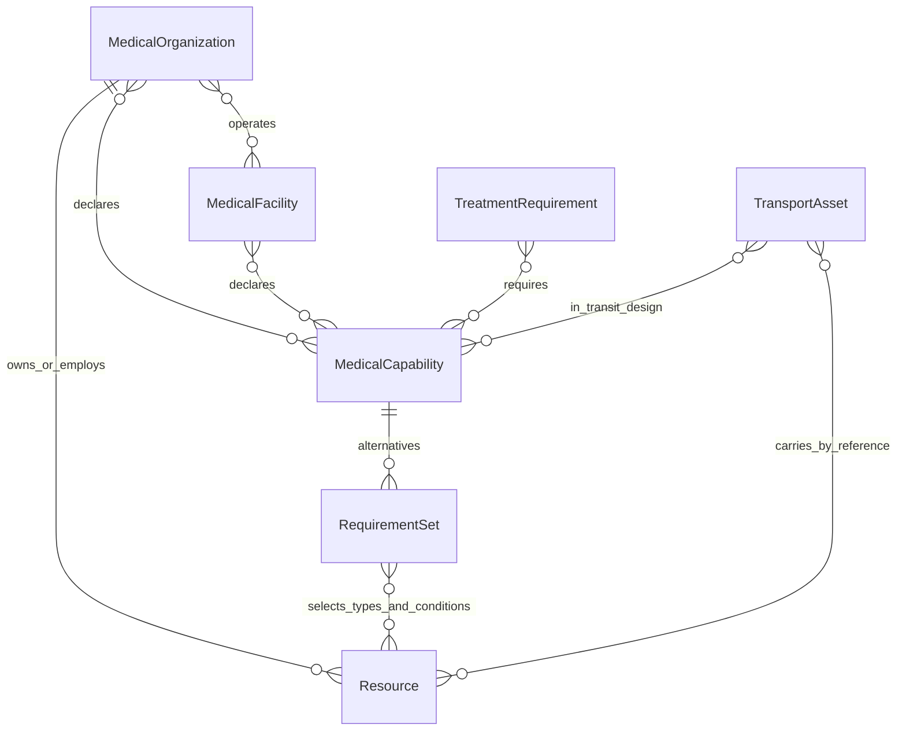
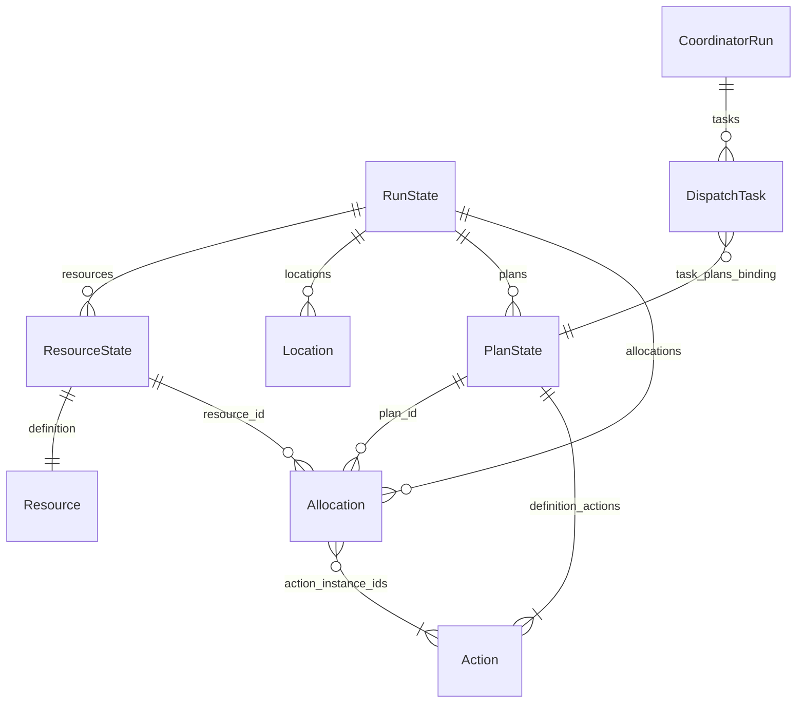
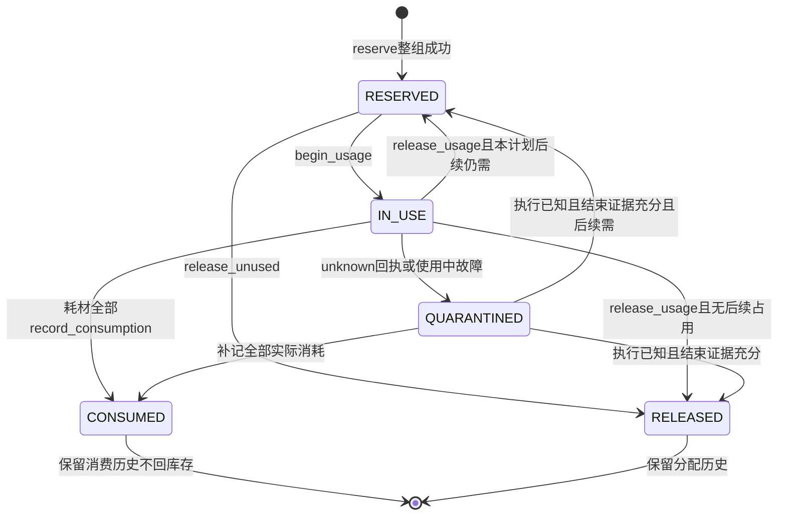
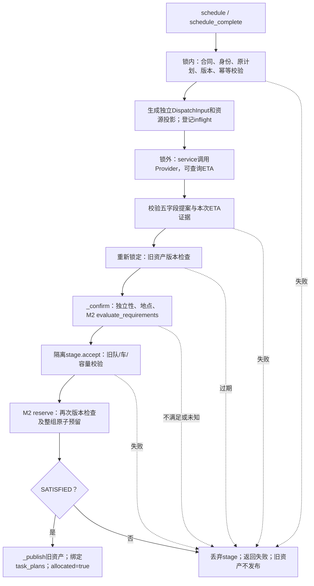
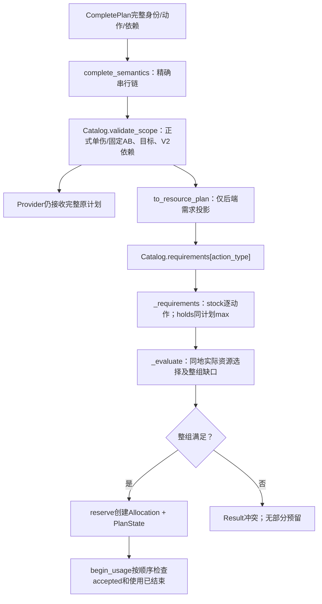
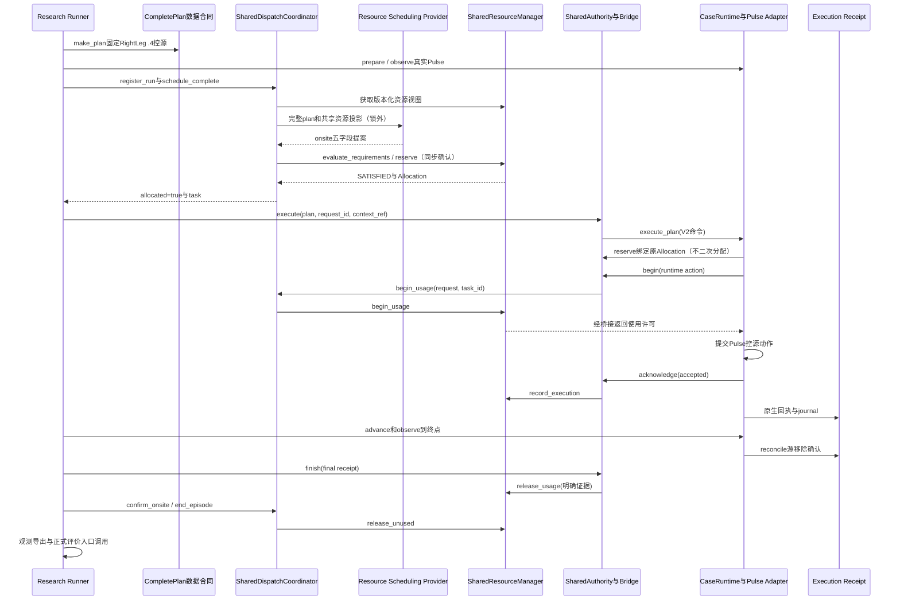

# 301 V2科研工程：医疗资源模型、共享资源管理与多Agent调度系统完整技术解析

依据：`/home/private/project-301-v2` 当前源码、正式配置、测试源码及已保存运行证据。整理日期：2026-10-19。本文只解释现有工程，不修改医学定义、不建立新的资源标准。本轮未执行测试、Pulse治疗或LLM调用；下文“已验证”均明确指向已有证据。

**当前结论：M1提供建模设计，M2-A/B/C已构成可运行的研究资源约束基础设施；最新单场景桥接已把固定CompletePlan、共享账本和真实Pulse控源接起来。它尚不是完整的真实双Agent动态协作、十二动作通用执行与十四规则可评分系统。**

阅读时区分六种状态：**已实现**指当前存在可追踪实现；**已验证**必须同时说明单元测试、Mock、Demo或真实Pulse层次；**仅设计**没有对应完整实现；**部分实现**只有限定子集；**待确认**表示证据或业务参数尚缺；**未实现**表示当前链路不存在。研究fixture是宿主显式给定的实验令牌，不等于现实临床资源标准。

### 阅读导航与证据入口

本文按十四章展开：问题直觉 → 分层架构 → 六实体 → 十二动作 → 共享账本 → 调度集成 → 完整合同 → 三案例 → 调用追踪 → 接口索引 → 验证 → 边界 → MAS研究 → 自学指南。

| 证据层 | 当前入口 | 如何使用 |
|---|---|---|
| M1设计 | [模型设计](../research_artifacts/resource_model_m1/RESOURCE_MODEL_V1_DESIGN.md)、[动作盘点](../research_artifacts/resource_model_m1/CURRENT_ACTION_INVENTORY.md)、[资源映射](../research_artifacts/resource_model_m1/ACTION_RESOURCE_MAPPING.md)、[未决问题](../research_artifacts/resource_model_m1/OPEN_QUESTIONS.md) | 识别设计、工程事实和医学未知；不能直接当Python合同 |
| M2-A实现 | [models.py](../src/core301/dispatch/shared_resources/models.py)、[catalog.py](../src/core301/dispatch/shared_resources/catalog.py)、[manager.py](../src/core301/dispatch/shared_resources/manager.py) | 数据类型、需求、状态权威 |
| M2-B实现 | [shared_integration.py](../src/core301/dispatch/shared_integration.py)、[旧manager.py](../src/core301/dispatch/manager.py)、[providers.py](../src/core301/dispatch/providers.py) | 提案、两类资产协调及任务生命周期 |
| M2-C实现 | [complete_contracts.py](../src/core301/dispatch/complete_contracts.py)、[complete_demo.py](../src/core301/dispatch/complete_demo.py) | 十二动作完整合同及固定AB范围 |
| 最新闭环 | [runner.py](../src/core301/research_runtime/runner.py)、[bridge.py](../src/core301/research_runtime/bridge.py)、[闭环报告](research_closed_loop_v1/README.md) | 单一真实场景的执行与记账 |
| 范围/兼容 | [RESEARCH_SCOPE](RESEARCH_SCOPE.md)、[工程基线](V2_ENGINEERING_BASELINE.md)、[历史依赖审查](LEGACY_DEPENDENCY_AUDIT.md)、[资源一致性审查](research_alignment/ACTION_RESOURCE_ALIGNMENT.md) | 保留冻结范围；识别兼容调用方 |

**文档时间差异：**M1 README中的“未实现M2”是M1交付时事实；工程清理基线及一致性审查中的“尚无完整计划执行桥接”是后续最小闭环之前的事实。当前已有`research_runtime`限定控源桥接，但不能据此把旧报告全部改读为“十二动作/所有复合伤都已闭环”。本文通过源码与`native-002`原始记录更新认识，不回写历史报告。

## 第一章：整个医疗资源系统到底在解决什么问题？

Treatment Agent解决“对伤员提出什么治疗”，资源系统解决“此刻在哪里、由谁、用哪些仍可分配的资源执行”。一个计划可以符合动作合同，却因为唯一呼吸机已被别人预留而不可执行。还可能缺耗材、地点能力未知、设备故障、接收容量不足或转运尚未到达。这些约束无法靠一段自然语言保证。

设A、B都需要`intubation → mechanical_ventilation`，研究场景有两份气道包、两个medic令牌和一台呼吸机。若两个Agent各自看到一份“呼吸机=1”的患者私有副本，都会认为计划可行。即使LLM诚实读取同一快照，A和B也可能在异步推理期间同时选中它。

共享账本把这一个设备作为一个canonical `resource_id`维护。A提交整组预留成功后，可用量变0、预留量变1。B若仍用旧版本，得到`STALE_SNAPSHOT`；若读取新版本再申请，得到`RESOURCE_IN_USE`及阻塞分配ID。**预留已经排他，不必等Pulse开始通气才产生冲突。**A明确结束使用并提交释放证据后，可用量才回1；B需要新请求再次确认，不会自动排队获配。

Resource Scheduling Provider提出`onsite / team_response / evacuation`方案；它可以是Fixed，也可以是LLM。SharedDispatchCoordinator检查方案、位置、旧资产和医疗资源，把确认过程串起来。SharedResourceManager保存医疗资源事实并执行原子预留。后两者都是确定性Python后端，不是新增Agent。

治疗决策与分配相互约束，却不能混为一个动作：调度器不擅自删掉治疗计划里的动作来“凑足资源”，账本也不决定医疗上应改用哪种治疗。当前失败响应可以告诉宿主需要重新规划，但尚无自动把冲突送回Treatment Agent并生成新方案的闭环。

本章例子的真实实现与14步记录见第八章案例一；没有借用临床人数或虚构资源释放时刻。

## 第二章：M1—M2整体架构

### 2.1 四个阶段分别增加了什么

| 阶段 | 解决的问题 | 当前产物和边界 |
|---|---|---|
| M1 | 定义对象、能力、动作需求和未知项 | 六实体设计、十二动作映射；完整临床本体仅设计 |
| M2-A | 多伤员共享同一医疗库存 | 内存账本、整组预留、消费/占用/释放、版本与幂等；单实例单进程 |
| M2-B | 调度建议怎样变成可执行任务 | 共享Coordinator整合旧队伍/车/机构容量与M2-A；调用期间重新校验 |
| M2-C | 旧八动作合同不能完整表达新研究计划 | 十二动作、scope、实例ID和串行依赖；仍用M2-A/B同一资源权威 |
| 最新最小闭环 | 预留怎样约束真实治疗提交 | 只支持RightLeg .4单动作控源；Fixed计划与调度，真实Pulse |

M1不是一个已部署的数据库，M2-C也不是另一个库存服务。`Catalog`从既有COSTS和冻结配置构建需求，不从M1 Markdown运行时解析临床要求。



实线表示当前有代码连接；虚线表示设计依据或未完成连接。图中Provider从完整合同读计划，实际调用组织是Coordinator→service→Provider，而非Provider直接持有manager对象；第六、九章给出调用顺序。

### 2.2 谁拥有最终决定权

医疗物资是否可预留，由`SharedResourceManager.reserve`确认。包含队伍/车辆/设施的整个调度是否成功，由`SharedDispatchCoordinator._confirm`在旧资产校验与医疗预留都通过后确认。Provider没有库存写权限，CompletePlan只是数据；Pulse只处理生理仿真动作，不知道研究medic账本。

当前有两个**不应重叠的状态域**：M2-A医疗令牌，以及Coordinator持有的旧运输/设施资产状态。不能简单称“全部资产都已进一张M2表”，也不能给每个伤员开一套可独立写入的旧库存。两域通过同一锁内确认和明确身份前提协调。

## 第三章：M1医疗资源模型详解

### 3.1 先看证据类型与公共约定

M1的`EvidenceValue<T>`是设计表达：`value: T|null`、`status`、`evidence_refs: string[]`、`scope_kind`、`note`。状态为`CONFIRMED / PROPOSED / PENDING_EXPERT_REVIEW / UNKNOWN`。确认“代码有medic×1”不代表确认“现实处置只需要一名医护”。`null`不等于0、不适用或无限量。

M1建议ID带版本、数量带单位、位置带坐标系，时间区分时刻和时长。当前M2-A只实现严格非负整数令牌`Count`、有限非负仿真时间`Time`及非空ID；没有完整EvidenceValue对象、资格数据库或连续mL/L库存。Pydantic `Model`禁止额外字段、冻结属性并重新校验传入实例，管理器另以深拷贝隔离内部可变状态。

### 3.2 Resource：东西本身，不是能力结论

资源是可被计数、定位、占用或消耗的对象。一个`resource_id`可表示单台呼吸机，也可表示一池同型气道包；人员在fixture中可显式聚合。资源身份与数量不同：`medic`这个ID配`initial_total=2`表示两个人员令牌，不是两个不同技能自动生成两个人。

| M1设计字段组 | 类型与约束 | 当前实际对应 |
|---|---|---|
| `resource_id, model_version, resource_type_id` | string；身份/目录/版本 | 实现resource_id、resource_type_id；无实体model_version |
| `kind, name, specification` | personnel/equipment/consumable；string；EvidenceValue对象 | 无完整字段；类型键和use_mode表达最小分类 |
| `accounting_mode, use_mode, quantity_unit` | unit/pool/continuous_supply；consumable/reusable/mixed；string | 仅consumable/reusable和`unit`；不支持mixed/连续供应 |
| `owner_organization_id, initial_location, initial_total` | 可空ID、LocationRef、EvidenceValue<number> | 无owner；`location_id: ID|null`、`initial_total: Count|null` |
| `mobility, qualification_refs, skill_refs, technical_constraints` | 带证据的枚举、ID数组、对象 | 未实现完整移动/技能/设备约束 |
| `lot_id, expires_at, storage_constraints` | 带证据的批次、时间、对象 | 未实现冷链、批次与有效期 |
| `release_policy_ref, consumption_policy_ref, evidence_refs` | 可空ID、string[] | 无资源级策略解析；统一管理器规则，需求带evidence_refs |

**当前`shared_resources.models.Resource`全部字段：**`resource_id: ID`、`resource_type_id: ID`、`unit: ID`、`use_mode: Literal['consumable','reusable']`、`initial_total: Count|None`、`location_id: ID|None`、`scope_kind: Literal['research_fixture']`。`create_run`核对type/unit/mode与Catalog完全匹配、位置引用存在、ID唯一。状态不直接存此冻结对象，而在`ResourceState`、Allocation和snapshot中维护。

### 3.3 MedicalCapability：资源满足条件后能提供的服务

“有呼吸机”只说明有设备，不证明有操作人员、气源、合适地点和可用时间。M1以能力表达这些组合条件，避免“库存有设备→能力一定可用”的错误。

| M1字段 | 类型/含义 | M2实现 |
|---|---|---|
| `capability_id, version, name` | string，能力身份 | 没有独立MedicalCapability类 |
| `domain` | hemorrhage/chest/airway/respiration/infusion/exposure | 展示分组，没有资源继承 |
| `clinical_scope` | EvidenceValue<object> | 临床scope整体拒绝确认为满足 |
| `alternatives` | RequirementSet[]；组内all_of为AND，组间OR | 未实现通用可替代组合求解 |
| `supported_action_refs, evidence_refs` | ID[]、string[] | 实际Location.capabilities保存action_type字符串 |

M1的`RequirementItem`还建议category、selector、带证据数量及required、unit、phase、use_mode、兼容与地点约束。该表达足以设计“多个资源共同提供一项能力”，但现实OR替代尚未确认，也没有运行中的多组织能力自动合成器。

当前替代机制是：`Location.capabilities: frozenset[str]|None`声明允许的动作，Catalog给出固定需求，再核对permission与库存。这是一组研究凭据。M1的`ventilatory_support`能力ID不会自动成为代码里的能力令牌；运行时使用`mechanical_ventilation`。

### 3.4 MedicalOrganization：归属、团队和机构

组织回答“资源属于谁、谁与谁协作”，设施回答“在哪里救助”。团队可以移动，一座设施可以由多个组织支援，不能把两个ID混用。

M1设计字段为`organization_id/name/kind`（team/unit/institution）、`parent_organization_id: ID|null`（无环单父级）、`member_resource_ids: ID[]`、`declared_capability_ids: ID[]`、`evidence_refs: string[]`。成员归属不能复制库存；整体团队与其成员不能同时独立分配。

**部分实现：**没有完整MedicalOrganization类/表。目前`dispatch.models.MedicalTeam`实际字段为`run_id, team_id, display_name, position, supported_action_types, active_task_id`；动作列表唯一，active_task_id可空，非空必须关联匹配的未结束任务。没有成员清单、组织父子关系或资质细项。M2-A的`evacuation_team`是数量令牌，并不是自动关联MedicalTeam成员的组织对象。两者物理身份是否重叠必须由宿主证明。

### 3.5 MedicalFacility：救治地点与接收容量

M1设计的设施包含现场、救护点、机构三类，不强制每个动作去医院。建议字段为`facility_id/name/kind`、`position: LocationRef`、`operator_organization_ids: ID[]`、`declared_capability_ids: ID[]`、`conditions: EvidenceValue<object>`、`capacity_definitions`数组、可空`role_label`、`evidence_refs`。能力专用槽位与总床位若是同一实体，必须避免双重计数。

当前分为两个对象：

- `shared_resources.models.Location`：`location_id`、可空capabilities/permissions集合、可空`protected_route_available`与`receiving_environment_verified`。只存场景ID和条件，无坐标、床位或运营组织。
- `dispatch.models.Facility`：`run_id, facility_id, display_name, kind(hospital/aid_station), position(x/y/z), capacity:int>=0, supported_action_types:list, reserved_patient_ids:list, admitted_patient_ids:list`。两患者集合不得重叠，各列表不能重复；`remaining_capacity = capacity - len(reserved) - len(admitted)`不得负。

`CompleteFacility`只把支持动作类型扩大到十二项。`facility_locations`由Coordinator把设施ID关联到M2-A Location；两个对象不是自动合并的数据库实体。容量是旧合同的接收名额，不能自动叫ICU床位或手术台数。

### 3.6 TransportAsset：为何不塞入普通设备表

运输不仅占一台设备，还涉及位置、路径、乘载、车组、途中能力和交接。M1单独设计`transport_asset_id/name/platform_kind`、`owner_organization_id`、带证据`capacity_definition`、`crew_requirement_set_id`、`in_transit_capability_ids`、`equipment_resource_ids`、`compatibility_constraints`、`initial_location/evidence_refs`，运行态再加任务和ETA。

**部分实现：**当前`Ambulance`只有`run_id, ambulance_id, display_name, position, active_task_id`。旧manager按一个活动任务占用车辆，未实现多席位、车组、车载设备或途中医疗能力。`EtaAdapter`提供路线预测接口，`TaskEvent`提供受策略约束的移动事实入口；它们不等于已完成实际运输系统。尤其`remove_from_exposure`修改Pulse环境，不会创建救护车任务。

### 3.7 TreatmentRequirement：把动作接到资源

M1建议需求包含身份/版本/action_type、scope_kind、execution_scope_ref、required_capability_ids、target_constraints、depends_on/conflicts_with、resource_sets、duration_model、consumption_events、release_conditions、location_conditions和evidence_refs。时长模型的setup/procedure/support/cleanup均需证据，当前不能填临床值。

**当前实际类**位于`shared_resources/catalog.py`，是冻结dataclass：

| 字段 | 精确类型/当前用途 |
|---|---|
| `action_type` | str，正式动作键 |
| `stock` | tuple[tuple[str,int], ...]，每动作的耗材需求 |
| `holds` | tuple[tuple[str,int], ...]，可复用研究令牌需求 |
| `permission` | str或None，额外研究权限 |
| `evidence_refs` | tuple[str,...]，指向COSTS及M1映射 |
| `scope_kind` | str，默认research_fixture |
| `requirement_id` | property，`301.resource.m2a.1:`加action_type |

目标和序列约束没有重复存进这个类，而由`Catalog.validate_scope`读取正式单伤/复合配置并调用现有V2合同；具体依赖又由CompletePlan表达。这是职责分散，不是把M1所有字段都落地。

### 3.8 两张ER图：设计关系与运行关系

以下第一张**全部是M1设计关系**，不能理解为已有数据库外键。能力通过RequirementSet引用资源类型/条件，不是直接生成库存。



下图是**当前内存模型中的引用关系**。非数据库DDL；PlanState以动作ID字典保存状态，Allocation可以关联多个串行动作。



可用性由数量、当前位置、能力/权限和当前Allocation共同决定，不能只读一个`operational_state`字符串。M1完整组织、运输及能力替代图没有被偷偷补全为运行事实。

## 第四章：12个救助动作如何映射到医疗资源？

### 4.1 资源来源与计量

实际加载链为`dispatch/shared_resources/catalog.py:Catalog.__init__` → `runtime/v2_1/resources.py:COSTS` → `runtime/v2/resources.py:COSTS`（导入为BASE）及`runtime/v2/hemothorax_resources.py:COSTS`（导入为HEMO），再加入环境移除。这里BASE是导入别名，原定义名是COSTS。M2没有另写一套十二动作数量。

下表各数量都为**当前研究fixture已实现**；M1能力名称为**仅设计/PROPOSED**；对应现实必要性、人员数、设备规格、耗材构成和时长均**待确认**。`—`表示研究COSTS没有该项，不能解释为临床不需要。

地点L统一表示：计划`location_id`存在、资源位于同地、Location.capabilities包含动作，额外权限也满足。未知条件返回INDETERMINATE；没有统一“必须医院”规则。

| 动作ID | 对应基础伤情 | M1医疗能力 | 人员holds | 设备holds | 耗材stock | 地点/额外权限 | 需求状态 |
|---|---|---|---|---|---|---|---|
| `control_external_bleeding` | external_hemorrhage | external_source_control | medic×1 person | — | — | L；simulated_external_source_control | 研究实现；临床待确认 |
| `control_internal_bleeding` | abdominal_internal_hemorrhage | internal_source_control | medic×1 person | — | — | L；simulated_internal_source_control | 同上 |
| `control_hemothorax_bleeding` | hemothorax | hemothorax_source_control | medic×1 person | — | — | L；simulated_hemothorax_source_control | 同上 |
| `occlusive_dressing` | open_pneumothorax | chest_wound_sealing | medic×1 person | — | occlusive_dressing_kit×1 kit | L；无额外permission | 同上 |
| `needle_decompression` | closed_tension_pneumothorax | pleural_decompression | medic×1 person | — | needle_kit×1 kit | L；无额外permission | 同上 |
| `chest_tube` | hemothorax | pleural_drainage | medic×1 person | — | chest_tube_kit×1 kit | L；research_chest_tube | 同上 |
| `fluid_resuscitation` | external_hemorrhage、abdominal_internal_hemorrhage、dehydration | iv_fluid_support | medic×1 person | — | saline_500ml_bag×1 bag | L；iv_access | 同上 |
| `transfusion` | external_hemorrhage、abdominal_internal_hemorrhage | blood_support | medic×1 person | — | blood_500ml_bag×1 bag | L；iv_access | 同上 |
| `intubation` | respiratory_muscle_impairment | tracheal_airway | medic×1 person | — | airway_kit×1 kit | L；无额外permission | 同上 |
| `mechanical_ventilation` | respiratory_muscle_impairment | ventilatory_support | — | ventilator×1 device | — | L；无额外permission | 同上 |
| `supplemental_oxygen` | impaired_alveolar_exchange | oxygen_delivery | medic×1 person | nasal_cannula×1 device；oxygen_425l_source×1 device | — | L；无额外permission | 同上 |
| `remove_from_exposure` | carbon_monoxide_exposure、environmental_hypoxia | exposure_removal | evacuation_team×1 team | — | — | L；research_environment_removal；route/receiving均true | 同上 |

Catalog把stock中以`_bag`结尾的键计为bag，其余为kit；holds中medic计person、evacuation_team计team，其余计device。**这是代码计量规则，不是医学物料分类规范。**例如鼻导管和氧源在研究账本中为reusable，不证明鼻导管临床可复用，也不代表已管理氧气连续消耗。

### 4.2 每项需求为什么这样表达

1. **外出血控源**把“可以执行研究停源”与任意直接修改伤情分开，需要medic令牌和专门权限。Pulse最终对同一个RightLeg外出血源提交Severity=0。没有开包/压迫/止血带模型，因此stock为空；不能反推真实零耗材。
2. **内出血控源**同样是Spleen源Severity=0的代理。`medic`没有手术团队资质含义，没有已实现的手术室/介入器械清单。
3. **血胸控源**改变同侧Hemothorax源，独立于后续引流。它占medic但不扣胸管包；胸管包不能作为“已经完成控源”的证据。
4. **封闭敷料**用一个`occlusive_dressing_kit`记录一次研究物料投入、medic记录人员占用。原生机制是Left ChestOcclusiveDressing；包内数量与替换政策未定义。
5. **针刺减压**对应`needle_kit`和medic，原生机制是Left NeedleDecompression。没有针具型号、尺寸或额外监测设备的当前账本项。
6. **胸管引流**对应`chest_tube_kit`和medic，固定原生TubeThoracostomy路径。研究先控源再引流；持续引流装置、护理和清理要求尚未完整建模，不能因没有设备holds就声称无需持续管理。
7. **补液**为Saline研究袋和medic、iv_access权限。bag×1是资源单位，不等于500mL已经全部进入患者；实际给入要靠执行侧证据。当前没有独立输液泵、针头、加温器扣减。
8. **输血**与补液分别使用`blood_500ml_bag`和`saline_500ml_bag`，不可自动互换。研究Blood不是已核定临床血制品，血型、配血、温控和储存有效期未实现。
9. **插管**用airway_kit与medic记录操作阶段。当前账本没有另计喉镜、药品等细项。后续机械通气必须满足现有合同配对及串行结束条件。
10. **机械通气**只列ventilator，**没有隐式添加medic**。设备预留后持续占用，accepted不使其可再分配；要显式停止、脱离、可复用证据。人员监护和供电气源是未决医学/设备问题。
11. **补充氧气**占medic、鼻导管和氧源三个令牌，不按L逐次扣气。正式V2鼻导管协议由专用适配器维护；旧V1同名氧疗参数不同，不能用旧适配器直接替代新路径。
12. **脱离暴露**需要evacuation_team及受保护路径/已验证接收环境两个布尔凭据；原生机制是环境气体恢复CO=0、O₂=.21。它没有普通开包消耗，也没有自动预留Ambulance、模拟搬运轨迹或确认到院。

所有holds都必须遵循M2的显式结束规则，但不意味着各动作的现实持续时间相同。`record_consumption`与`begin_usage`分离是M2语义；M1表中沿用旧fixture“开始扣减”的描述不应拿来覆盖M2实现。

### 4.3 复合伤如何引用同一映射

配置来源：[五复合配置](../config/v2_1_battle_composite_patterns.yaml)。下列只是固定研究AB，不是自由组合算法。

| pattern_id | 正式动作序列 | 整组stock | 整组holds |
|---|---|---|---|
| penetrating_thoracic_composite_v2 | occlusive_dressing → control_hemothorax_bleeding → chest_tube | occlusive_dressing_kit1、chest_tube_kit1 | medic1 |
| blunt_thoracoabdominal_composite_v2 | control_internal_bleeding → fluid_resuscitation → needle_decompression | saline_500ml_bag1、needle_kit1 | medic1 |
| blast_hemorrhage_respiratory_composite_v2 | control_external_bleeding → fluid_resuscitation → intubation → mechanical_ventilation | saline_500ml_bag1、airway_kit1 | medic1、ventilator1 |
| fire_co_alveolar_composite_v2 | remove_from_exposure → supplemental_oxygen | 无 | evacuation_team1、medic1、nasal_cannula1、oxygen_425l_source1 |
| trapped_hypoxia_dehydration_composite_v2 | remove_from_exposure → fluid_resuscitation | saline_500ml_bag1 | evacuation_team1、medic1 |

数量按同计划串行max(holds)/逐动作stock聚合。五组合没有固定transfusion，但十二动作覆盖另含两种出血的输血分支。五组合资源预留通过不能推导五组合真实共享执行通过。

## 第五章：M2-A共享资源管理器的完整实现

本章核心源文件：[shared_resources/manager.py](../src/core301/dispatch/shared_resources/manager.py)。`SharedResourceManager`的职责是可信后端记账，不提交Pulse、不调用Agent、不推断临床能力。

### 5.1 账本到底存什么

管理器必须由宿主创建一次，注入所有相关伤员。它的`_runs`按run_id隔离，不是进程全局单例，也不跨运行借库存。

| 实际内部结构 | 关键字段 | 用途 |
|---|---|---|
| `ResourceState` | definition、location_id、received、consumed、lost、blocked | 资源定义加可变事实；数量派生而非多处手动写余额 |
| `Allocation` | allocation_id、patient_id、plan_id、resource_id、quantity、unit、use_mode | 将一次计划需求绑定到实际资源池 |
| Allocation续 | action_instance_ids、requirement_ids、status、consumed_qty、active_action_id、start_at_s、actual_end_at_s | 串行复用、当前占用、消耗和结束记录；没有expected_end/expires字段 |
| `PlanState` | definition、actions字典、cancelled | 每动作status/execution/receipt_ref；全计划是否取消后续预留 |
| `RunState` | resources、locations、views、version、at_s、allocations、plans、requests、events | 同一运行的权威状态和幂等历史 |

`create_run`从显式Resource与Location初始化，不调用“默认无限供应”。`research_scene(counts)`只是fixture工厂：counts决定实际库存，地点被显式赋研究能力与权限。省略一种资源表示该封闭场景没有配置；存在资源但数量未知应写`initial_total=None`，不是0。

`views`保存canonical资源ID引用，例如团队视图和设施视图可看同一设备；不能各复制一份总量。`get_snapshot(run_id, view=...)`的view筛选resources，返回的allocations等仍是run层数据，因此它是展示投影，不是权限隔离API。返回深拷贝，改快照不会修改账本。

资源snapshot包括初始、接收、消耗、损失、剩余总量、可用、预留、使用中、不可用、当前位置、状态、版本和更新时间。`operational_state`可以是AVAILABLE、PARTIALLY_ALLOCATED、RESERVED、IN_USE、EXHAUSTED、FAULTED、MAINTENANCE、QUARANTINED、UNKNOWN；聚合池应以数量为准。

### 5.2 原子预留：为什么不能逐项拿到就提交

若胸部计划需要敷料包、medic和胸管包，先拿敷料和人员、最后发现胸管包没有，会让其他伤员无故失去资源。当前实现先计算全部需求，在私有副本完成分配，只有所有条件满足且守恒成立才替换权威run。

`reserve(request, plan)`路径为：

1. 严格校验Request/Plan；整计划请求要求action_instance_id=null。
2. `_mutate`检查幂等、版本、时间，复制当前run。
3. 拒绝同plan_id重复预留、同run动作实例ID复用。
4. `_evaluate`→`_conditions`检查身份、scope、目标、能力、权限、位置及环境凭据；同一patient不能另有未完成计划。
5. `_requirements`形成逐动作stock与串行holds；`_evaluate`按resource_id排序查同类型同地资源，可从多个同型资源池拆分数量。临时`used`计数避免本次选择重用同一余额。
6. 任一项缺失，返回全部发现的conflicts，不创建任何Allocation或PlanState。
7. 全部满足才创建Allocation并把动作标为RESERVED；`_mutate`增版本、检查守恒、提交。

`evaluate_requirements`只是读操作，先检查版本再评估，不锁定未来库存、不缓存预留结果。确认时必须再reserve。同样，SATISFIED只表示**当前研究资源条件**满足，不能绕过Pulse源身份、授权、时间及患者准入。

### 5.3 预留与开始使用是两个阶段

reserve让别的计划不能抢走资源；begin_usage表示某个动作实际开始使用。两者都减少可用量，但前者记reserved，后者记in_use。

`begin_usage(request)`要求计划/患者/动作归属正确、计划未cancelled、动作状态RESERVED；重新检查scope与地点能力/权限。此前**所有动作**必须FINISHED且execution=accepted，而不只是当前资源的上一个使用者。每个相关Allocation仍须RESERVED、资源无故障、位置匹配。通过后Allocation变IN_USE，active_action_id和start_at_s更新，actual_end_at_s清空；动作变STARTED。

如果资源预留后移走、故障或权限撤销，开始使用失败，原预留保持，调用方可显式取消未用项。这里没有“失败就回滚所有已发生治疗”的逻辑。

### 5.4 消耗：实际投入是独立事实

`record_consumption(request, *, amounts, receipt_ref)`接收**allocation_id→正整数数量**，不是resource_type→数量。它要求非空证据引用，分配属于该患者/计划/当前动作，类型consumable，状态IN_USE或QUARANTINED，数量不超过未消耗部分。完全消耗后Allocation为CONSUMED；资源consumed累计增加，total减少。

accepted不是消费触发器。包可能已打开但Pulse拒绝动作，也可能Pulse接受输注而尚无整袋使用事实；`record_execution`不自动调用消费。已消耗不能通过cancel、失败或release_usage加回。未消耗材料要归还，需明确`returned_unused_consumables=True`，不能靠“动作rejected”推断仍可用。

旧`ResearchResourceFixture.begin`/V2.1单病例Resources.begin会按旧语义扣stock；新桥接不能同时保留其独立库存再扣一次M2。当前真实桥接只支持无stock的控源，尚未证明耗材动作的这种端到端对接。

### 5.5 释放：未开始与已使用分开

| 操作 | 可处理的对象 | 不会做什么 |
|---|---|---|
| `release_unused(request, reason=...)` | 全计划；RESERVED动作→CANCELLED，RESERVED分配→RELEASED，plan.cancelled=true | 不归还IN_USE/QUARANTINED；不恢复耗材 |
| `release_usage(request, evidence, returned_unused_consumables=False)` | 已STARTED/QUARANTINED动作，已知accepted或rejected；三项释放证据全true | 不因accepted、超时或close自动释放 |
| `record_execution(... unknown ...)` | 动作与正在使用的分配隔离 | 不重试、不猜是否执行、不回补物料 |
| `record_resource_change(... restore ...)` | 清除资源blocked故障标记 | 不自动解除Allocation隔离 |

ReleaseEvidence要求`receipt_ref`以及`stopped/detached/cleared_for_reuse`。通用manager只验证字段，不读取引用文件核实医学事实；可信执行后端负责任证。最新SharedAuthority为单一无设备控源检查机制回执后构造此证据，不能把该解释复制给呼吸机。

释放一个动作后，若同一Allocation还服务本计划未来RESERVED动作且计划未取消，它回到RESERVED，继续为该计划保留；否则RELEASED。动作变FINISHED。CONSUMED分配仍CONSUMED，只补实际结束时间。故而串行复用不会把已投入耗材重新变成库存。

unknown后可以补记新的accepted/rejected事实，再提供结束证据；已经确定的accepted/rejected不可覆盖。新plan_id也不能绕过同患者未解的unknown。当前没有自动恢复算法。

### 5.6 版本、幂等与锁

`Request`字段为run_id、patient_id、plan_id、request_id、idempotency_key、可空action_instance_id、at_s、expected_state_version。版本是整个run的医疗账本版本，不是每个资源各自递增；一次成功变更加1。失败不推进资源版本和仿真时钟，但会保存失败结果及事件，所以“失败完全没有任何内存写入”不准确。

所有写操作经`_mutate`。fingerprint由operation、**整个Request**、payload的排序JSON组成。同键同fingerprint返回原Result深拷贝，在版本校验之前处理，因而原请求可以在后来版本已经变化时仍获得原回执。**换了request_id、at_s或expected_version，也算不同请求**；复用原幂等键会IDEMPOTENCY_CONFLICT。失败也缓存：想在资源释放后重试，应重新读快照并发新逻辑请求，不能期望同键旧失败变成功。

```python
previous = current.requests.get(req.idempotency_key)
if previous:
    if previous[0] == fingerprint:
        return previous[1].model_copy(deep=True)
    return self._result(current, req, [self._conflict(current, req, 'IDEMPOTENCY_CONFLICT', 'Key reused with different operation/request/payload')])
```

这段摘自`_mutate`：第1行查本run幂等表；第2—4行使真正重复调用返回原结果；最后一行拒绝相同键被赋予新含义。它保证单实例内重复写不再次分配或扣减，不保证进程重启后的幂等。

`RLock`保护管理器的所有状态访问，成功写在深拷贝上执行并检查不变量。`serialized(run_id)`给Coordinator一个可重入的同步确认边界；锁内不等待Agent/ETA。当前是一把管理器级锁，连不同run也在这把锁下串行访问；没有数据库事务、分布式锁或多worker共享能力。历史事件和幂等表增长、每次深复制的性能也未做大规模验证。

### 5.7 守恒与真实状态机

对已知库存，代码每次成功变更在提交前执行`_assert_invariants`：

```text
initial_total + received_qty - consumed_qty - lost_qty = total_qty
available_qty + reserved_qty + in_use_qty + unavailable_qty = total_qty
```

所有量必须是非负整数。QUARANTINED分配的未消耗部分计unavailable；blocked资源的未分配自由量也计unavailable，不与reserved/in_use重复相加。未知初始总量的各余额为None且不允许Allocation。`lose`只能扣未分配的available库存；`receive`/`lose`必须正整数。故障会隔离正在用的分配；位置变化返回受影响分配，但不自动替它们重规划。

下图是**Allocation.status**状态机，资源池AVAILABLE/EXHAUSTED是派生快照状态，不是Allocation状态。



同样不能把Action.status与Allocation.status混用：动作有RESERVED/STARTED/QUARANTINED/FINISHED/CANCELLED；执行事实另为None/accepted/rejected/unknown。已知rejected后可以安全结束占用，但后继动作仍因前序不是accepted而不能开始。

一个实际资源的完整数量变化见`native-002` medic（第八章另给时间）：

| 操作后 | version | initial | received | consumed | lost | total | available | reserved | in_use | unavailable | operational_state |
|---|---:|---:|---:|---:|---:|---:|---:|---:|---:|---:|---|
| create_run | 0 | 1 | 0 | 0 | 0 | 1 | 1 | 0 | 0 | 0 | AVAILABLE |
| reserve | 1 | 1 | 0 | 0 | 0 | 1 | 0 | 1 | 0 | 0 | RESERVED |
| begin_usage | 2 | 1 | 0 | 0 | 0 | 1 | 0 | 0 | 1 | 0 | IN_USE |
| record_execution accepted | 3 | 1 | 0 | 0 | 0 | 1 | 0 | 0 | 1 | 0 | IN_USE |
| release_usage | 4 | 1 | 0 | 0 | 0 | 1 | 1 | 0 | 0 | 0 | AVAILABLE |
| end_episode→release_unused | 5 | 1 | 0 | 0 | 0 | 1 | 1 | 0 | 0 | 0 | AVAILABLE |

中间行由该run五条资源事件及确定性状态变更重建，最终行与`resource_final.json`逐字段一致；不是额外采集的六份独立快照。

## 第六章：M2-B资源调度Agent与共享资源的集成

### 6.1 Provider看到什么、返回什么

输入主合同`DispatchInput`包括run_id、patient_id、position、current_facility_id、patient_observation、treatment_plan、facilities、ambulances、medical_teams。完整版本替换其中的plan与设施/队伍动作类型。共享入口还额外提供`shared_resources`只读数据投影，**不是manager对象**。

`_projection`输出schema_version、两个版本、scope_kind、资源可用/预留/使用等数量、locations、research_requirements、constraints。它不包含源注册表、私有执行状态或原始事件流。constraints明确计划只读、需要后端预留、临床要求未确认、患者/请求地点、设施地点映射、旧资产独立声明和不支持动作列表。

`DispatchProposal`精确五字段：

| 字段 | 类型与约束 |
|---|---|
| patient_id | 非空ID，与输入伤员一致 |
| mode | onsite / team_response / evacuation |
| team_id | ID或null；仅team_response必须非空 |
| ambulance_id | ID或null；仅evacuation必须非空 |
| target_facility_id | ID或null；仅evacuation必须非空 |

onsite三种资产ID全null。提案不含资源数量、库存修改、治疗动作替换或“后端已确认”字段。任务ID、accepted_at_s、状态和readiness由后端创建。

`FixedDispatchProvider`返回宿主指定方案；非onsite会查询选定路段ETA，但不做最优调度。`LLMDispatchProvider`通过现有模型配置发起Chat Completions，可选启用query_eta工具、限制工具轮次，解析严格五字段提案。两者均经service和Coordinator校验。已有HTTP Mock证明真实Provider代码会传完整计划/共享视图，不等于付费模型已经实际决策。

### 6.2 调度确认流程与原子性

入口位于`shared_integration.py`。`register_run`先建立可信拓扑：所有伤员输入共享相同初始旧资产列表、patient_locations精确匹配伤员集合、地点存在、旧资产无预先活动任务、run不能覆盖注册。它不把旧队伍数量复制成medic库存。



`_stage`深拷贝患者manager，注入Coordinator当前唯一旧资产集合和时钟，再从真实M2地点生成现场能力回调。旧`ResourceManager.accept`作为隔离的状态转换器运行。只有M2 reserve成功后，`_publish`做赋值、增legacy_version、绑定task_id→(patient_id,plan_id)，锁内没有I/O或await。

因此旧资产校验成功但M2失败时，旧资产变更只发生在副本，无需“先释放已公开车辆”来补偿。**原子范围是同实例、同进程的调度确认，不含外部Pulse动作、进程崩溃或数据库提交。**M2-A自身也采用私有副本提交；两个机制层次不同。

Provider等待期间，其他伤员可能改变状态。回来后既检查legacy_version，也通过M2评估/预留检查expected_state_version；不相信此前已足够的数量。相同请求在进行中返回REQUEST_IN_PROGRESS，不会启动第二次Agent调用；已完成请求返回保存的结果。

### 6.3 旧队伍、车辆、容量怎样接入

旧`ResourceManager`仍负责任务和旧资产引用一致性：一个伤员不能同时有多个未结束任务；车辆/队伍active_task_id必须对应自己持有的活动任务；设施reserved与admitted不能超capacity。

| mode | accept阶段 | 何时治疗ready | 释放/结束 |
|---|---|---|---|
| onsite | assigned，readiness=accepted_at_s | 接受时即可；仍需M2 begin通过 | confirm_onsite完成任务；end_episode清理 |
| team_response | 占team.active_task_id | 合法到达事件及policy确认 | 到场不自动释放队伍；显式结束episode或合法终止 |
| evacuation | 占车，设施reserved增加 | 到设施后`confirm_facility_admission` | admission把reserved转admitted并释放车；episode结束清机构名额 |

这里没有名为FacilityCapacity的独立完整类，实际容量字段在Facility。容量可接收不代表具体医疗物资充足，两个条件都要过。

`legacy_assets_disjoint=True`是team_response/evacuation成功的必要宿主声明：旧资产不能与M2令牌代表同一物理资源。None/False得到CONSTRAINT_UNKNOWN。注册时还拒绝旧facility/ambulance/team ID与M2 resource_id直接重叠；但不同字符串不能证明物理独立。当前没有自动解析团队成员、车载设备和共享物理身份图，也不会因队伍到达就搬运其名下M2设备。

旧状态由Coordinator按run统一持有，各患者stage只用于转换。若绕开它直接写一个独立旧manager，就破坏该约束；当前也没有HTTP访问控制替调用者防止这种程序误用。

### 6.4 ETA是预测，TaskEvent是事实

`eta.py:EtaAdapter.query_eta(context, payload)`检查身份、资源类型与空闲状态、起终点，生成query_id并调用注入的EtaProvider。结果available必须有非负有限travel_duration_s；unreachable/failed不能伪装0秒。`estimated_arrival`相加departure_at_s和duration。

`eta_validation.validate_eta_evidence`要求提案选中的路段有**本次调用内**匹配记录；同一路段采用最新记录，不能让旧成功盖过新失败。evacuation第二段出发时刻等于第一段出发+第一段耗时。`FakeEtaProvider`只返回显式场景时长，不通过几何距离猜速度；当前没有新增路径算法。EtaAdapter支持可选timeout_s，Coordinator当前构造时没有设置这个超时参数，不能称已有统一ETA超时策略。

`TaskEvent`字段event_id/run_id/task_id/kind/occurred_at_s/position；kind包括departed、arrived_at_patient、transport_started、arrived_at_facility。`events.validate_task_event`检查顺序时间、任务身份、模式，再调用注入`TaskEventPolicy`核验序列与位置容差。没有policy会拒绝，ETA到点也不会自动产生到达事实。当前测试注入的策略不是Unity实际联调证据。

Coordinator.lifecycle在cancel/fail/end_episode前检查M2是否仍有IN_USE/QUARANTINED分配或STARTED/QUARANTINED动作；有则拒绝先放掉旧资产。这个限制避免“车辆/队伍已释放但医疗操作还未知”。它不主动停止Pulse设备。

### 6.5 失败怎么读

返回`DispatchOutcome`含schema_version、allocated、resource_result、legacy_state_version、task、needs_replanning。`resource_result`含三值outcome、冲突、当前版本和allocation_ids。Conflict可含action/requirement/resource身份、需求和可用数量、unit、阻塞allocation_ids、证据引用、detail。部分高层失败没有具体资源字段，应保持null。

| 情况 | 实际原因码举例 | 解释/宿主后续 |
|---|---|---|
| 数量不足/已被占 | RESOURCE_SHORTAGE / RESOURCE_IN_USE | 缺口或阻塞分配；不要删动作掩盖失败 |
| 设备/地点/能力问题 | RESOURCE_FAULTED / LOCATION_MISMATCH / CAPABILITY_UNAVAILABLE / PROCEDURE_NOT_AUTHORIZED | 修复可信状态或返回研究决策层 |
| 未知数量/权限/物理独立性 | CONSTRAINT_UNKNOWN | INDETERMINATE，不是默认满足 |
| 临床scope无资格证据 | QUALIFICATION_UNVERIFIED | M2-A INDETERMINATE |
| 旧快照 | STALE_SNAPSHOT | 读新状态，以新请求重新决定；不是偷偷覆盖版本 |
| 请求键冲突 | IDEMPOTENCY_CONFLICT | 键对应内容变了，属于请求使用错误 |
| 同请求尚未结束 | REQUEST_IN_PROGRESS | INDETERMINATE，等待/查询原调用 |
| 同患者未结束/未知执行 | PATIENT_PLAN_ACTIVE / EXECUTION_UNCERTAIN | 先解决旧计划事实，不可换ID再治疗 |
| 合同/目标/顺序不合法 | PLAN_SEMANTICS_INVALID / DEPENDENCY_UNMET / INCOMPATIBLE_RESOURCE | 完整计划被拒；旧合同不支持还可ACTION_CONTRACT_UNSUPPORTED |
| Provider/旧任务/ETA失败 | DISPATCH_FAILED / RESOURCE_UNAVAILABLE / ETA_FAILED / ETA_TIMEOUT | 从对应边界报告；没有伪造成功task |

M2-A分类中，CONSTRAINT_UNKNOWN、QUALIFICATION_UNVERIFIED、EXECUTION_UNCERTAIN属于未知；同次若还出现明确不满足码，结果优先UNSATISFIED。schema错误、未知run等程序调用错误可直接抛异常，不保证全部包成Result。

needs_replanning只是信号，没有循环、队列、抢占或自动重试。lifecycle的`allocated=False`表示这不是新分配，不代表生命周期操作失败；此时应读resource_result和task。

## 第七章：M2-C完整计划与资源分配

### 7.1 为什么旧八动作不够

旧`contracts/treatment.py:TreatmentPlan`只表达patient_id和八类动作。它缺少三种控源与环境移除，也不能保留新scope、实例ID、串行依赖与固定参数政策。把不支持动作过滤掉再调度，会让资源预留对应一个被截断的治疗计划。

`CompletePlan`继承M2-A Plan，版本为`301.treatment.complete.1`。精确字段如下：

| 层级 | 字段 | 类型/约束 |
|---|---|---|
| plan | schema_version、run_id | 固定版本、非空ID |
| plan | patient_id、plan_id | 非空ID；协调器保持原计划 |
| plan | scope_kind、scope_id | research_fixture/clinical_design；冻结伤情或pattern_id |
| plan | severity | 有限float或None；单伤按正式离散档，复合必须None |
| plan | location_id | ID或None；实际预留需已知地点 |
| plan | execution_policy | 仅m2a_serial_execution |
| plan | parameter_policy | 仅fixed_profile_no_overrides |
| plan | actions | 非空tuple[CompleteAction,...]；实例ID唯一 |
| action | action_instance_id、action_type | 非空ID；十二动作Literal |
| action | side、compartment | Left/Right或None；ID或None；后续scope约束固定目标 |
| action | depends_on | tuple[ID,...]；首项空，后项恰为前一个动作ID |

没有每动作自填dose、流量、执行时长、资源数量或priority字段。extra forbid使额外参数失败，而非悄悄忽略。

### 7.2 CompleteDispatchInput字段在哪一层

版本`301.dispatch.complete.1`；继承旧DispatchInput，treatment_plan换为CompletePlan，facilities与medical_teams分别换CompleteFacility/CompleteMedicalTeam，ambulances沿用旧类。

patient_id在输入顶层与plan/observation内一致；run_id在顶层、plan及旧资产引用中一致；plan_id、scope、location_id在treatment_plan内；side/compartment/depends_on在actions内。主输入顶层position是空间坐标，plan.location_id是账本地点身份，解剖RightLeg/Left不是空间位置。

资源需求不是CompletePlan中的stock/holds字段，而由后端Catalog生成，通过共享sidecar的research_requirements提供给Provider。scope_id引用的复合配置携带固定两伤情及严重度/环境参数；CompletePlan没有重复嵌入全部injuries或CO/O₂字段。不能由severity=None推断复合严重度未知，它表示由固定scope定义。

### 7.3 从动作到Allocation



`to_resource_plan()`移除完整合同的外层版本/policy以及动作depends_on，只为M2-A生成其已有Plan投影；原CompletePlan仍保留在输入和Provider，依赖已经严格验证，M2-A又按实际顺序检查。这不是把计划降为旧八动作合同。

`Catalog.validate_scope`要求动作在十二映射中。单伤动作必须是冻结白名单子集、Severity在配置离散列表；复合动作必须完全等于bundle A+B且severity=None。目标固定：胸部相关Left、外出血RightLeg、内出血Spleen；其余目标为None。调用原V2合同核验配对/冲突，环境移除走自身范围；胸管额外要求先血胸控源。资源层不替代执行器患者和源版本验证。

### 7.4 合并公式与串行复用

对于计划动作序列a，当前策略为：

```text
stock总需求[k] = 各动作stock[a,k]之和（实现保留逐动作分配）
holds总需求[k] = max(各动作holds[a,k])（同计划、严格串行）
跨计划需求 = 各计划实际Allocation共同占用，不能取max共享
```

下面是`SharedResourceManager._requirements`的核心摘录：

```python
stock, holds = [], {}
for a in plan.actions:
    r = self._catalog.requirements[a.action_type]
    stock.extend((key, n, [a]) for key, n in r.stock)
    for key, n in r.holds:
        if key not in holds:
            holds[key] = [n, []]
        holds[key][0] = max(holds[key][0], n)
        holds[key][1].append(a)
return stock + [(key, n, actions) for key, (n, actions) in holds.items()]
```

第1行创建两种容器；第2—4行保留每个动作自己的stock，因而不能把两袋合成只消耗一次；第5—9行对同类holds记录最大数量和全部关联动作；最后输出需求项。这里没有临床替代、最优分配或并行动作时间推算。

对`intubation → mechanical_ventilation`，插管需要airway_kit1+medic1，通气需要ventilator1；两者实际并没有共同medic需求。整计划预留三个资源类型，先用插管的包/人，插管accepted并结束使用后才可begin MV。呼吸机从整组reserve时就被锁住，即使尚未开始用。它最终必须独立结束使用，不能因动作数组跑完而自动归还。

对胸部三动作，medic在三步间共享同一Allocation；前一步释放后回RESERVED留给下一步。严格串行是当前max策略的前提。它无法表达“通气持续进行，同时开始后续治疗”的重叠支持计划；实现一般DAG并行需要另行设计，不是改depends_on数组就能完成。

### 7.5 兼容和真实Agent状态

`decode_dispatch_input`：无schema_version按旧DispatchInput；精确新版本按CompleteDispatchInput；其他版本拒绝。旧计划与新计划可在同一run竞争同一个M2账本。

`from_resource_plan(run_id, plan)`在已有明确scope基础上建立串行依赖，不重排传入计划。`from_legacy_plan`要求宿主显式给出plan_id、全部action_instance_ids、scope_kind、scope_id、severity、location_id，不从旧计划猜这些信息。`to_legacy_plan`始终抛LOSSY_CONVERSION，因为即便动作恰好在八动作集合内，元数据仍无法无损表示。

当前`agent/llm_provider.py:LLMTreatmentProvider.create_plan`仍导入旧`contracts.treatment.TreatmentPlan`，**未实现真实Treatment LLM输出CompletePlan**。ManualProvider是给定计划输入，不能当自主新合同生成；`complete_demo.research_plan`及`research_runtime.runner.make_plan`是确定性宿主构造。FixedDispatchProvider只选给定调度提案；LLMDispatchProvider已能携带新合同，但本链路验证是离线HTTP Mock/Fixed。最新native-002没有真实LLM参与。

## 第八章：用真实案例完整讲解资源流转

本章使用已存在的输出，不重新运行Demo或Pulse。“真实案例”指可追踪的项目记录，其中前两项只有资源管理器真实运行，原生治疗未发生。

### 8.1 案例一：两个伤员争夺唯一呼吸机

源码：[shared_demo.py:run_demo](../src/core301/dispatch/shared_demo.py)。记录：[validation/shared_demo.jsonl](../validation/shared_demo.jsonl)，14行。场景`shared-demo`；A/B的Plan分别为plan-A/plan-B，scope为respiratory_muscle_impairment、severity=.4、location=scene，动作实例A-int/A-mv及B-int/B-mv。库存medic2、airway_kit2、ventilator1，全部是显式fixture。

下表V为医疗state_version；呼吸机列为`available/reserved/in_use/unavailable`。每项request的expected_version读当前快照；示例请求时间46—58是Demo事件时刻，不是Pulse或临床处置耗时。初始医疗账本at_s为0，旧调度注册时钟为45。

| 历史事件/输入 | 实际调用 | 结果 | 呼吸机四量 | V变化 | 原生Pulse |
|---|---|---|---|---|---|
| initial-research-fixture | create_run/get_snapshot | 初始库存 | 1/0/0/0 | 0 | 无 |
| A，req-46，完整插管/通气计划 | coordinator.schedule | allocated=true；三类资源整组预留 | 0/1/0/0 | 0→1 | 无 |
| B，req-47，自己的同类计划 | coordinator.schedule | allocated=false，RESOURCE_IN_USE | 0/1/0/0 | 1→1 | 无 |
| A-int，req-48 | coordinator.begin_usage | SATISFIED，包/人开始；呼吸机尚未用 | 0/1/0/0 | 1→2 | 无 |
| A气道包数量1，req-49 | manager.record_consumption | SATISFIED；airway_kit已耗1、剩余总1 | 0/1/0/0 | 2→3 | 无 |
| A-int accepted，req-50 | manager.record_execution | SATISFIED，fixture回执 | 0/1/0/0 | 3→4 | 无 |
| A-int停止/脱离/可复用证据，req-51 | manager.release_usage | SATISFIED，medic返还；包仍耗掉 | 0/1/0/0 | 4→5 | 无 |
| A-mv，req-52 | coordinator.begin_usage | SATISFIED，前序已结束且accepted | 0/0/1/0 | 5→6 | 无 |
| A-mv accepted，req-53 | manager.record_execution | SATISFIED，设备保持使用 | 0/0/1/0 | 6→7 | 无 |
| 显式停止/脱离/清理，req-54 | manager.release_usage | SATISFIED，呼吸机可再次分配 | 1/0/0/0 | 7→8 | 无 |
| A现场确认，req-55 | lifecycle(confirm_onsite) | 任务completed；非新分配 | 1/0/0/0 | 8→8 | 无 |
| A结束，req-56 | lifecycle(end_episode) | release_unused成功 | 1/0/0/0 | 8→9 | 无 |
| B新请求req-57，读V9 | coordinator.schedule | allocated=true；余下气道包足够 | 0/1/0/0 | 9→10 | 无 |
| B开始前取消，req-58 | lifecycle(cancel) | 未用预留全释放 | 1/0/0/0 | 10→11 | 无 |

B第一次冲突中的required_qty=1、available_qty=0、resource_id=ventilator，blocking_allocation_ids指向A的`181b3e1a4e66485c91ee511d11b1479c`。注意原因名RESOURCE_IN_USE包含“被预留”情形，不意味着那一刻已开始通气。

最终airway_kit consumed=1，B取消没有消耗第二个包；呼吸机available=1。旧资产版本独立变化：A接受1、现场确认2、episode结束3、B接受4、B取消5。A结束事件即使没有未用Allocation可退，也因成功M2变更使医疗版本8→9。

这个例子证明共享排他、整组预留、显式使用/消耗/释放和新请求重试；所有execution/stop证据引用均是`fixture:*`，不证明插管或通气在Pulse中发生。多线程竞争另由测试验证，不能把这个顺序Demo当线程压力测试。

### 8.2 案例二：胸部三动作完整计划

源码：[complete_demo.py:research_plan/run_demo](../src/core301/dispatch/complete_demo.py)。记录：[validation/complete_demo.jsonl](../validation/complete_demo.jsonl)，2行。scope=`penetrating_thoracic_composite_v2`，固定Left开放气胸.6与Left血胸.8，必须正式AB。

A的实际CompletePlan关键内容如下，省略的仅是已在第七章列出的固定外层策略：

```json
{
  "run_id": "complete-demo", "patient_id": "A", "plan_id": "plan-A",
  "scope_kind": "research_fixture", "scope_id": "penetrating_thoracic_composite_v2",
  "severity": null, "location_id": "scene",
  "actions": [
    {"action_instance_id":"A-0","action_type":"occlusive_dressing","side":"Left","compartment":null,"depends_on":[]},
    {"action_instance_id":"A-1","action_type":"control_hemothorax_bleeding","side":"Left","compartment":null,"depends_on":["A-0"]},
    {"action_instance_id":"A-2","action_type":"chest_tube","side":"Left","compartment":null,"depends_on":["A-1"]}
  ]
}
```

这只是展示节选，不能把它直接当完整schema输入；原文件还含schema_version、execution_policy、parameter_policy。依赖表示当前串行执行政策，不能解释为真实医学操作必须各耗时多少秒。

逐动作解析：A-0有敷料包1+medic1，A-1只有medic1，A-2有胸管包1+medic1。合并后是两种包各1和medic1，而不是medic3。medic Allocation关联三个动作实例；两个stock Allocation各关联自己的动作。

Demo将Catalog全部资源类型初始化为各1，只用到其中三种。A在46秒请求，M2版本0→1，allocated=true；Provider收到的`agent_received_plan`与`input_plan`完整相等，包括控源动作和depends_on。B在47秒请求相同scope的新患者计划，版本1→1，allocated=false；已有敷料包、胸管包和medic均被A预留，B不会拿到任何部分资源。

另外，[tests/complete_dispatch/test_complete.py](../tests/complete_dispatch/test_complete.py)中的`test_composite_last_resource_missing_rejects_entire_plan`对五个复合scope逐项把最后动作所需的一种stock/holds设为0。胸部就是胸管包不足，整个快照保持不变，车辆active_task_id及设施reserved_patient_ids也不泄漏。这个“初始缺最后一项”是单元测试场景，不能拼成Demo里不存在的第三条事件。

**已验证：**完整合同往返、十二动作能力输入、三动作资源聚合、原子预留、第二患者冲突。**未验证于此Demo：**begin、耗材实际投入、胸管停止、真实Pulse胸部AB执行、真实LLM计划或疗效。不能把两条调度输出写成“胸部救助完成”。

### 8.3 案例三：native-002真实外出血控源

原始目录：[external-source-control-native-002](../experiments/results/minimal_closed_loop/external-source-control-native-002/)。患者工程ID=`external-source-control-native-002-patient`，Pulse患者来源是StandardMale，二者不是同一用途的标识。固定RightLeg external_hemorrhage .4；伤情在60秒施加，180秒决策，终点约480秒。这里没有Soldier患者或匹配对照。

| 实际文件 | 说明 |
|---|---|
| [treatment_plan.json](../experiments/results/minimal_closed_loop/external-source-control-native-002/treatment_plan.json) | runner.make_plan固定构造单动作CompletePlan；并非Treatment LLM生成 |
| [dispatch_result.json](../experiments/results/minimal_closed_loop/external-source-control-native-002/dispatch_result.json) | onsite任务、SATISFIED、allocation ID |
| [resource_events.jsonl](../experiments/results/minimal_closed_loop/external-source-control-native-002/resource_events.jsonl) | 五条真正写账事件及请求版本 |
| [execution_events.jsonl](../experiments/results/minimal_closed_loop/external-source-control-native-002/execution_events.jsonl) | 宿主计划/动作与Runtime别名、执行事实、释放证据 |
| [execution_receipt_final.json](../experiments/results/minimal_closed_loop/external-source-control-native-002/execution_receipt_final.json) | 最终COMPLETED、原生载荷、accepted、源移除确认 |
| [resource_final.json](../experiments/results/minimal_closed_loop/external-source-control-native-002/resource_final.json) | version5，medic可用1、预留0、使用0、消耗0 |
| [run_summary.json](../experiments/results/minimal_closed_loop/external-source-control-native-002/run_summary.json) | RESEARCH_CLOSED_LOOP_V1_PASS；evaluation_state为NOT_EVALUABLE |
| [run_manifest.json](../experiments/results/minimal_closed_loop/external-source-control-native-002/run_manifest.json) | 患者/状态/原生库SHA、固定时间线、Provider及范围 |

输入资源仅`medic:1`，Location scene显式有研究控源能力/权限。dispatch_input里facilities、ambulances、medical_teams均空；Fixed Provider返回onsite，三资产ID为null，不需要ETA路段。地点能力集合声明十二动作，并不意味着medic1足够执行全部十二动作，账本还要核验每种实际需求。

精确关联：

| 身份 | 实际值 |
|---|---|
| CompletePlan.plan_id | external-source-control-native-002-plan |
| CompleteAction.action_instance_id | external-source-control-native-002-control |
| Allocation | 3dc8e0677c2f4d619b45960582ec94ce |
| Runtime plan_id | c5bfc5b023214bb682f17f379999810d |
| Runtime action_id | 55ab6fdcbcce464aa797a6a9be4ec0b8 |

**时间线：**下表≈180/181/480分别对应实际浮点180.00000000001828、181.0000000000188、479.9999999998534秒。时刻不是实耗墙钟时间。

| 时刻 | 发生的事实/方法 | 资源版本和medic状态 | 证据解释 |
|---|---|---|---|
| 初始化 | create_run(medic1) | V0 AVAILABLE | 显式fixture，不来自Pulse |
| ≈180 | schedule_complete→reserve | V1 RESERVED | 分配成功后才允许桥接 |
| ≈180 | SharedAuthority.reserve绑定Runtime别名 | V1不变 | 引用已存在Allocation，**不做第二次reserve** |
| ≈180 | coordinator.begin_usage→manager.begin_usage | V2 IN_USE | onsite ready、归属/目标/权限/资源合法 |
| ≈180 | CaseRuntime提交Hemorrhage External RightLeg Severity=0 | 提交本身不改M2版本 | 唯一真实治疗动作；native accepted=true |
| ≈180 | acknowledge→record_execution(accepted) | V3 IN_USE | execution_events第3条被receipt_ref引用 |
| ≈181 | runtime.advance/_reconcile确认源控制 | V3仍IN_USE | source_control_confirmed=true；并未此刻释放medic |
| ≈181—480 | 持续观测，合计301帧含治疗前帧 | V3保持 | 保守占用到观察终点，不是临床操作时长 |
| ≈480 | SharedAuthority.finish→release_usage | V4 AVAILABLE | COMPLETED+accepted+机制确认+动作ID匹配后给结束证据 |
| ≈480 | lifecycle(confirm_onsite) | 医疗V4不变 | 旧任务完成，不能当一次新分配 |
| ≈480 | lifecycle(end_episode)→release_unused | V5 AVAILABLE | 清未用预留；allocation_ids为空 |

真实机制证据在最终回执中：source_control_confirmed=true，累计出血量173.0659699721137mL，capacity_restoration_claimed=false。它说明固定源控制生效，不宣称血容量恢复或临床治愈。

本动作COSTS.stock为空，SharedAuthority.begin返回allocated_units={}；资源日志没有record_consumption，因此“消耗0”是正确建模结果，不能补一条虚构耗材事件。最终Allocation=RELEASED、Action=FINISHED/execution accepted。plan.cancelled=true源于通用end_episode调用release_unused，用于关闭后续未用预留；它不表示已经执行的控源被撤销。

总账核对为`1+0-0-0=1`，`1+0+0+0=1`。同时Runner重复查询相同调度和执行请求，要求任务ID/记录不变且原生action_results不新增；已有输出与验证记录支持一次治疗，而不是两次。

**结果的准确含义：**真实执行、资源记账、301帧观测及评价入口已连接；正式评价调用返回NOT_EVALUABLE，原错误MANIFEST_PATIENT_INPUT，M/F及grade为空。StandardMale不满足独立Soldier证据入口，加上无匹配Control、执行证据/branch格式不匹配，不能声称V2E-01阈值AST已经在本次数据上完成打分。该结果不是I。最小闭环PASS允许合法拒评，不代表十四规则可评分。

历史`native-001`是在PyPulse导入前失败，0治疗；早期summary的real_pulse标记仅反映请求模式，后续源码已分开native_execution_requested与实际初始化成功标记。本文不把001算作一次成功原生实验，不修改该历史记录。

## 第九章：从源码角度追踪一次完整调用

### 9.1 按实际入口展开

入口`research_runtime/runner.py:main`→`asyncio.run(run(...))`。`run`只接受真实ResearchPulseSession工厂、检查锁定规则、拒绝覆盖已有run目录。make_plan和dispatch_input构造当前限定合同，research_scene创建medic令牌，manager/create_run与coordinator建立共享权威。

`CaseRuntime.prepare`执行既有固定初始化，`runtime.observe`采集真实PatientObservation。Coordinator注册该输入后，`schedule_complete`保持完整计划，内部投影为M2 Plan并走schedule→service→RecordedFixedProvider。Provider只记录所见计划/视图后返回onsite。通过_confirm得到task和Allocation，宿主把task_id绑定到SharedAuthority。

`runtime.build_context`生成context_ref；`CompleteExecutionBridge.execute`校验原CompletePlan未改变、scope是external_hemorrhage/.4且只有control_external_bleeding，然后生成**V2执行命令**。这里不是V1八动作降级：原完整合同和别名在桥接层仍保留。

`CaseRuntime.execute_plan`核验request/context/session、源身份及固定协议，先调用SharedAuthority.reserve绑定原共享分配，再在逐动作提交前调用SharedAuthority.begin。begin委托Coordinator检查任务readiness并调用M2 begin_usage。真正原生提交在CaseRuntime调用已有适配器/session路径发生；资源管理器不向Pulse发动作。

原生返回由acknowledge记入M2执行事实。之后`runtime.advance`及`_reconcile`检查机制生效，`query`取最终journal。SharedAuthority.finish验证完成和源控制证据后释放；Coordinator结束任务，Runner导出观测与评价输入、调用既有评价入口，最终保存resource_final和SHA清单。

### 9.2 当前成功路径时序



图中M→X返回许可是经Coordinator/SharedAuthority返回的逻辑结果，不是manager直接调用引擎。执行回执是数据和journal，不是第三个Agent。

### 9.3 失败边界与不可回滚事实

资源确认与Pulse提交**不是同一事务**。调度可能成功后执行前权限变更，也可能引擎已接受而调用方收到异常。M2单进程锁不能回滚引擎里的Hemorrhage变化；消费也不能因异常回滚。

- 资源不足/调度未确认：桥接不允许治疗提交。
- begin前任务取消或条件变化：拒绝开始，不把预留误当执行许可。
- 原生rejected：保存拒绝事实，不能仅据此自动归还已打开耗材或设备。
- 原生unknown：保存隔离和原请求身份，不换ID重复执行。只有补充实际执行事实和结束证据才可恢复；当前无自动重试。
- accepted但未机制确认：finish拒绝；accepted不是源已经消除或设备已经停止。
- 进程崩溃：M2内存、执行journal、Pulse状态不能整体事务恢复。现有文件可审计，但不提供崩溃后安全重放能力。

Bridge绑定唯一(request_id,context_ref)，同绑定交给Runtime原journal查询，不重复提交；新绑定被拒。`close_case`刻意不清账：关闭Pulse连接不是安全释放证明。Runner的异常分支保留failure和活跃/未知状态；评价未调用则输出NOT_RUN，不伪装成评价器主动拒评。

证据关联用run_id→patient_id→CompletePlan.plan_id→action_instance_id→allocation_id，并以execution_events记录Runtime plan/action别名；receipt_ref指向具体事件或journal。它没有加密签名或外部事实核验器，SHA只能核对导出字节一致性。

## 第十章：模块、代码与接口速查

下表签名省略`self`，其他参数按源码；输出为实际返回类型/结构，不是重新设计API。相同简称都可通过本表定位。

| 功能 | 文件 | 类/函数签名 | 输入→输出 | 要点 |
|---|---|---|---|---|
| M1设计入口 | [RESOURCE_MODEL_V1_DESIGN.md](../research_artifacts/resource_model_m1/RESOURCE_MODEL_V1_DESIGN.md) | 无运行类 | 证据/需求→设计 | 六实体不等于六个已实现类 |
| 运行需求Catalog | [catalog.py](../src/core301/dispatch/shared_resources/catalog.py) | `Catalog()`；`validate_scope(plan)` | 冻结配置+COSTS→requirements；非法返回(code,detail)，合法None | 不解析M1 Markdown临床要求 |
| 初始化账本 | [manager.py](../src/core301/dispatch/shared_resources/manager.py) | `SharedResourceManager()`；`create_run(run_id, resources, locations, *, views=None)` | 显式定义→内存run；无返回值 | 不覆盖已有run |
| Snapshot/事件 | 同上 | `get_snapshot(run_id, *, view=None)`；`get_events(run_id)` | run→独立dict/list | 非数据库，view非鉴权 |
| 需求聚合 | 同上 | `_requirements(plan)` | Plan→stock/holds选择项list | 内部函数；串行holds max |
| 只读评估 | 同上 | `evaluate_requirements(request, plan)` | Request+Plan→Result | 不预留 |
| 原子Reservation | 同上 | `reserve(request, plan)` | Request+Plan→Result含allocation_ids | 整计划、全有或全无 |
| 开始使用 | 同上 | `begin_usage(request)` | action Request→Result | 重查前序/位置/权限 |
| 记录消耗 | 同上 | `record_consumption(request, *, amounts, receipt_ref)` | allocation数量字典→Result | 独立不可逆物料事件 |
| 记录执行 | 同上 | `record_execution(request, execution)` | Execution→Result | accepted/rejected/unknown |
| 取消未用 | 同上 | `release_unused(request, *, reason)` | 整计划Request→Result | 只退RESERVED |
| 结束使用 | 同上 | `release_usage(request, evidence, *, returned_unused_consumables=False)` | ReleaseEvidence→Result | 结束事实而非定时释放 |
| 资源/地点变化 | 同上 | `record_resource_change(request, change)`；`record_location_change(request, location, *, receipt_ref)` | 显式事件→Result | 返回受影响分配，不自动重规划 |
| 幂等/原子提交 | 同上 | `_mutate(operation, request, payload, handler)`；`_assert_invariants(run)` | 内部写操作→Result/断言 | 缓存失败；成功增版本 |
| 同步协调边界 | 同上 | `serialized(run_id)` | context manager | RLock，不可持锁await |
| 注册共享调度 | [shared_integration.py](../src/core301/dispatch/shared_integration.py) | `SharedDispatchCoordinator(resources)`；`register_run(run_id, inputs, *, at_s, patient_locations, facility_locations=None, legacy_assets_disjoint=None, event_policy=None)` | 显式拓扑→run注册 | 无默认旧资产独立假设 |
| 旧/完整调度 | 同上 | `async schedule(request, plan, provider, eta_provider)`；`async schedule_complete(request, plan, provider, eta_provider)` | Request、Plan→DispatchOutcome | complete入口保留全部元数据 |
| 调度准备/确认 | 同上 | `_stage(run_id, patient_id)`；`_confirm(req, plan, source, proposal, context)`；`_publish(run, patient_id, stage)` | 隔离状态→原子发布 | 内部函数，不能独立当服务接口 |
| 任务生命周期 | 同上 | `lifecycle(request, task_id, operation, *, event=None, detail=None)`；`begin_usage(request, task_id)` | 任务/资源请求→DispatchOutcome或Result | 前者不新分配，后者有readiness门槛 |
| Provider与调用边界 | [providers.py](../src/core301/dispatch/providers.py)、[service.py](../src/core301/dispatch/service.py) | `async decide_dispatch_with_resources(dispatch_input, query_eta, shared_resources)`；service `async decide_dispatch(context, payload, provider, query_eta, *, ensure_active, shared_resources=None)` | 输入+只读视图→Proposal；service包CallSuccess/CallFailure | 不给Provider可变账本对象 |
| ETA | [eta.py](../src/core301/dispatch/eta.py) | `EtaAdapter(input_source, provider, ensure_active, *, timeout_s=None)`；`async query_eta(context, payload)` | EtaLegRequest→EtaResult | 预测不确认到达 |
| 旧任务确认 | [dispatch/manager.py](../src/core301/dispatch/manager.py) | `ResourceManager.accept(context, payload, proposal)` | proposal→DispatchTask | 实际由Coordinator隔离stage调用 |
| 完整合同 | [complete_contracts.py](../src/core301/dispatch/complete_contracts.py) | `CompletePlan.to_resource_plan()`；`CompletePlan.complete_semantics()`；`CompleteDispatchInput` | 完整合同→M2 Plan/验证结果 | 精确链式依赖 |
| 显式合同桥接 | 同上 | `from_resource_plan(run_id, plan)`；`from_legacy_plan(run_id, plan, *, plan_id, action_instance_ids, scope_kind, scope_id, severity, location_id)`；`to_legacy_plan(plan)` | 返回CompletePlan；降级始终拒绝 | 不推断缺失scope |
| 最新Runner | [runner.py](../src/core301/research_runtime/runner.py) | `make_plan(run_id, patient_id)`；`async run(output_root=None, run_id=None, *, session_factory=ResearchPulseSession, medic_count=1)` | 固定场景→(directory,summary) | 本轮仅阅读，未运行 |
| 资源执行桥 | [bridge.py](../src/core301/research_runtime/bridge.py) | `SharedAuthority(plan, coordinator, now, directory)`；`reserve(plan_id, plan, run_id, patient_id)`；`begin(plan_id, action_id, action_type)`；`acknowledge(plan_id, action_id, accepted)`；`finish(record)` | Runtime调用→共享分配引用/事实写入 | 没有自己的库存 |
| 完整执行门面 | 同上 | `CompleteExecutionBridge(runtime, authority)`；`execute(plan, *, request_id, context_ref)`；`executor_plan(plan)` | 限定CompletePlan→原Runtime回执/V2命令 | 仅外出血控源单动作 |
| 真实治疗执行 | [case_runtime.py](../src/core301/runtime/v2/case_runtime.py) | `CaseRuntime.execute_plan(plan, *, request_id, context_ref)`；`advance(seconds, *, reconcile=True)`；`query(request_id)` | V2命令→执行journal记录 | 源/协议检查、原生提交、机制确认 |
| 评价/导出核验 | [evaluation.py](../src/core301/research_runtime/evaluation.py)、[verify.py](../src/core301/research_runtime/verify.py) | `evaluate(directory, plan, simulation_time_s)` | 本run证据→评价结果 | 核验导出不等于重算疗效或重新仿真 |

版本常量和默认值有严格含义。内部helper不是稳定外部API；未来开发前应从上述签名继续查看实现和测试，不能把文档中的简写当JSON schema。

## 第十一章：测试与正确性保证

### 11.1 已有验证记录怎么分层

M1 [VALIDATION.md](../research_artifacts/resource_model_m1/VALIDATION.md)记录12动作集合、五复合覆盖、配置封存一致性、39链接和35项源码快照比较；这是静态检查，没有M2或Pulse运行。

M2-A [RESULTS.json](../research_artifacts/resource_model_m2a/RESULTS.json)记录46新增测试、522回归、Demo守恒；M2-B [RESULTS.json](../research_artifacts/resource_model_m2b/RESULTS.json)记录44新增+46 M2-A+543其他回归=633；M2-C [RESULTS.json](../research_artifacts/resource_model_m2c/RESULTS.json)记录45新增+633回归=678及17个fixture范围覆盖。它们是各阶段历史结果，不能把重叠回归相加作为“独立总测试数”。

最新闭环的[TEST_REPORT.md](research_closed_loop_v1/TEST_REPORT.md)、[regression.xml](research_closed_loop_v1/validation/regression.xml)、[targeted.xml](research_closed_loop_v1/validation/targeted.xml)记录1043 passed/26 deselected全量默认回归，以及最终17项针对性通过。最终比全量时多两个保护测试，不能称重新跑过1045全量。原生native-002另有独立记录，不包含在Mock pytest数量中。本轮只读这些证据。

### 11.2 问题与测试逐项对应

| 正确性问题 | 真实测试文件/测试名 | 能证明什么 |
|---|---|---|
| 12动作映射完整 | [tests/shared_resources/test_manager.py](../tests/shared_resources/test_manager.py)：`test_all_twelve_mappings_are_exercised_in_admitted_single_scopes`、`test_catalog_coverage_and_composite_sequential_reuse` | 实际资源分配覆盖与串行聚合，不是原生治疗覆盖 |
| 多项需求不部分占用 | 同文件：`test_atomic_group_does_not_leak_first_resources` | 缺后一项不泄漏前面库存 |
| 数量守恒/动态收损 | 同文件：`test_received_lost_conservation_and_over_loss_atomic`；Harness快照检查 | 资源恒等式与过量损失拒绝 |
| 唯一设备竞争 | 同文件：`test_thread_race_only_one_winner` | 同版本两线程仅一方成功，另一方过期；刷新后报占用 |
| 幂等并发 | 同文件：`test_many_threads_same_idempotency_key_only_one_allocation`、`test_idempotency_and_conflicting_keys`、`test_failed_request_is_idempotent_and_events_are_detached` | 相同请求无重复分配/消费，失败也保存 |
| 消耗与accepted分离 | 同文件：`test_actual_consumption_not_acceptance_and_no_rollback` | accepted不扣袋，真实消费事件不回滚 |
| 持续设备不能早放 | 同文件：`test_persistent_ventilator_requires_explicit_release` | cancel未用项不释放在用设备；不完整证据拒绝 |
| unknown隔离/换ID绕过 | 同文件：`test_unknown_quarantines_without_restore_or_replay`、`test_new_plan_id_cannot_bypass_unknown_execution` | 保留未知、不自动返还或重试 |
| 快照独立/跨run隔离 | 同文件：`test_views_reference_same_inventory_and_detached_snapshots`、`test_two_runs_isolated_and_duplicate_run_rejected` | 视图不复制库存，不能覆盖运行 |
| M2-B两个状态域协调 | [tests/shared_dispatch/test_integration.py](../tests/shared_dispatch/test_integration.py)：`test_reserve_failure_discards_already_validated_legacy_stage`、`test_facility_capacity_failure_has_no_medical_or_ambulance_leak` | 医疗/车辆/设施确认失败不泄漏另一侧资源 |
| 物理身份前提 | 同文件：`test_same_canonical_asset_cannot_be_imported_in_both_ledgers`、`test_unknown_or_overlapping_ownership_fails_closed` | 同ID拒绝；未知独立性不能默许 |
| 异步等待期间过期 | 同文件：`test_state_changes_during_agent_decision_are_rechecked`、`test_inflight_duplicate_is_not_a_second_agent_call` | 不根据陈旧Agent视图确认；不重复发起决策 |
| 任务到达/取消联动 | 同文件：`test_evacuation_events_readiness_admission_and_episode_release`、`test_event_without_policy_is_rejected_without_state_change`、`test_active_medical_resources_block_legacy_release_and_consumption_never_rolls_back` | 测试policy驱动生命周期，未知在用资源阻止旧资产提前释放 |
| M2-C完整计划保持 | [tests/complete_dispatch/test_complete.py](../tests/complete_dispatch/test_complete.py)：`test_complete_profile_roundtrip_agent_receives_all_actions_and_real_reserve` | 10单伤/5复合合同和真实manager预留；不丢动作 |
| 12动作含输血分支 | 同文件：`test_all_twelve_actions_and_transfusion_have_actual_allocation_coverage` | 不能因五复合无transfusion而漏覆盖 |
| 完整组缺最后资源 | 同文件：`test_composite_last_resource_missing_rejects_entire_plan` | 五种scope失败无医疗/车辆/设施泄漏 |
| 串行/目标/参数拒绝 | 同文件：`test_invalid_semantics_return_structured_failure_without_reserve`、`test_reordered_sequence_with_repaired_ids_still_rejected_by_existing_rules` | 不接受修依赖后违规重排、额外原生参数等 |
| 新旧合同共用库存 | 同文件：`test_old_and_complete_plans_in_same_run_compete_in_one_ledger` | 合同版本不同不变成两份医疗库存 |
| 多线程完整调度 | 同文件：`test_threaded_complete_plans_do_not_overallocate` | 单进程线程级整组确认 |
| LLM代码序列化 | 同文件：`test_real_llm_provider_sends_complete_contract_via_offline_http_mock` | 实际Provider+HTTP Mock；**不是真实模型调用** |
| 最新桥接资源/原生身份 | [tests/research_runtime/test_bridge.py](../tests/research_runtime/test_bridge.py)：`test_complete_plan_real_manager_executor_mapping_and_release`、`test_duplicate_schedule_and_execute_are_exactly_once` | 真manager+模拟session的调用/幂等、别名和释放 |
| 执行失败与释放保护 | 同文件：`test_failed_native_receipt_preserved_no_retry_or_release`、`test_accepted_alone_cannot_release`、`test_task_cancelled_before_begin_blocks_native` | 替身模拟失败事实，不伪造原生失败实验 |
| 防伪原生结果 | 同文件：`test_runner_refuses_fake_native_evidence_before_creating_run`、`test_initialization_failure_exports_not_called_without_fake_evaluation` | Fake不能进入原生Runner，初始化失败诚实记NOT_RUN |

### 11.3 哪些已被真实Pulse验证

`native-002`验证一个伤员的medic预留→使用→accepted记账→机制确认→释放、一个真实控源动作、真实观测和评价入口拒评。已有[只读核验记录](research_closed_loop_v1/validation/native_evidence_check.json)检查31文件SHA、301帧、61末窗帧、一次原生治疗、合同与账本/评价关联。

它没有真实验证共享呼吸机跨伤员、耗材开包或全量给入、持续设备停止、多患者Pulse并发、运输、十二动作统一执行、真实双LLM协作。多线程测试只保证同manager/coordinator实例、单进程锁边界；无跨进程或崩溃恢复测试能证明更强保证。Fixture数据和Mock回执都不能作为临床生产能力证据。

## 第十二章：系统边界与目前存在的问题

### 12.1 已实现、已验证、仅设计分别列出

| 能力 | 当前状态 | 证据与限制 |
|---|---|---|
| 十二动作研究资源解析 | 已实现、已验证（本地manager） | Catalog/COSTS；不含临床细项 |
| 多患者共享即时资源账本 | 已实现、已验证（单元/线程/Demo） | 同实例同run；唯一资源排他 |
| 版本、幂等、整组预留、消耗、隔离/释放 | 已实现、已验证（测试） | 证据来自可信宿主，manager不核验医学事实 |
| 队伍/车/设施共享调度确认 | 已实现、已验证（Mock） | 物理不重叠声明、位置映射、注入event policy |
| CompletePlan十二动作/五复合AB | 已实现、已验证（合同及预留） | 新合同没有自动赋予全原生执行能力 |
| 固定控源的共享执行桥 | 部分实现、已验证（真实Pulse单场景） | 只RightLeg .4一动作 |
| M1六实体完整落地 | 仅设计/部分实现 | 无完整Organization/Capability/TransportAsset模型 |
| 临床人员资质、术式、物料规格和容量 | 待确认 | M1 Q01—Q09、Q18；clinical_design不放行 |
| 连续氧气消耗、冷链、血液兼容/有效期 | 未实现 | 当前只有整数kit/bag/person/team/device |
| 自动等待、抢占、排班、资源补充算法 | 未实现 | 资源receive/fault等是事实接口，不是规划策略 |
| 资源失败→Treatment LLM改计划→再调度 | 未实现 | needs_replanning没有控制循环 |
| 真实Treatment LLM完整合同输出 | 未实现 | 当前仍旧八动作Provider |
| 持久化、重启恢复、多服务实例共享 | 未实现 | 内存run和幂等表；导出不能安全恢复执行 |
| 多伤员Pulse联合共享实验 | 未验证 | 两患者Demo没有Pulse；native仅一人 |
| 十五指标全Runtime与Agent激活 | 未完成 | 新桥接局部13公开字段；COHb/Na未请求，全局冻结激活状态未改变 |
| 十四规则全Runtime可评分 | 未完成 | 单次V2E-01入口拒评，非全部规则打分 |

### 12.2 对实际维护最重要的限制

**单进程部署边界。**每个worker各new一个manager会各自看到medic1，锁只保护本实例，不能防跨worker双卖。注册时一次性给定患者和旧资产，尚不支持运行中增删患者、导入已有运输任务或院际转院。没有自动过期、租约或事件重放恢复；进程重启不能凭旧文件重新提交治疗。当前适合受控实验宿主，不适合把同一库存横向扩展到多个服务实例。

**取消不是撤销生理变化。**开始前取消能整组释放；已使用时Coordinator拒绝先结束旧任务。底层release_unused可清剩余预留并保留活跃项；消耗与Pulse变化不回滚。恢复需可信执行事实和具体停止/交接证据，当前没有自动处理这些事实的全动作适配器。

**串行max的表达能力有限。**当前把前序FINISHED作为后序开始条件，不表达任意并行DAG、治疗重叠或未来时段预约。呼吸机在计划开始预留可能长时间空等；这可成为实验约束，但不是已优化的资源利用策略。

**身份与位置依赖宿主。**同ID冲突会拒绝，但同一物理设备换两个ID仍需宿主防止。队伍与设备、车辆与车载物资没有成员级绑定，地点映射不会自动因TaskEvent移动M2资源；“派队能带来设备”不是当前隐含功能。

**证据可信但非自动验证。**receipt_ref是字符串，M2不会检查文件内容、验签或资格来源。未知执行隔离是保守后端机制，不是自动故障诊断。时间来自宿主仿真秒；0.02s tick、300s观测窗、ETA均不能当医疗操作时长。native-002把medic保持到480秒是研究记账选择。

**当前医学未知仍保持未知。**实际人员资格/人数/监督、呼吸机配套、包内组成、氧源余量/导管复用、血制品兼容、设施条件、处置与清理时长及替代治疗组合，都不能由COSTS反推。M1既有文献依据只支持建模维度；本文没有重新核验或扩展临床标准。

### 12.3 现在能做什么实验，做动态双Agent还缺什么

现在可以在显式fixture中研究资源竞争、快照过期、整组不可执行原因、任务取消、未知隔离和请求幂等；可采集明确的冲突和任务/资源轨迹。可以用真实单场景控源证明“后端资源许可约束原生提交”。

真实多Agent动态实验仍需新增版本化Treatment输出、冲突反馈与重规划控制、episode/全局时钟编排、多患者原生session管理、跨动作执行桥及停止/消耗证据、与正式评价兼容的患者/对照/观测契约。若部署跨进程还需真正的权威持久化与故障恢复。这些是后续任务，不是本文已经实现的功能。

## 第十三章：与后续MAS科研的关系

M1/M2把资源事实与模型建议分开，使实验可以回答“Agent为什么提出不可执行方案”“反馈后是否改进”，而不把库存错误当成Agent策略表现。它首先是**科研实验基础设施**：定义可重复的环境约束、可信执行门槛和失败证据；尚未提出并验证新的协作算法。

| 可研究方向 | 当前已有基础 | 还需新增的研究控制/证据 | 不可直接宣称 |
|---|---|---|---|
| 唯一设备竞争 | 真实共享排他与冲突码、双患者Demo | 可重复到达序列、不同决策方法和公平比较 | 已有最优或公平调度算法 |
| 资源不足下计划可执行性 | 12动作整组需求、结构化缺口 | 版本化Treatment输出、失败反馈与新计划轮次记录 | needs_replanning就是重规划 |
| 状态变化对Agent决策影响 | 版本/故障/位置事件、等待期间重查 | 受控变化注入、决策时延测量、快照策略对照 | 线程测试就是动态MAS实验 |
| 协作失败分析 | plan/task/action/allocation关联、明确拒绝边界 | 因果标签、反事实/消融、评价协议 | 错误码本身已经构成新的归因方法 |
| 资源利用率与完成情况 | Allocation开始/结束、使用/预留状态 | 预留等待与实际使用分开统计、异常删失、临床时长依据 | fixture占用时间代表临床效率 |
| 资源约束下生理效果 | 单场景真实Pulse及评价入口 | 固定患者一致性、匹配对照、合法M/F证据、多场景覆盖 | native-002已有可评分E结果 |
| 多Agent重新规划 | 稳定合同与确定性失败返回 | 谁接收反馈、何时触发、停止条件、避免重复治疗、方法基线 | 当前已具备完整双Agent反馈 |

可能的科研问题需要清晰假设、比较基线、指标与消融才能论证创新性。例如“反馈结构如何影响重新规划成功率”是一种待研究问题；当前只有结构化反馈能力，没有实验结论。不能把事务/锁/版本这些通用工程正确性机制直接写成MAS方法创新。

指标设计也要保留证据层次：资源申请成功不等于治疗完成；任务completed不等于生理目标F；NOT_EVALUABLE不计作无效治疗I。计算利用率时要区分RESERVED与IN_USE，unknown未释放应单列，不能当正常结束；native观测终点才释放的medic时间不能与真实临床手术时长比较。

## 第十四章：总结与自学指南

### A. 一页纸总结

M1建立“资源—能力—动作需求”的语言，把人员、设备、耗材、组织、地点、运输及其证据分开。它确认了现有研究COSTS，提出六实体和更丰富临床要求；这些设计并未全部成为运行对象，未知人数/资格/规格仍未知。

M2-A把研究令牌变成同run共享账本。后端提供真实初值，计划先整体预留，动作再开始使用，耗材靠独立事实扣减，设备靠明确结束证据释放。版本防止用陈旧视图确认；幂等防止重复请求重复占用；单实例RLock和副本提交保证进程内原子性，守恒检查防止负数和双重计数。

M2-B把调度Provider接到账本。Provider只能提出五字段方案，Coordinator调用旧任务转换器检查队伍、车辆、设施，在M2-A预留成功后统一发布。Agent等待时不持锁，返回后重新检查两个状态域。ETA是预测，TaskEvent和admission才推进就绪事实。物理资产独立性、位置和事件策略必须由宿主明确提供。

M2-C使正式十二动作、固定scope、目标、实例ID和串行依赖可以完整进入调度。它不另建资源库，也不放开参数。耗材逐动作累计；可复用holds只在同一严格串行计划内取max。旧八动作合同保留兼容，不允许有损删减新计划。

最新最小闭环把一条固定CompletePlan通过Fixed调度、共享medic账本交给真实Pulse控源执行，再依据机制证据释放并调用评价入口。native-002是真实单动作成功记录；评价为NOT_EVALUABLE。它没有证明全部十二动作端到端、十五指标全面激活、十四规则可评分或真实双Agent重规划。

这套工程可作为MAS资源约束实验基础：资源事实由后端保证，模型建议可以被客观拒绝，运行轨迹可追踪。后续方法研究仍需补完整计划生成、反馈控制、证据契约和实验协议；本轮只生成本文，保持这些待开发边界。

### B. 建议源码阅读顺序

| 步骤 | 文件 | 阅读重点 | 看完应能回答 |
|---|---|---|---|
| 1 | [M1映射](../research_artifacts/resource_model_m1/ACTION_RESOURCE_MAPPING.md)、[M1未决问题](../research_artifacts/resource_model_m1/OPEN_QUESTIONS.md) | CONFIRMED工程事实与UNKNOWN临床参数分开 | medic1到底证明什么？ |
| 2 | [shared_resources/models.py](../src/core301/dispatch/shared_resources/models.py)、[catalog.py](../src/core301/dispatch/shared_resources/catalog.py) | Request/Resource/Plan/Result，COSTS与scope | 哪些字段宿主给，哪些需求后端算？ |
| 3 | [manager.py](../src/core301/dispatch/shared_resources/manager.py) | 先_resource_snapshot/_assert_invariants，再_mutate/reserve | 为什么失败不部分预留、同请求能返回旧结果？ |
| 4 | 同文件begin_usage/record_consumption/record_execution/release_usage | 动作、分配和执行事实三种状态 | accepted后哪些东西还不能释放？ |
| 5 | [test_manager.py](../tests/shared_resources/test_manager.py)、[shared_demo记录](../validation/shared_demo.jsonl) | 对照唯一呼吸机每行账本 | B失败后新请求为何能成功？ |
| 6 | [dispatch/models.py](../src/core301/dispatch/models.py)、[manager.py](../src/core301/dispatch/manager.py)、[eta_validation.py](../src/core301/dispatch/eta_validation.py)、[events.py](../src/core301/dispatch/events.py) | 提案、任务、capacity、ETA与事实到达 | 车到院为何还需admission？ |
| 7 | [shared_integration.py](../src/core301/dispatch/shared_integration.py)、[service.py](../src/core301/dispatch/service.py) | stage/publish、异步等待、旧/新资产版本 | 锁覆盖哪里，为什么不持锁等LLM？ |
| 8 | [complete_contracts.py](../src/core301/dispatch/complete_contracts.py)、[complete_demo.py](../src/core301/dispatch/complete_demo.py) | 完整合同与投影、固定AB、显式兼容 | to_resource_plan为何不等于有损V1降级？ |
| 9 | [bridge.py](../src/core301/research_runtime/bridge.py)、[runner.py](../src/core301/research_runtime/runner.py)、[CaseRuntime](../src/core301/runtime/v2/case_runtime.py) | 资源权威、执行提交、回执和别名 | reserve为何出现两个方法却只分配一次？ |
| 10 | [native-002资源事件](../experiments/results/minimal_closed_loop/external-source-control-native-002/resource_events.jsonl)、[最终回执](../experiments/results/minimal_closed_loop/external-source-control-native-002/execution_receipt_final.json)、[评价结果](../experiments/results/minimal_closed_loop/external-source-control-native-002/evaluation_result.json) | 用ID与时间串起证据 | 为什么执行PASS且评价仍不可评分？ |

阅读练习不要求重新运行原生实验。可先手算第八章两个fixture的余额，再对照历史snapshot；以后修改时优先重读相应测试的失败断言，而不是只搜索成功返回。

### C. 十个核心理解问题

1. Resource与MedicalCapability有何区别？M1六实体是否都已有Python实现？
2. 为什么Resource Scheduling Agent不能自行确认资源分配？谁有最终权威？
3. Reservation、begin_usage、Consumption与Pulse accepted分别表示什么？
4. 为什么同时需要版本与幂等？失败请求同键重试会自动重新评估吗？
5. 多动作计划怎样合并资源？为什么medic可以取max，耗材不能？
6. 资源不足后返回哪些信息？needs_replanning会不会自行调用Treatment Agent？
7. 为什么unknown不能换一个plan_id再执行？什么证据才能释放设备？
8. 旧MedicalTeam/Ambulance与M2-A令牌怎样避免双重计数？当前跨进程保证是什么？
9. native-002的medic何时释放？为什么没有耗材消耗、为什么不是临床疗效E？
10. M2-C与完整双Agent系统之间还缺哪些连接？M1/M2为什么首先是实验基础设施？

### 参考答案（文档最后）

1. Resource是可计数/定位/占用的对象；Capability是必要条件共同满足后能提供的服务。六实体是M1设计，当前只有Resource与轻量TreatmentRequirement等直接实现，组织/能力/运输完整对象没有落地，Facility/MedicalTeam/Ambulance与Location提供部分替代。
2. Agent只能看到快照，推理期间状态会变且可能输出非法方案。M2-A确认医疗预留；Coordinator在医疗及旧资产均通过后确认整组调度。模型没有账本写权。
3. 预留是排他承诺；begin是开始使用；消费是不可逆物料事件；accepted是引擎接受动作。四者分别记录，不能互相替代，accepted不证明全量给入、可释放或疗效。
4. 版本拒绝基于旧状态的新操作；幂等识别同一操作的重复传输。失败同键同内容返回原失败；要重新决定须读新快照并发新逻辑请求。成功请求重放也返回原版本的保存结果。
5. Catalog按action_type读COSTS，stock逐动作保留并累计，holds同计划取max并关联全部使用动作。前序必须accepted且FINISHED才可后序开始，证明当前研究串行假设；跨患者不能max共享，持续支持重叠计划尚不支持。
6. Result/Conflict包含原因、版本、动作/资源/需求身份、可用/需求量和阻塞分配等。Coordinator可给needs_replanning，但没有自动反馈/重规划控制循环。
7. unknown可能已对患者生效，再执行可能重复治疗；manager还阻止同患者新计划绕过。必须补明accepted/rejected事实，再给stopped、detached、cleared_for_reuse及receipt_ref；剩余耗材还需明确未用退还事实。
8. Coordinator统一旧资产状态，注册拒绝直接同ID重叠，非onsite要求宿主legacy_assets_disjoint=true；不同ID仍需真实身份核定。只保证同实例单进程锁内协调，没有跨进程共享、持久化或重启幂等。
9. 180秒reserve/begin/accepted，181秒机制确认但仍持有，到约480秒finish后释放，最后账本V5。控源stock为空，故无消耗；Pulse控源不等于血容量恢复，正式评价因患者/对照/证据不兼容返回NOT_EVALUABLE，不能标E或I。
10. 缺真实Treatment LLM完整输出、资源反馈重新规划、全动作执行/消耗停止桥接、多患者原生编排和合法评价证据闭环等。M1/M2提供可信约束与轨迹，没有单独提出并实证新的MAS协作方法，创新性仍需研究假设、基线与消融论证。
