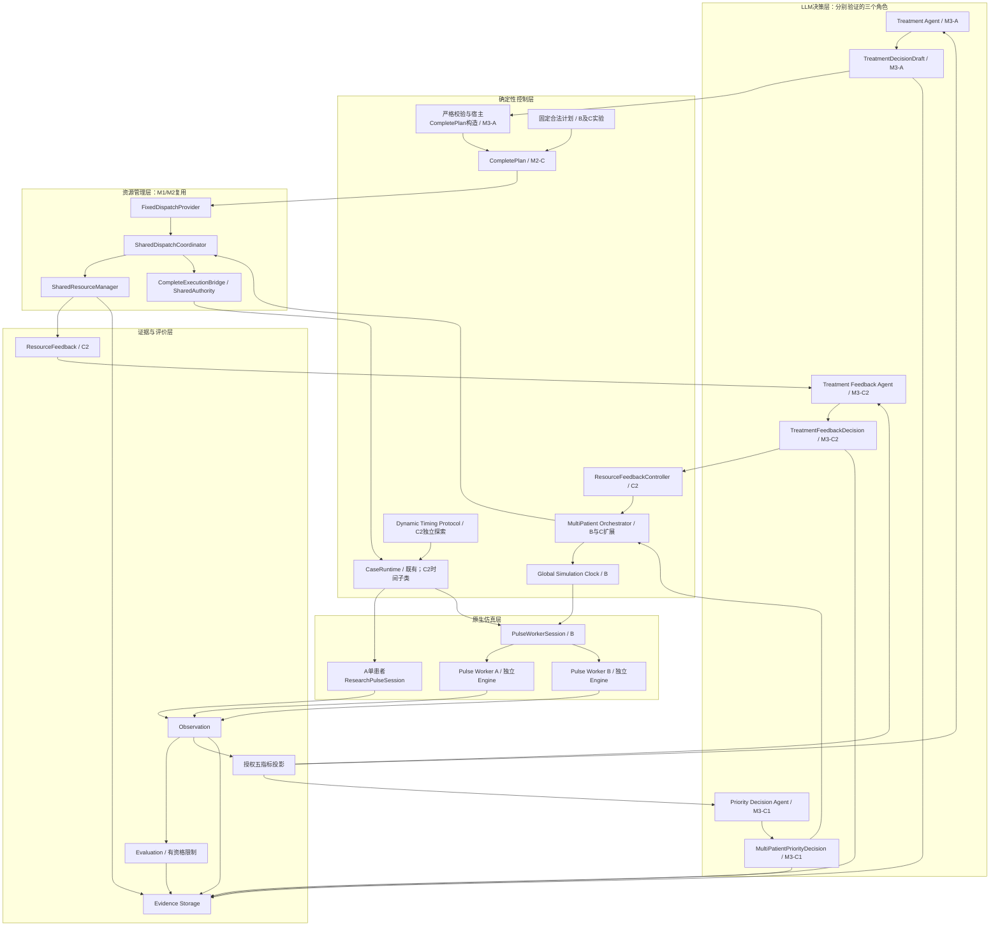
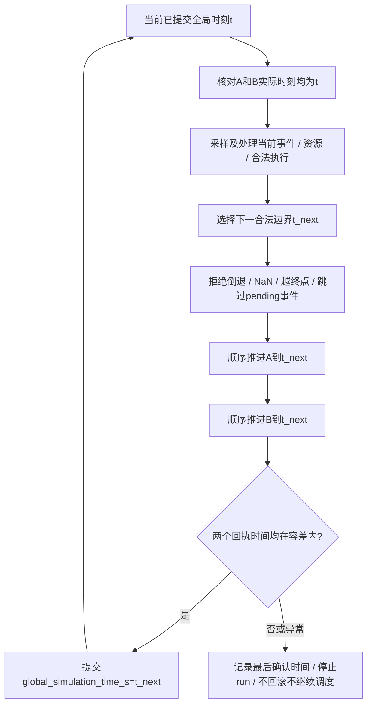
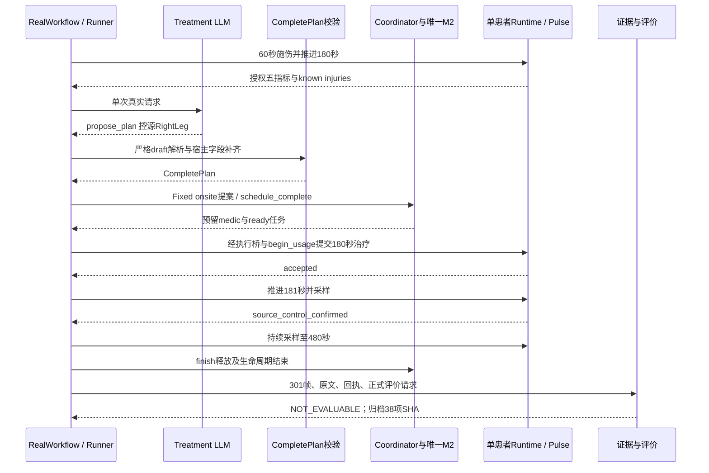
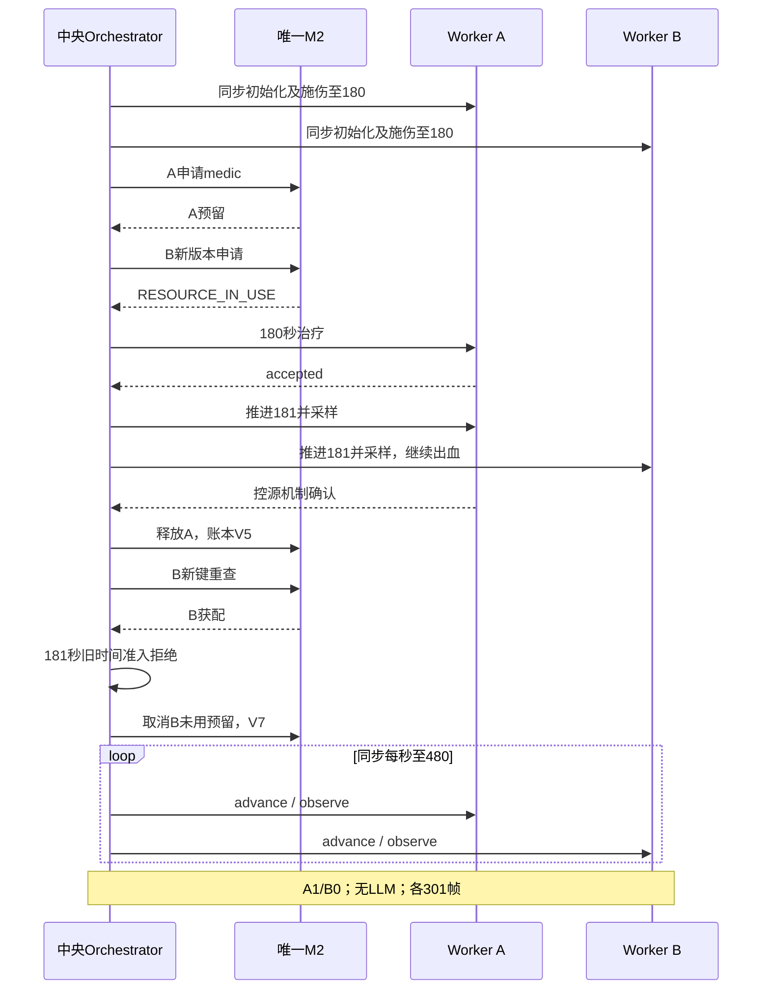
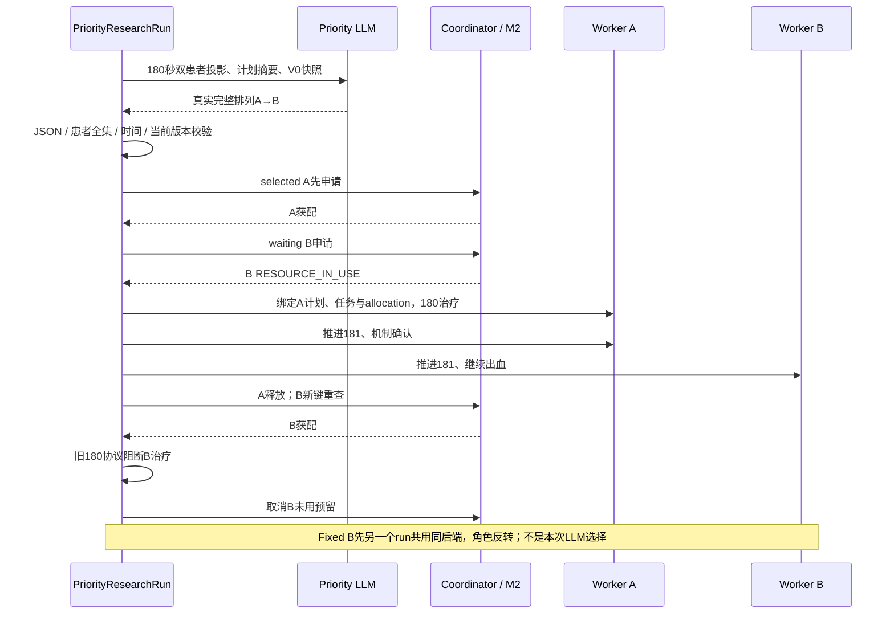
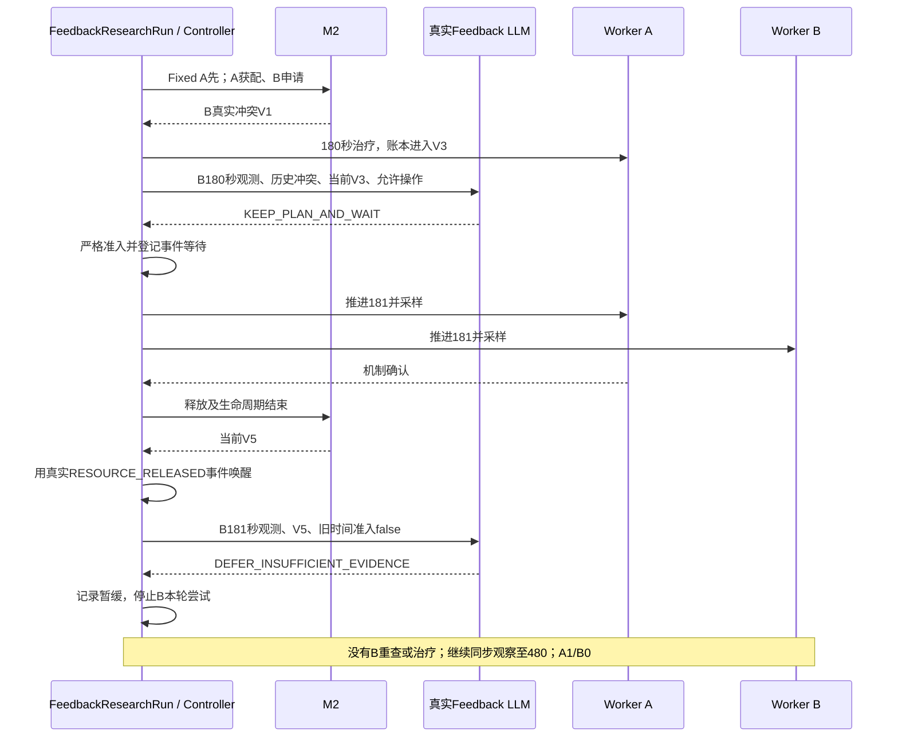
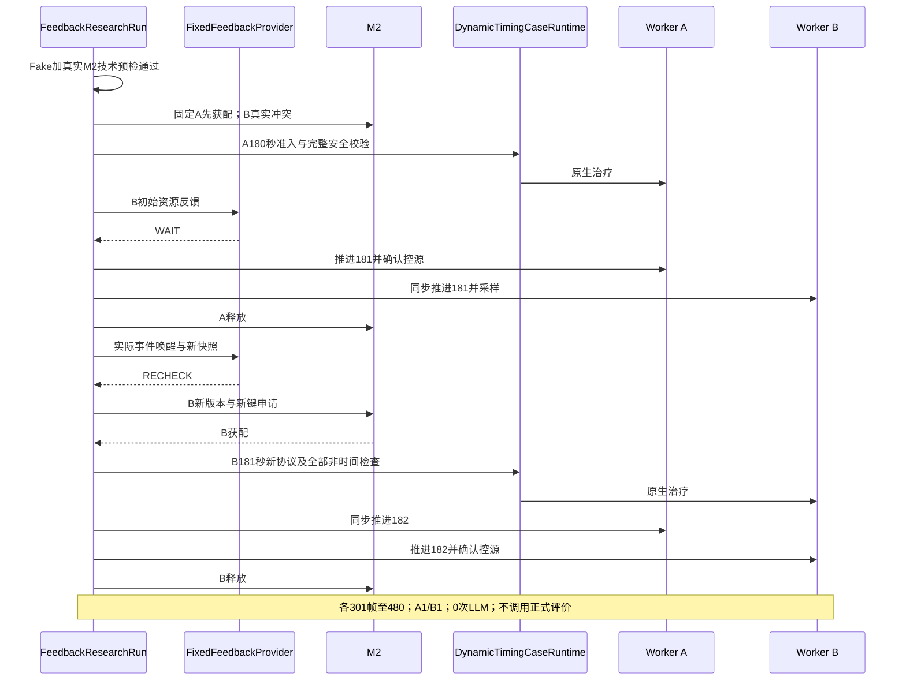

# 《301 V2科研工程M3阶段完整研发总结：真实Agent决策、多患者Pulse执行、资源约束调度与动态反馈控制》

更新日期：2026-10-19（Asia/Shanghai）。研究工程：`/home/private/project-301-v2`。用途：后续开发、导师汇报、论文选题和工程维护。

**M3已分别完成真实Treatment决策接入、双患者独立Pulse运行、真实优先级排序、真实资源反馈WAIT→DEFER，以及Fixed反馈下180/181秒双患者治疗探索。尚无同一个run中真实Priority LLM与真实Feedback LLM联合完成动态双患者治疗的证据。** 正式动态疗效适用性仍为`M3C2_TIMING_NOT_VALIDATED`；技术执行成功不能替代E/P/I疗效结论。

本文保留原A/B报告的合同、输入投影、执行桥、隔离、时钟、账本和生理证据分析，重新整合C1/C2。依据为当前源码、原始实验、阶段测试日志与独立验收。只读复核没有重新调用LLM、启动Pulse、运行pytest或评价器，也没有改变历史证据。只修改本报告；不读取原横向工程。

阅读约定：实现存在、离线验证、真实LLM、真实Pulse和正式评价是不同层次。Fixed表示明确的确定性策略；Fake/Mock表示替代的仿真或服务对象。真实M2配Fake Worker仍不是原生生理证据。SHA证明索引内容一致，不能单独证明语义或疗效；需要结合身份、时刻、原文、资源和执行事件核验。

## 第一章：M3阶段总体目标与研发历程

### 1.1 M1/M2之后的缺口

M1建立动作与资源、能力的研究映射；M2建立唯一共享账本、版本、幂等、整组预留、使用/消耗/释放、旧队伍车辆设施协调和CompletePlan合同。它们回答“计划是否合法、资源能否确认”，尚不能单凭合同证明真实模型参与了决策、指定患者实际接受了治疗，或等待患者经历了真实时间。M3补齐模型建议与确定性资源控制、独立生理执行和可复核证据之间的连接。

开发顺序先减小不确定性：A隔离单模型接入；B撤掉模型，验证两个Engine及共享时间/资源；C1在同一后端引入一次排序；C2再引入冲突后的有界控制，并把延迟治疗作为独立协议探索。后阶段复用前阶段接口，但实验没有自动继承其他run中所有真实Agent角色。

| 阶段 | 开发目标 | 核心新增能力 | 真实验收结果 | 主要限制 |
|---|---|---|---|---|
| M3-A | 模型建议进入完整计划与原生执行 | draft、五指标投影、真实Provider、宿主转换与证据链 | `M3A_REAL_AGENT_EXECUTION_PASS` | 单患者、单候选动作；非复杂治疗规划 |
| M3-B | 两患者竞争同一资源并同步演化 | spawn Worker、中央屏障、共享账本、真实等待 | `M3B_DUAL_PATIENT_PARTIAL`；`WAITING_TIME_ADVANCEMENT_VERIFIED` | A1/B0，B181秒受冻结协议阻断；无LLM |
| M3-C1 | 模型排序确实影响资源及执行身份 | Priority合同/Provider、selected/waiting角色 | `M3C1_REAL_AGENT_PRIORITY_PASS` | 单run仍保守PARTIAL；对称患者；等待者未治疗 |
| M3-C2真实反馈 | 资源失败后让模型决定控制行为 | ResourceFeedback、四种决策合同、事件触发Controller | `M3C2_REAL_AGENT_FEEDBACK_PASS` | 实际仅WAIT→DEFER，A1/B0；优先级固定 |
| M3-C2独立探索 | 验证181秒延迟治疗技术路径 | 独立动态协议、技术预检、时间准入子类 | `M3C2_TIMING_EXPLORATORY_PASS`；`M3C2_DUAL_PATIENT_DYNAMIC_EXECUTION_PASS` | Fixed反馈、A1/B1；正式适用性`M3C2_TIMING_NOT_VALIDATED` |

证据入口：[A汇总](../experiments/results/m3a_real_treatment_agent/m3a-real-agent-001/run_summary.json)、[B汇总](../experiments/results/m3b_dual_patient/m3b-dual-native-001/run_summary.json)、[C1聚合验收](m3c1_priority_decision/validation/acceptance.json)、[C2分项验收](m3c2_feedback_decision/validation/acceptance.json)。C2同时保留`M3C2_TIMING_AUDIT_PASS`与`M3C2_TIMING_PROTOCOL_DESIGNED`，二者分别表示审查和协议实现，不是医学有效性批准。

### 1.2 复用基础与历史文档差异

| 既有能力 | 依据 | M3实际复用方式 |
|---|---|---|
| M1研究映射、十二动作COSTS | [M1/M2指南](M1_M2_MEDICAL_RESOURCE_SYSTEM_GUIDE.md)、[Catalog](../src/core301/dispatch/shared_resources/catalog.py) | 继续使用研究需求，不新造临床人数或器材标准 |
| M2-A资源权威 | [manager.py](../src/core301/dispatch/shared_resources/manager.py) | 全run单实例；版本、幂等、事务、隔离与守恒 |
| M2-B调度确认 | [shared_integration.py](../src/core301/dispatch/shared_integration.py) | Fixed onsite提案、任务ready、生命周期与资源确认 |
| M2-C完整计划 | [complete_contracts.py](../src/core301/dispatch/complete_contracts.py) | 保留scope、身份、固定参数政策、串行依赖；不降级八动作 |
| 既有固定单患者执行桥 | [闭环说明](research_closed_loop_v1/README.md)、[bridge.py](../src/core301/research_runtime/bridge.py) | 复用SharedAuthority及CompleteExecutionBridge；不是M3新造全动作执行器 |
| 原受限Runtime、适配器及评价 | [CaseRuntime](../src/core301/runtime/v2/case_runtime.py)、[evaluation.py](../src/core301/research_runtime/evaluation.py) | 保留非时间安全检查及锁定规则；C2只给独立路径增加窄时间覆盖 |

[RESEARCH_SCOPE](RESEARCH_SCOPE.md)、[V2_ENGINEERING_BASELINE](V2_ENGINEERING_BASELINE.md)和[M1/M2指南](M1_M2_MEDICAL_RESOURCE_SYSTEM_GUIDE.md)包含清理/M2阶段的“真实完整输出、双患者、反馈尚未实现”；[SYSTEM_ARCHITECTURE](SYSTEM_ARCHITECTURE.md)、[MODULE_STATUS](MODULE_STATUS.md)已有部分A/B更新，但不能据旧正文判断C1/C2缺失。[DEVELOPMENT_ROADMAP](DEVELOPMENT_ROADMAP.md)早期把“M3-B”命名为反馈/双Agent重规划，与实际B交付不同。

阶段专用文档也有明确时间边界：[B限制](m3b_dual_patient_runtime/LIMITATIONS.md)说尚未进入C；[C1限制](m3c1_priority_decision/LIMITATIONS.md)说C2尚未实现。这些作为当时记录成立，不是当前总状态。原总报告“M3-C未实现”在本版替换；当前源码和C2实验优先。仍成立的十二动作通用闭环缺失、十五指标未全激活、正式评价资格不足等限制继续保留。本轮不回写这些历史资料。

## 第二章：M3整体系统架构

### 2.1 分层模块图

以下是**可复用模块及接口关系图**，不是一次全模块真实联合实验。方括号内标出来源；箭头表示数据/控制接口，不授予模型资源写权。



### 2.2 同run组合边界与权威

| 实际run类型 | 实际决策模块 | 同run联合组件 | 没有同时参与的模块 |
|---|---|---|---|
| A真实执行 | Treatment LLM一次 | draft→CompletePlan→Fixed调度→M2→单Session→评价入口 | 双Worker、Priority/Feedback LLM |
| B双患者 | 固定计划、固定A先 | 双Worker、全局时钟、单账本、自动恢复检查 | 所有真实LLM |
| C1真实排序 | Priority LLM一次 | 冻结计划、角色化episode、M2、双Worker | Treatment生成LLM、Feedback LLM、新时间协议 |
| C2真实反馈 | 固定优先级、Feedback LLM两次 | 真实冲突→WAIT→释放唤醒→DEFER、双Worker | Priority LLM、动作修订、181治疗 |
| C2动态探索 | 固定优先级、Fixed反馈 | WAIT→RECHECK→新协议、M2、双Worker双治疗 | 任何真实LLM |

LLM只提出建议。宿主解析身份、版本、时刻和操作集合；Coordinator确认任务与资源；SharedResourceManager维护唯一库存；CaseRuntime、执行桥、适配器和Worker共同维护提交及生理事实。中央账本单进程共享与双原生进程隔离并不矛盾：Worker不各建一份medic库存。时钟由宿主推进；API墙上耗时不会自行变成患者等待时间。证据存储用于审计，不是另一个资源权威或可直接重放的恢复数据库。

## 第三章：M3-A——真实Treatment Agent执行闭环

### 3.1 Treatment Agent升级

旧[LLMTreatmentProvider](../src/core301/agent/llm_provider.py)输出[旧TreatmentPlan](../src/core301/contracts/treatment.py)，受V1八动作限制，不包含本次验证的`control_external_bleeding`。旧Provider、Prompt和调用接口保留兼容，M3-A未把旧输出换名冒充完整研究计划。

新增[complete_decision.py](../src/core301/agent/complete_decision.py)定义：

| 合同 | 版本与范围 |
|---|---|
| Agent输入 | `301.treatment.input.m3a.1`，五指标与明确授权临床已知伤情 |
| 决策draft | `301.treatment.decision.m3a.1`，提出计划、暂缓或证据不足 |
| 正式执行计划 | 复用`301.treatment.complete.1`，不是新造执行合同 |

`DraftAction`的Literal只允许`control_external_bleeding / RightLeg`。`TreatmentDecisionDraft`要求所有声明字段存在，沿用`Contract`的严格类型和额外字段禁止策略；提出计划恰好包含一个合法动作，拒绝/暂缓必须空动作并说明原因。**完整合同支持十二种动作，不代表新LLM draft已开放十二动作规划。**

| 字段来源 | 具体内容 | 授权含义 |
|---|---|---|
| 模型 | decision_type、action_type、compartment、reasoning_summary、refusal_reason | 表达建议或拒绝；解释文本不授权执行 |
| 宿主 | run_id、patient_id、decision_id、plan_id、action_instance_id | 绑定实验和动作，不让模型生成身份 |
| 宿主 | scope_kind/id、severity=.4、location_id、执行/参数策略、depends_on | 固定研究协议及后端顺序约束，不采纳模型覆盖 |
| 原资源/执行模块 | allocation、task ready、原生参数、执行结果、释放 | 必须来自真实事务或执行事实 |

新版[LLMCompleteTreatmentProvider](../src/core301/agent/complete_provider.py)复用既有配置加载及OpenAI兼容客户端，调用`chat.completions.create`返回原始文本；解析由宿主另行处理。它使用[独立Prompt](../src/core301/agent/prompts/treatment_decision_m3a.md)，未修改旧八动作Prompt。单实例第二次请求拒绝；SDK `max_retries=0`、timeout=60秒、max_tokens=1200。失败不更换模型、不补固定计划。

### 3.2 Agent输入与输出

`RealWorkflow.decide`读取本次`runtime.observe()`结果及`runtime.registry.known()`。后者来自可信伤情注册表，但输出临床授权的类型/部位，不带伤情Severity、原生源ID或机制诊断。`agent_input`再次检查patient_id、180秒时点及与本受限场景完全一致的授权伤情。

投影只遍历BASIC五项，单位来自现有REQUESTS映射；保留value、status、observed_at_s，不用正常值填缺测。后端实际可以采集十三项公开字段和内部诊断，但“后端可采集”不等于“模型已授权”。血容量、总出血率、累计失血、未来帧和评价结果不进入该模型请求。

以下为[真实agent_input.json](../experiments/results/m3a_real_treatment_agent/m3a-real-agent-001/agent_input.json)的简化展示：表中数值为便于阅读的舍入值，原文件保留完整精度。

- patient_id：`m3a-real-agent-001-patient`。
- simulation_time_s：`180.00000000001828`。
- known_injuries：`external_hemorrhage / RightLeg`；allowed_actions仅`control_external_bleeding`。

| 实测指标 | 值 | 单位 | 可用性与采样时间 |
|---|---:|---|---|
| HR | 75.322886 | 1/min | available，同本帧180秒 |
| RR | 12.048193 | 1/min | available，同本帧180秒 |
| SpO₂ | 0.973863 | 1，比例而非百分数 | available，同本帧180秒 |
| SBP | 112.762291 | mmHg | available，同本帧180秒 |
| MAP | 95.025363 | mmHg | available，同本帧180秒 |

[llm_response.json](../experiments/results/m3a_real_treatment_agent/m3a-real-agent-001/llm_response.json)中的完整content为：

```json
{"schema_version":"301.treatment.decision.m3a.1","decision_type":"propose_plan","actions":[{"action_type":"control_external_bleeding","compartment":"RightLeg"}],"reasoning_summary":"Known external hemorrhage at the RightLeg supports source control.","refusal_reason":null}
```

这是实际服务输出，不是宿主fixture。候选集合虽只有一个治疗动作，模型仍可以暂缓或拒绝；本次选择了提出计划。这里不能据成功输出推断其具有复杂治疗排序、资源优化或医学推理能力。

`parse_decision`用JSON解析器的object_pairs_hook拒绝重复key，再进行严格Schema校验；非JSON、围栏、缺字段、额外字段、非法动作/目标均不修复。API失败、空响应、模型明确defer/insufficient_evidence及CompletePlan失败都会停止下游流程。SDK拒绝内容未形成合法draft时也不能进入执行。相关覆盖见[tests/m3a/test_decision.py](../tests/m3a/test_decision.py)。

请求文件保存实际消息、参数、请求时间和Prompt SHA；响应文件保留服务model、message和usage。API错误另存类型/状态码，不把可能含认证信息的异常原文写入错误日志；密钥不进入实验文件。费用未提供则为null，不估算成实付成本。预检只检查配置/本地绑定，远端是否可服务由唯一决策请求确认，没有第二次收费探测。

### 3.3 CompletePlan转换

`build_complete_plan`对draft再验证，只接受propose_plan。关键操作是把每条模型action的`model_dump()`展开为CompleteAction，再由宿主添加实例ID和依赖，构造正式CompletePlan。它不会替换动作、增加支持治疗或从reasoning_summary推导参数。

```python
# 摘自build_complete_plan，突出模型字段与宿主字段的组合
CompleteAction(
    action_instance_id=f'{run_id}-action-{i+1}',
    **action.model_dump(),
    depends_on=() if i == 0 else (f'{run_id}-action-{i}',),
)
```

正式`CompletePlan.complete_semantics`验证串行依赖，并调用Catalog检查冻结scope、目标、动作许可与既有冲突规则。`CompleteDispatchInput`继续验证run/患者关联。当前仅一动作，“顺序保留”在本次原生证据中是平凡情况；多动作顺序拒绝测试不能算复杂排序能力实证。

这里没有调用`from_legacy_plan`把V1八动作转换过来。执行桥`executor_plan`使用的是`core301.contracts.v2.treatment`的受限执行命令，并在SharedAuthority中保留完整计划与原生runtime别名；不是降级到旧八动作合同。

### 3.4 资源与Pulse执行

[runner.run](../src/core301/research_runtime/runner.py)新增可选`treatment_workflow`。有workflow时，初始plan为空，不调用固定`make_plan`；真实观测之后才调用模型、构造正式计划并绑定SharedAuthority。旧固定计划入口仍可独立运行。

合法计划送入`CompleteDispatchInput→schedule_complete`。`RecordedFixedProvider`记录接收到的完整计划和资源快照，然后提出onsite；它不修改治疗选择。Coordinator校验后由唯一M2-A账本原子预留medic=1。`begin_usage`再次检查任务ready和预留事实，执行桥才把命令交给原CaseRuntime。

原执行器核对授权源、固定scope、必需监测、180秒时点和执行幂等；原适配器执行研究控源代理，把同源出血机制按冻结协议控制。它不模拟现实外科手术，也不声称恢复已经流失的血容量。

**接受、机制完成、资源释放是三个不同事实。** 本次原生动作在180秒accepted，181秒`_reconcile`发现同源Hemorrhage移除且TotalHemorrhageRate为0，记录source_control_confirmed。M3-A的runner仍采集至480秒，然后调用`authority.finish`与生命周期结束，实际`release_usage`发生在约480秒。这一点来自原始[resource_events.jsonl](../experiments/results/m3a_real_treatment_agent/m3a-real-agent-001/resource_events.jsonl)，不能误写为M3-A在181秒就释放了medic。该持有到观察终点的宿主记账安排，不是临床治疗时长估计。

观察文件共301帧：180秒治疗前一帧，加300次一秒推进后的采样；不是“301帧全部治疗后”。最终回执COMPLETED、资源可用恢复1，之后调用锁定评价入口，保存其拒评原因。

### 3.5 M3-A真实实验逐项核对

| 原报告结论 | 原始证据核对 | 判定 |
|---|---|---|
| gpt-6-sol真实调用1次 | [请求](../experiments/results/m3a_real_treatment_agent/m3a-real-agent-001/llm_request.json)、响应及单次代码路径；请求和回报model一致 | 符合；名称/usage来自服务，不额外推断底层供应商身份 |
| 模型选控源 | 响应content与[treatment_decision](../experiments/results/m3a_real_treatment_agent/m3a-real-agent-001/treatment_decision.json)一致 | 符合 |
| 完整合同通过 | [complete_plan](../experiments/results/m3a_real_treatment_agent/m3a-real-agent-001/complete_plan.json)、decision_validation、调度接收计划 | 符合 |
| 共享预留成功 | [dispatch_result](../experiments/results/m3a_real_treatment_agent/m3a-real-agent-001/dispatch_result.json)：allocated=true、SATISFIED | 符合 |
| 原生治疗一次 | [native_action_results](../experiments/results/m3a_real_treatment_agent/m3a-real-agent-001/native_action_results.json)：一条injury、一条treatment | 符合，施伤不计治疗次数 |
| 301帧 | [observations](../experiments/results/m3a_real_treatment_agent/m3a-real-agent-001/observations.jsonl)：180至480秒 | 符合，含首帧治疗前 |
| 正式评价NOT_EVALUABLE | [evaluation_result](../experiments/results/m3a_real_treatment_agent/m3a-real-agent-001/evaluation_result.json)：called=true、MANIFEST_PATIENT_INPUT | 符合；不是I或E/P |
| 38文件SHA | [SHA256.json](../experiments/results/m3a_real_treatment_agent/m3a-real-agent-001/SHA256.json)、[历史核验](m3a_real_treatment_agent/validation/real_evidence_check.json)，本次逐文件重算也匹配 | 符合；指38项索引，不含索引自身 |
| 1077项回归 | [原始日志](m3a_real_treatment_agent/validation/full_regression.log)：1077 passed、26 deselected、6 warnings | 符合；本次没有重跑 |

服务报告prompt_tokens=612、completion_tokens=66、total_tokens=678，cost=null。八个阶段状态全PASS，但仅证明本受限场景接入成功。初次配置缺失的[m3a-native-preflight-001](../experiments/results/m3a_real_treatment_agent/m3a-native-preflight-001/run_summary.json)保留为独立失败记录，未混入成功run。

## 第四章：M3-B——双患者Pulse与共享资源运行

### 4.1 双患者Pulse实例

共享资源研究需要两个真正持有生理状态的患者：如果只换patient_id却复用同一Engine，B的等待或A的治疗效果都无法独立解释。M3-B在中央进程创建两个`PulseWorkerSession`代理，`multiprocessing.get_context('spawn')`启动两个地址空间独立的Worker，每个Worker构造一个ResearchPulseSession和一个PyPulse.Engine。中央保存两个CaseRuntime、两个SharedAuthority，但只保存一个manager和一个coordinator。

[PulseSession](../src/core301/pulse/session.py)虽然每次构造新Engine，现有源码没有充分证明原生绑定全局状态和多线程调用安全性。选择进程隔离是避免依赖该未验证假设，不是证明同进程多Engine必然不可用。

Worker接收带run_id、patient_id、command_id、expected_time_s的命令；回复实际时间、worker_pid和结果。治疗命令附带plan、action、task、allocation身份绑定。中央核对回执身份；跨患者、超时、中断或错误回复使代理uncertain，禁止继续发送，不能把通讯错误解释为“原生一定失败”或“原生一定成功”。中央CaseRuntime在不确定提交时保留UNKNOWN和资源隔离。

[隔离Smoke结果](../experiments/results/m3b_dual_patient/m3b-isolation-002/run_summary.json)实际证明：A单独推进和施伤时B时间仍为0、完整解析状态未变；两者随后同步到180秒；关闭A后B仍推进到181秒。两进程各有日志/输出路径。首次Smoke采用JSON原文字符串相等比较失败；第二次保存的before/after文本不同但完整JSON对象相等，改正了顺序敏感的核验方式，没有忽略生理字段。

正式run的Worker PID为595347与595411。两个独立Engine使用同一冻结StandardMale输入，不能称为两个独立验证的人体模型或不同人群。

### 4.2 全局仿真时间

[MultiPatientResearchRun](../src/core301/research_runtime/m3b_runner.py)持有唯一`global_simulation_time_s`，并通过`times`、`barrier`和`advance_to`控制边界。`barrier`要求患者集合为A/B且所有实际读数与目标差不超过1e-6秒；落后、超前或缺少患者均不承认同步。



这不是两个引擎在CPU上原子同时运行：A计算完成到B完成之间存在墙上执行间隔，但屏障内部不处理调度/治疗事件。两者完成后才发布新全局时刻。若B推进失败，A可能已到下一步；代码记录这种分歧并停止，不把部分推进说成同步成功。

`now()`取逻辑全局时间与session缓存时间的最大值，为M2提供不倒退的操作时刻；例如180秒的原生值为180.00000000001828。`time.monotonic()`只记录IPC墙上耗时，不能转成Pulse生理时间。固定pending事件为60、180、181、480秒，后续逐秒推进；2000事件预算是程序运行限制，不是医学条件。

初始化也按0→60施伤→180决策的全局阶段展开。为此新orchestrator复用正式CasualtyInput、validate_injury_scope、原session和injury adapter，并在同步后注册伤情、设置CaseRuntime的`_prepared`；未重写治疗适配器。但这涉及原CaseRuntime的内部字段，是未来维护时必须关注的窄耦合。

### 4.3 共享医疗资源竞争

初始化只调用一次`research_scene({'medic':1})`和`manager.create_run`。两个CompleteDispatchInput一起注册到同一Coordinator。Worker只持有原生状态和命令绑定，不拥有库存。

历史M3-B run及当前默认策略先schedule A再schedule B；C1后来把`episode()`改为调用`priority_order()`取得selected/waiting，C2又添加默认不放宽180秒的时间扩展点；两人都在180秒拥有合法固定计划。A预留后B使用版本1真实申请，得到：

| 冲突字段 | 本次值 |
|---|---|
| outcome / code | UNSATISFIED / RESOURCE_IN_USE |
| resource_id / unit | medic / person（研究令牌） |
| required_qty / available_qty | 1 / 0 |
| state_version | 1 |
| blocking_allocation_ids | `208cd098134b47a986920484ff81f42c`，属于A |
| 动作关联 | B的plan_id、action_instance_id、control_external_bleeding需求 |

详见[scheduling_decisions.jsonl](../experiments/results/m3b_dual_patient/m3b-dual-native-001/scheduling_decisions.jsonl)。B第一次失败是资源实际被A预留，不是故意给旧版本制造STALE_SNAPSHOT，也不是宿主跳过请求后伪造反馈。

A开始时manager把RESERVED改为IN_USE，accepted记执行事实而不释放。181秒原CaseRuntime机制确认后，`release_confirmed`调用原SharedAuthority.finish，提供ReleaseEvidence，再调用confirm_onsite/end_episode。医疗`release_usage`后版本4，结束生命周期的release_unused后版本5；全局RESOURCE_RELEASED事件记录的是版本5。B读取版本5以新request/key申请，成功到版本6；因为时序阻断，取消未用预留后终态版本7、medic可用1。

**B首次冲突的主证据位于调度结果和global_events，而不应仅在resource_events寻找。** 本次resource_events列出了成功状态变更；被拒绝的竞争没有产生第二份有效分配。审计必须联合调度反馈、全局事件和账本事件。

### 4.4 等待与执行控制

B首次失败后没有task、没有治疗提交，患者状态是WAITING_RESOURCE，不是“治疗失败”。global_events保留冲突、阻塞分配、所见版本和next_review_trigger。181秒A释放后，宿主显式写入RESOURCE_CHANGE_OBSERVED并关联释放事件序号，再调用B的新调度请求。当前是固定episode内的最小唤醒流程，不是通用订阅总线或自动重规划器。

B两帧真实原生数据如下，未从A复制：

| 指标 | 180秒 | 181秒 |
|---|---:|---:|
| B累计失血mL | 173.0659699721137 | 174.45268862582802 |
| B出血率mL/s | 1.3875565623723651 | 1.3873850363138653 |
| B血容量mL | 5323.103896316768 | 5321.759231527766 |
| A出血率mL/s，供隔离对照 | 1.3875565623723651 | 0.0 |

来源：[B observations](../experiments/results/m3b_dual_patient/m3b-dual-native-001/patients/patient_B/observations.jsonl)、[A observations](../experiments/results/m3b_dual_patient/m3b-dual-native-001/patients/patient_A/observations.jsonl)。M3-B内部diagnostics行是数值形式，其物理单位来自既有ResearchPulseSession的DIAGNOSTICS请求定义；公开measurements则逐项附带unit，不能笼统称所有JSON诊断字段均内嵌单位。

资源等待时间由WAIT_ENDED记录的181−180=1秒计算。它来自本场景首次1秒后采样的机制确认安排，不是新增临床处置时长，也不证明最早只能在181秒释放；未验证0.02秒最早释放路径。181—480秒是时窗阻断后的未治疗观察，不能继续算作资源等待。

历史B恢复资源后，`execute('B')`在180秒时点检查处记录UNVALIDATED_TIMING并返回False；当前代码通过默认`treatment_time_allowed()`保持该行为（容差1e-6）。没有进入执行桥、没有原生治疗回执。随后调用Coordinator的`lifecycle(..., 'cancel')`释放B未使用的预留。**资源已经恢复可用，不等于治疗动作仍然合法。** 当前正式时序不是“180秒之后任意时刻都可治疗”，不能用排队需求扩大准入。

### 4.5 M3-B真实实验逐项核对

| 原报告结论 | 当前原始证据 | 判定 |
|---|---|---|
| 两个真实Engine / spawn Worker | [manifest](../experiments/results/m3b_dual_patient/m3b-dual-native-001/run_manifest.json)、两个patient_summary和worker_commands、隔离Smoke | 符合 |
| 相同StandardMale、RightLeg .4 | [scenario](../experiments/results/m3b_dual_patient/m3b-dual-native-001/scenario.json)、两份runtime/injury_input和患者源文件 | 符合；独立运行而非不同人体模型 |
| 唯一账本 / A获配 / B失败 | 三条真实scheduling_decisions：A成功、B失败、B恢复成功 | 符合 |
| A180秒控源、181秒释放 | [A最终回执](../experiments/results/m3b_dual_patient/m3b-dual-native-001/patients/patient_A/execution_receipt_final.json)、[资源事件](../experiments/results/m3b_dual_patient/m3b-dual-native-001/resource_events.jsonl) | 符合 |
| B180—181真实等待推进 | 两个真实时间点、不同生理值及WAIT_ENDED关联释放事件17 | 符合 |
| B恢复预留后时序阻断 | global_events中的TIME_PROTOCOL_BLOCKED、UNUSED_RESERVATION_CANCELLED | 符合；B没有治疗receipt文件 |
| A1次 / B0次治疗 | 两份native_action_results的treatment phase计数 | 符合；每人施伤各1次另计 |
| 各301帧、均到480秒 | 两份observations首尾及[clock_trace](../experiments/results/m3b_dual_patient/m3b-dual-native-001/clock_trace.jsonl) | 符合；末实际值约479.9999999998534，容差内 |
| 57文件SHA | [sha256_manifest](../experiments/results/m3b_dual_patient/m3b-dual-native-001/sha256_manifest.json)、[历史核验](m3b_dual_patient_runtime/validation/native_verify.json)，本次重算匹配 | 符合 |
| 1101回归通过 | [最终原始日志](m3b_dual_patient_runtime/validation/full_regression_final.log) | 符合，26项排除 |

双患者原生运行和资源竞争已真实验证；双患者治疗完成条件未满足，因此整体PARTIAL正确。A[评价结果](../experiments/results/m3b_dual_patient/m3b-dual-native-001/patients/patient_A/evaluation_result.json)为真实正式调用后的NOT_EVALUABLE；B[评价结果](../experiments/results/m3b_dual_patient/m3b-dual-native-001/patients/patient_B/evaluation_result.json)是宿主对未治疗/不适用分支的明确标记，evaluator_called=false，不能说两个患者都调用了正式评价器。

## 第五章：M3-C1——真实Agent参与资源优先级排序

### 5.1 合同、权限和输入

C1回答“现有合法计划中谁先申请资源”，没有替换Treatment Agent，也不生成新治疗。[priority_decision.py](../src/core301/agent/priority_decision.py)新增`MultiPatientPriorityInput`、`MultiPatientPriorityDecision`、`PriorityDecisionProvider`及`FixedPriorityProvider`；[priority_provider.py](../src/core301/agent/priority_provider.py)提供`LLMPriorityDecisionProvider`。输出版本为`301.resource.priority.m3c1.1`。

| 合同内容 | 实际约束及来源 |
|---|---|
| run_id、simulation_time_s、resource_state_version | 必须与本轮输入和当前账本完全一致；真实run为180秒/V0 |
| decision_type | prioritize / defer / refuse；拒绝不回退固定排序 |
| ordered_patient_ids | prioritize必须是待选患者完整排列，无重复、遗漏、未知ID；不能只报一个赢家 |
| reasoning_summary、refusal_reason | 解释与拒绝理由，不作为资源数量或治疗参数 |
| 患者信息 | 两名患者各自五指标、原单位/缺测/采样时刻、授权RightLeg伤情 |
| 计划与资源 | 固定单控源计划摘要、Catalog计算的medic×1需求、唯一账本只读快照和版本 |
| 权限 | `order_pending_patients_only`，pending状态PLAN_READY；没有写账本、造task/allocation或改参数能力 |

`build_input`调用M3-A投影，沿用180秒和授权伤情检查，隐藏Severity、机制诊断、未来帧与评价。输入顶层为严格合同，但patients/snapshot等嵌套字典的隐私边界主要依赖构造函数，不能声称任意外部字典都由全深度Schema自动清洗。解析拒绝重复JSON键，`validate_decision`再次核对患者全集、上下文和当前版本。

原五字段`DispatchProposal`仍负责onsite/team_response/evacuation及team/ambulance/facility选择，不包含跨患者优先级。将排序塞入它会混淆“谁先申请”与“为某人选择哪种调度”；因此C1新增独立合同，原`FixedDispatchProvider`仍在每次患者申请中提出onsite，M2保持最终确认权。

### 5.2 从排序到实际执行身份

[PriorityResearchRun](../src/core301/research_runtime/m3c1_runner.py)继承`MultiPatientResearchRun`并重载`priority_order()`：采集输入，调用Provider，保存原文，严格验证，再把真实patient_id映射为selected/waiting。B的`episode()`由历史硬编码A/B变为依次schedule selected、waiting，并对selected执行、释放，对waiting记录冲突和181秒重查。默认`priority_order()`仍返回A/B；这保留旧实验行为，而不是把C1执行器复制三份。

`fixed_A_first`、`fixed_B_first`、`llm_priority`共用同一后端。真实Provider使用[独立Prompt](../src/core301/agent/prompts/priority_decision_m3c1.md)，单次请求、timeout=60秒、SDK retries=0、max_tokens=1200；失败不转Fixed。资源尚未确认前排序只是建议；即使排序合法，M2仍可以拒绝申请。

核验链不是只看排序文件：模型原文→解析排序→初始申请顺序→获配task/allocation→对应Worker命令身份→native_action_results→最终回执。`m3c1_verify.verify`按实际selected/waiting检查，不沿用B验证器硬编码A赢的假设；`m3c1_accept.accept`还检查三份原生实验及其所记录的B后端SHA一致。该历史一致性不意味着之后C2不能新增明确的默认兼容扩展点。

### 5.3 三次原生实验证据

| 策略 | 排序来源 | 初次获配并治疗患者 | 181秒重新获配但未治疗者 | 原生治疗A/B | 验收 |
|---|---|---|---|---|---|
| fixed_A_first | Fixed A→B | A | B；时间阻断后取消预留 | 1/0 | [固定A核验PASS](m3c1_priority_decision/validation/fixed_a_native_verify.json) |
| fixed_B_first | Fixed B→A | B | A；时间阻断后取消预留 | 0/1 | [固定B核验PASS](m3c1_priority_decision/validation/fixed_b_native_verify.json) |
| llm_priority | 真实gpt-6-sol，A→B | A | B；时间阻断后取消预留 | 1/0 | [真实排序核验PASS](m3c1_priority_decision/validation/real_priority_verify.json) |

三个run各有两个不同PID、每患者301帧、一个共享medic、初次真实RESOURCE_IN_USE、181秒机制确认释放。等待者新版本/新幂等键获配后仍受旧时窗阻断。反向Fixed实验说明执行身份确实可被排序改变；真实模型没有被替换成B优先来制造差异。

[真实原文](../experiments/results/m3c1_priority_decision/m3c1-real-priority-001/llm_response.json)说明两人已知伤情、观测和计划相同，证据无法区分紧迫程度，A优先是平局处理。服务记录请求/响应模型均为gpt-6-sol，调用1次，usage为2322 prompt +235 completion =2557 total，cost=null。这个结果支持“排序接口影响执行”，不支持“模型选出了医学上更优患者”。

原始run_summary为`M3C1_PARTIAL`，因为不是双患者都治疗；[聚合验收](m3c1_priority_decision/validation/acceptance.json)为`M3C1_REAL_AGENT_PRIORITY_PASS`，验收的是真实排序因果链与两个方向的后端执行。两者范围不同，不构成覆盖原记录的理由。聚合报告中`dynamic_timing_implemented=false`是C1阶段事实；C2独立探索不能倒写成C1当时已支持动态时序。

## 第六章：M3-C2——真实资源反馈决策

C1决定谁先申请；C2决定发生资源冲突后下一步做什么。它是有界任务控制，不是动作级治疗方案修订。

### 6.1 ResourceFeedback：历史结果与当前状态并列

[resource_feedback.py](../src/core301/agent/resource_feedback.py)的`build_feedback`读取真实`DispatchOutcome.resource_result`，验证run/patient/plan身份，再向唯一manager读取当前快照。结构版本`301.resource.feedback.m3c2.1`保留以下信息：

| 字段组 | 内容 | 为什么需要 |
|---|---|---|
| 上下文 | run_id、patient_id、plan_id、decision_id、global_simulation_time_s | 防止把别人的冲突或旧轮输出接入当前患者 |
| 任务 | plan_state、pending_actions | 知道保留什么任务，区分已执行事实 |
| 历史M2结果 | m2_result、conflict_codes、resource_ids、blocking_allocation_ids | 保留失败时版本和真实阻塞原因，不改写旧失败 |
| 当前资源 | resource_state_version、resource_changed；输入另含resource_snapshot | 决策依据当前账本，不把旧冲突当成现状 |
| 事件 | trigger_event_sequence、next_check_condition | 重新考虑应由实际释放事件触发，不猜预计释放时间 |
| 执行准入 | timing_protocol、allowed_operations、unresolved_execution | 资源可用不等于当前时间可执行；未知执行不允许重试 |

初次冲突发生在V1；A随后begin和accepted使账本变为V3，因此180秒首次反馈是“历史冲突V1＋当前V3”。`resource_changed=true`可能仅表示A开始/接受导致版本变化，并不等于medic已释放。181秒真实释放与生命周期结束后为V5；同一历史冲突配新快照及实际释放事件才构成唤醒。

触发序号必须指向中央事件列表中的`RESOURCE_RELEASED`且版本匹配当前快照。没有未决执行时，IN_USE/SHORTAGE支持WAIT；释放事件且版本改变支持RECHECK；STALE_SNAPSHOT支持读取新状态后重查；未知约束只给保守DEFER/STOP。若本患者已有request、EXECUTION_UNCERTAIN或IN_USE/QUARANTINED分配，则限制为DEFER/STOP。这些多类冲突有离线覆盖，原生真实反馈run实际冲突只有RESOURCE_IN_USE。

`authorized_observation`核对传入的当前时刻；本流程实际在180或181秒调用，检查patient与时间、拒绝未来样本，仍只投影HR/RR/SpO₂/SBP/MAP并保留单位、缺测与采样时间；没有改动M3-A固定180秒的输入契约。payload还含授权known_injuries、单动作plan_summary、waiting_state和executed_actions。内部Severity、源诊断、未来结果和评价都不进入模型。嵌套dict仍依赖可信builder构造，不能把它当通用不可信输入清洗器。

### 6.2 模型合同与调用边界

`TreatmentFeedbackDecision`版本`301.treatment.feedback.m3c2.1`要求回传run/patient/plan/decision身份、全局时间、当前资源版本、decision_type、reasoning_summary与refusal_reason。`parse_decision`拒绝重复JSON key；`validate_decision`核对上下文、最新账本、当前时刻和本阶段allowed_operations。DEFER必须给理由；WAIT/RECHECK不能附冲突的拒绝原因。不存在`PROPOSE_REVISED_PLAN`，额外动作、剂量、时间参数均不能通过合同。

[LLMTreatmentFeedbackProvider](../src/core301/agent/feedback_provider.py)使用[独立反馈Prompt](../src/core301/agent/prompts/resource_feedback_decision_m3c2.md)，复用已有配置读取和OpenAI兼容接口；最多2次，timeout=60秒、SDK retries=0、每次请求max_tokens=1000。累计本地预算24000单位按输入UTF-8字节数加请求输出token数计，不能写成精确tokenizer统计或实付费用；两次请求输出上限合计2000，实际usage另按服务返回记录，费用缺失为null。错误只记类型/状态码，无Fixed回退。

证据逐轮保存`llm_requests.jsonl`、`llm_responses.jsonl`、`resource_feedback.jsonl`、`feedback_agent_input.jsonl`、`feedback_raw_outputs.jsonl`、`feedback_decisions.jsonl`及控制事件。`feedback_calls`包含Fixed决策调用，不等于真实API调用数；真实调用必须结合LLM原始记录与manifest判断。

### 6.3 四种操作怎样落实

[ResourceFeedbackController.decide](../src/core301/research_runtime/m3c2_runner.py)以(patient label, trigger)去重，最多消费两次决策；在校验成功之后才记录`FEEDBACK_DECISION_ADMITTED`并改变控制状态。

| 决策 | 宿主实际行为 | 不会自动发生的行为 | 已有验证层次 |
|---|---|---|---|
| KEEP_PLAN_AND_WAIT | 保留原计划，置WAITING_FEEDBACK_EVENT，登记真实释放条件 | 不忙轮询、不立即重申资源、不猜释放时刻 | 真实LLM＋原生双患者 |
| RECHECK_RESOURCES | 读取新快照，以新request/idempotency key调用schedule；获配后独立检查执行时序 | 不复用失败键、不因模型建议跳过M2或时间准入 | Fixed原生探索＋离线；真实LLM未覆盖 |
| DEFER_INSUFFICIENT_EVIDENCE | 置DEFERRED、记录理由，停止本轮后续尝试 | 不偷偷RECHECK、不在后续每秒再次问模型 | 真实LLM＋原生双患者 |
| STOP_UNEXECUTABLE | 取消未用RESERVED；未决则UNKNOWN_RETAINED，否则STOPPED_UNEXECUTABLE | 不撤销生理变化、不归还已消费物料、不清除IN_USE/QUARANTINED | 离线合同/控制及真实M2检查；非原生LLM分支 |

RECHECK若仍被拒则进入RECHECK_BLOCKED，本轮不追加第三次调用；如果获配但旧时间协议拒绝，则取消未用预留。`cancel_unused`发现IN_USE/QUARANTINED时只记录保留，不以STOP清掉未知事实。原Runtime journal、幂等、Worker一次性绑定及M2同患者活动限制继续防重复治疗。该控制器是两处触发的受限流程，不是通用优先队列、抢占器、无限对话或完整协商系统。

### 6.4 真实run：WAIT→实际释放→DEFER

证据：[原始运行目录](../experiments/results/m3c2_feedback_decision/m3c2-real-feedback-001/)、[原始响应](../experiments/results/m3c2_feedback_decision/m3c2-real-feedback-001/llm_responses.jsonl)、[反馈输入](../experiments/results/m3c2_feedback_decision/m3c2-real-feedback-001/resource_feedback.jsonl)、[全局事件](../experiments/results/m3c2_feedback_decision/m3c2-real-feedback-001/global_events.jsonl)、[独立核验](m3c2_feedback_decision/validation/feedback_native_verify.json)。

| 时刻/版本 | 实际后端事实 | 模型输出与宿主后果 |
|---|---|---|
| 180秒/V1 | 固定A先获配；B真实RESOURCE_IN_USE，阻塞为A的allocation | 此时尚无反馈决策，不伪造资源失败 |
| 180秒/V3 | A已开始使用并原生accepted；B五指标与当前快照进入首次请求 | `KEEP_PLAN_AND_WAIT`；登记等待并保留计划 |
| 181秒/V5 | 两Worker真实推进；A源控确认；medic真实释放，事件关联当前版本 | 发第二次请求，含B181秒观测与execution_allowed_now=false |
| 181秒/V5 | 原生资源现已可用，但旧协议只准180秒 | `DEFER_INSUFFICIENT_EVIDENCE`；停止尝试，无B重新申请、无B治疗 |
| 480秒 | 两者各301帧，medic可用1，无未决分配 | A1/B0；A评价被调用但NOT_EVALUABLE，B未调用 |

第二次模型原文的理由是资源释放不能解决时间准入缺失，未授权替代计划或其他治疗时刻。宿主服从DEFER；这个run没有`FEEDBACK_RECHECK`，也没有B181秒获配后的执行拒绝事件。它与B/C1的“重查后UNVALIDATED_TIMING”不是同一实际分支，不能混写。

两次真实gpt-6-sol服务usage分别3446+430=3876和3449+621=4070，合计7946，cost=null。Worker PID为597203/597269，SHA66项匹配。原始summary保留`M3C2_PENDING_INDEPENDENT_VERIFICATION`，最终独立核验给`M3C2_REAL_AGENT_FEEDBACK_PASS`；不把运行时标签回写成PASS。验收证明真实WAIT、真实事件唤醒和真实DEFER，不证明真实RECHECK、STOP或动作级修订。

## 第七章：M3-C2——独立动态治疗时序研究协议

### 7.1 181秒阻断的真实来源

旧冻结流程为60秒施伤、180秒治疗、480秒终点。资源恢复只满足资源条件，不能改变研究时间合同。以下区分具体实现层，避免把所有拒绝归因于Pulse能力。

| 层级 | 当前源码/入口 | 约束及结论 |
|---|---|---|
| Runner | [m3b_runner.py](../src/core301/research_runtime/m3b_runner.py)：execute、treatment_time_allowed | 默认只180秒；历史B/C1先在这里阻断181提交 |
| CaseRuntime | [case_runtime.py](../src/core301/runtime/v2/case_runtime.py)：validate_treatment_timing、execute_plan、advance、fork_control | 默认非noop治疗只180；advance至多480；旧匹配control仅180分叉。直接绕过Runner也不能合法181治疗 |
| Scope Registry/参数档 | [restricted_registry.py](../src/core301/runtime/v2/restricted_registry.py)、[protocol_book.py](../src/core301/pulse/v2/protocol_book.py) | 冻结decision_s=180、end_s=480、患者/状态SHA及固定范围；不是动态权限注册库 |
| Treatment Adapter | [treatment_adapter.py](../src/core301/pulse/v2/treatment_adapter.py)：convert；[proxy_adapter.py](../src/core301/pulse/v2/proxy_adapter.py)：convert | 校验payload协议、源和RightLeg外出血授权；生成同源Severity0控源代理，没有读取绝对时刻 |
| Pulse Session | [v2/session.py](../src/core301/pulse/v2/session.py)：_submit；[session.py](../src/core301/pulse/session.py)：_apply | 对当前Engine提交，无180秒硬编码；源码本身不能证明181秒已成功 |
| 机制与资源释放 | CaseRuntime._reconcile；[SharedAuthority.finish](../src/core301/research_runtime/bridge.py) | 源移除、总出血率0等机制证据；accepted不能立即代替释放证据 |
| Evaluation | [evaluation.py](../src/core301/research_runtime/evaluation.py)：evaluate、verify_rules | 旧manifest硬编码180/480/phase1，核对锁定规则；不能把181伪装180送入旧评价 |

因此B181秒受阻直接是工程合同的时间拒绝，背后是冻结研究协议与证据范围；不是已证明原生引擎不能延迟提交。[旧完整执行器检查](m3c2_feedback_decision/validation/frozen_executor_check.json)为离线证据，直接走原桥/Runtime仍UNVALIDATED_TIMING且0提交；后述独立原生实验才证明新范围内技术可行。

### 7.2 新协议的范围与准入

[m3c2_timing.py](../src/core301/research_runtime/m3c2_timing.py)定义`protocol()`、`time_allowed()`与`DynamicTimingCaseRuntime`。协议ID为`m3c2_external_rightleg_delayed_control`，版本`301.research.dynamic_timing.m3c2.1`，引用原`301.v2.phase1.research.1`及固定payload协议`control_external_bleeding.phase1.1`。引用旧payload表示参数复用，不表示旧时间授权扩大。

| 项目 | 独立探索范围 |
|---|---|
| 患者/初态 | 原SHA固定StandardMale及状态，不替换独立Soldier证据 |
| 伤情 | 60秒RightLeg external_hemorrhage、内部Severity .4 |
| 治疗 | 恰好一个control_external_bleeding/RightLeg，fixed_profile_no_overrides |
| 合法治疗时点 | 仅180、181，有限数值，容差1e-6；不是连续区间，182不允许 |
| 观测 | 180—480每秒；两患者各301帧，181治疗后只有299秒 |
| 释放 | 首个后续采样确认源控；A181/B182确认，与实际临床操作时长无关 |
| 未知执行 | 保留隔离、停止、不重放；不能通过延迟协议解除Unknown |
| 正式评价 | 不调用旧硬编码180的评价manifest构造器；NOT_EVALUABLE、grade=null |

`DynamicTimingCaseRuntime`只覆盖`validate_treatment_timing`，额外核对research模式、伤情、部位、初始严重度和单动作范围。继承的完整`execute_plan`仍负责schema、患者/上下文/registry、必需监测（MAP、心输出量、血红蛋白等）、authority绑定、重放防护、源数量/类型/严重度、设备/输注冲突、reserve/begin、原适配器和accepted/unknown/reconcile。时间子类返回新protocol_version、reference_protocol、exploratory及formal_grade=None写入回执；没有伪造引擎时间、直接调用_submit或复制一套弱化执行器。

C2对已有文件的窄修改是CaseRuntime提取默认时间方法，以及B Runner增加`runtime_class`和`treatment_time_allowed`扩展点；默认仍原CaseRuntime与180秒。M1/M2账本、执行桥、Worker、适配器、原固定参数、14规则和历史run未因这条探索路径改变，见[阶段变更审计](m3c2_feedback_decision/validation/change_audit.json)。

`timing_preflight`在探索入口启动原生episode之前运行：核对患者/状态/规则SHA，用隔离Fake Worker＋真实M2实测旧181拒绝、新181沿完整执行器通过、旧/新182拒绝及最终资源守恒，保存`timing_admission.json`并明确`FAKE_CONTRACT_AND_REAL_M2_ONLY`。临时探测产物清理后才进入真实run；失败阻断原生初始化，见[准入失败检查](m3c2_feedback_decision/validation/admission_failure_check.json)。这是入口的技术合同预检，不是医学批准、签名权限系统，也不能声称直接构造内部类已具备独立访问控制。

### 7.3 Fixed原生探索的实际结果

[探索run](../experiments/results/m3c2_feedback_decision/m3c2-timing-exploratory-001/)使用固定A优先和明确标记的`FixedFeedbackProvider`，实际WAIT→RECHECK，真实LLM调用0。两份[原生治疗记录A](../experiments/results/m3c2_feedback_decision/m3c2-timing-exploratory-001/patients/patient_A/native_action_results.json)、[B](../experiments/results/m3c2_feedback_decision/m3c2-timing-exploratory-001/patients/patient_B/native_action_results.json)显示：

| 时刻 | A | B | 中央资源/控制 |
|---|---|---|---|
| 180秒 | 原生控源一次，实际180.00000000001828 | 真实资源冲突，Fixed WAIT | A占medic，B继续生理演化 |
| 181秒 | 源控确认并释放 | Fixed RECHECK、新版本/新键获配；实际181.0000000000188控源一次 | 独立动态时间准入通过 |
| 182秒 | 继续观察 | 源控确认并释放 | medic可用恢复1 |
| 480秒 | 301帧、治疗1次 | 301帧、治疗1次 | 无未解决allocation；两人正式评价均未调用 |

Worker PID597388/597452；65项SHA及身份/资源/时刻核验见[独立验证](m3c2_feedback_decision/validation/timing_exploratory_verify.json)。末端累计失血保留A约173.06597mL、B约174.45269mL，控源不恢复已流失血液；这种同质、单次、相差1秒的机制事实不是临床效果比较或统计研究。

两个技术状态`M3C2_TIMING_EXPLORATORY_PASS`和`M3C2_DUAL_PATIENT_DYNAMIC_EXECUTION_PASS`只指这一Fixed探索范围。正式动态适用性仍`M3C2_TIMING_NOT_VALIDATED`：旧评价要求的患者、control、时窗和证据契约尚未匹配；181至480只有299秒，不能算原300秒治疗后窗口。没有为了输出E/P/I修改14条规则或制造评价调用。

## 第八章：四个阶段之间的技术衔接

| 阶段/运行 | Agent决策 | 患者数量 | 资源约束 | 真实Pulse | 反馈控制 | 时间协议 |
|---|---|---:|---|---|---|---|
| A真实 | 生成单动作draft | 1 | medic1，唯一账本 | 单Session1次治疗 | 无资源反馈LLM | 旧180 |
| B真实 | 固定计划、A先 | 2 | 同一medic竞争 | 双Worker，1/0 | 宿主确定性释放后重查 | 旧180，181阻断 |
| C1真实 | 一次Priority排序 | 2 | 同上，顺序由决策决定 | 双Worker，真实A先1/0 | 尚无Feedback LLM | 旧180，181阻断 |
| C2真实反馈 | Fixed排序＋反馈LLM | 2 | 真实冲突和释放 | 双Worker，1/0 | WAIT→DEFER | 旧180，不提交B181治疗 |
| C2独立探索 | Fixed排序＋Fixed反馈 | 2 | 同上、新键重查 | 双Worker，1/1 | WAIT→RECHECK | 新协议，仅180/181 |

**A→B：**复用CompletePlan、共享执行桥和原Runtime，把单Session改成两个Worker代理，增加中央屏障和按患者证据；B用固定计划隔离运行基础设施问题，没有自动复用A的真实Treatment调用。

**B→C1：**把固定A先抽成`priority_order()`，通过selected/waiting驱动同一个episode。新增的是排序合同、Provider及身份因果核验，M2资源权威不变；反向Fixed用来排除执行器暗中偏向A。

**C1→C2：**保留角色化编排，用ResourceFeedback明确失败版本、当前快照与可选操作，Controller消费模型输出。公开C2入口只接受fixed_A_first/fixed_B_first，明确拒绝llm_priority；继承PriorityResearchRun并不代表真实Priority LLM同时参与。需要区别继承关系与运行配置。

**C2内部：**真实反馈run在旧协议下合法WAIT/DEFER；独立Fixed探索用新协议验证RECHECK后181执行。两次run共享控制和资源接口，但模型、时间准入、治疗数、评价调用均不同。技术组件具备复用条件，联合实验还需独立设计和运行证据，不能在报告中拼接成已验证全链。

资源层始终维持两个区分：预留不等于可执行；原生accepted不等于机制完成/资源可释放。失败幂等键保存原失败，新资源事实必须用新逻辑请求重查。状态Unknown不能由新plan_id、STOP或重启Worker消除。这些约束是所有阶段相接时保持可信的基础。

## 第九章：M3关键源码与模块组织

以下为当前文件及真实符号索引。函数短名只在对应模块上下文使用；全局时钟没有独立`GlobalClock`类，属于MultiPatientResearchRun字段与方法。

| 模块 | 源码路径 | 核心类/函数 | 输入 | 输出 | 阶段 |
|---|---|---|---|---|---|
| Treatment draft与转换 | [complete_decision.py](../src/core301/agent/complete_decision.py) | DraftAction、TreatmentDecisionDraft、agent_input、parse_decision、build_complete_plan | 授权观测/原始文本/宿主身份 | 严格draft与CompletePlan | A新增 |
| Treatment真实Provider | [complete_provider.py](../src/core301/agent/complete_provider.py) | LLMCompleteTreatmentProvider | 输入投影、目录 | 单次服务原文、请求/usage证据 | A新增 |
| A工作流及入口 | [m3a_runner.py](../src/core301/research_runtime/m3a_runner.py) | RealWorkflow.preflight/decide/finalize、run | 原生/离线模式 | 合法计划及阶段证据 | A新增 |
| 原单患者编排 | [runner.py](../src/core301/research_runtime/runner.py) | run | treatment_workflow或固定计划 | 单患者完整产物 | 既有；A扩展workflow |
| 完整合同 | [complete_contracts.py](../src/core301/dispatch/complete_contracts.py) | CompleteAction、CompletePlan、CompleteDispatchInput | scope/动作/身份/依赖 | 校验后的完整请求 | M2-C复用 |
| 调度提案 | [providers.py](../src/core301/dispatch/providers.py) | FixedDispatchProvider | 患者调度输入 | 五字段DispatchProposal | 既有复用 |
| 共享协调器 | [shared_integration.py](../src/core301/dispatch/shared_integration.py) | SharedDispatchCoordinator.register_run/schedule_complete/lifecycle | 完整计划、请求、生命周期事实 | task、Result、资源确认 | M2-B/C复用 |
| 唯一资源账本 | [manager.py](../src/core301/dispatch/shared_resources/manager.py) | SharedResourceManager.reserve/begin_usage/record_execution/release_usage/get_snapshot | 版本化Request、Plan、证据 | Allocation、冲突、快照及事件 | M2-A复用 |
| 执行桥与资源权威 | [bridge.py](../src/core301/research_runtime/bridge.py) | CompleteExecutionBridge、SharedAuthority、executor_plan | 完整计划及M2任务 | Runtime命令、身份别名、执行记录 | 既有复用；仅单控源桥 |
| 双患者编排/全局钟 | [m3b_runner.py](../src/core301/research_runtime/m3b_runner.py) | MultiPatientResearchRun、Patient、fixed_plan、run；barrier/advance_to/capture/schedule/execute/release_confirmed/episode | 两名患者、单manager、session代理 | 同步事件、请求、治疗及观测 | B新增；C1角色/C2时间钩子 |
| Worker进程协议 | [pulse_worker.py](../src/core301/research_runtime/pulse_worker.py) | PulseWorkerSession、_serve | 带患者/时刻/动作绑定的Pipe命令 | PID/实际时刻/原生结果 | B新增 |
| 离线替代与隔离检查 | [m3b_fake.py](../src/core301/research_runtime/m3b_fake.py)、[m3b_smoke.py](../src/core301/research_runtime/m3b_smoke.py) | FakePulseWorker；隔离实验入口 | 明确离线对象或两个原生session | Fake控制证据或隔离Smoke | B新增 |
| Priority合同 | [priority_decision.py](../src/core301/agent/priority_decision.py) | MultiPatientPriorityInput/Decision、PriorityDecisionProvider、FixedPriorityProvider、build_input、parse_decision、validate_decision | 双患者投影与快照 | 完整排列或拒绝 | C1新增 |
| Priority真实Provider | [priority_provider.py](../src/core301/agent/priority_provider.py) | LLMPriorityDecisionProvider.create_decision | 排序输入 | 单次原文与调用证据 | C1新增 |
| Priority编排 | [m3c1_runner.py](../src/core301/research_runtime/m3c1_runner.py) | PriorityResearchRun.priority_order、run | Fixed或LLM策略 | selected/waiting，继承B episode | C1新增 |
| Feedback合同/投影 | [resource_feedback.py](../src/core301/agent/resource_feedback.py) | ResourceFeedback、TreatmentFeedbackDecision、FixedFeedbackProvider、authorized_observation、build_feedback、parse_decision、validate_decision | 历史Result、当前快照、当前观测、真实事件 | 授权反馈输入和四种严格决定 | C2新增 |
| Feedback真实Provider | [feedback_provider.py](../src/core301/agent/feedback_provider.py) | LLMTreatmentFeedbackProvider.create_decision | 反馈payload | 最多两次原文与预算证据 | C2新增 |
| Feedback控制及入口 | [m3c2_runner.py](../src/core301/research_runtime/m3c2_runner.py) | ResourceFeedbackController.decide、FeedbackResearchRun.episode/cancel_unused、timing_preflight、run | 模型/Fixed反馈、固定优先级、协议 | 等待/重查/暂缓/停止、运行证据 | C2新增 |
| 动态时间准入 | [m3c2_timing.py](../src/core301/research_runtime/m3c2_timing.py) | protocol、time_allowed、DynamicTimingCaseRuntime.validate_treatment_timing | 当前时刻/固定范围/执行计划 | 准入或UNVALIDATED_TIMING；新协议元数据 | C2新增 |
| 原完整Runtime | [case_runtime.py](../src/core301/runtime/v2/case_runtime.py) | CaseRuntime.execute_plan/validate_treatment_timing/_reconcile | 授权上下文/监测/源/资源 | 回执、journal与机制确认 | 既有；C2提取时间方法 |
| 原生适配/Session | [treatment_adapter.py](../src/core301/pulse/v2/treatment_adapter.py)、[session.py](../src/core301/pulse/v2/session.py) | TreatmentAdapter.convert、ResearchPulseSession._submit | 固定payload合同 | 原生动作/accepted/观测 | 既有复用 |
| 正式评价入口 | [evaluation.py](../src/core301/research_runtime/evaluation.py) | evaluate、verify_rules | 固定180秒完整证据、锁定规则 | 评价资格结果或NOT_EVALUABLE | 既有复用 |
| A只读核验 | [m3a_verify.py](../src/core301/research_runtime/m3a_verify.py)、[verify.py](../src/core301/research_runtime/verify.py) | verify | A目录 | draft/完整计划/原生与SHA检查 | A及既有 |
| B只读核验 | [m3b_verify.py](../src/core301/research_runtime/m3b_verify.py) | verify | B目录 | A/B/B顺序、A1/B0、时钟/资源/SHA | B新增，保留历史假设 |
| C1核验与聚合 | [m3c1_verify.py](../src/core301/research_runtime/m3c1_verify.py)、[m3c1_accept.py](../src/core301/research_runtime/m3c1_accept.py) | verify、accept | 真实排序及双向Fixed原生目录 | 角色化核验与阶段PASS | C1新增 |
| C2只读核验 | [m3c2_verify.py](../src/core301/research_runtime/m3c2_verify.py) | verify | 真实反馈或探索目录 | 原文/反馈/控制/释放/时序/原生/SHA核验 | C2新增 |

C2的[acceptance.json](m3c2_feedback_decision/validation/acceptance.json)是保存的分项聚合验收文件，源码中没有`m3c2_accept.py`或`M3C2Acceptor`；不要为表格对称而杜撰模块。各verify读取证据，不启动新仿真；本轮使用标准库独立读取和哈希，没有执行这些项目入口。

推荐阅读顺序：先complete_decision了解模型与宿主的字段分工，再bridge/manager了解执行权威，随后B episode与Worker理解同步，接着C1 priority_order、C2 build_feedback/decide及timing子类，最后对照verify与原始事件。模型建议产生在Provider，准入分布在合同/Controller/M2/Runtime，真正生理变化只发生在对应Engine，不能把其中任何一层的PASS代替全部层。

## 第十章：完整数据流与调用时序

以下五图各自对应一种实际路径。第二章架构图与第四章屏障流程图展示模块和同步；本章严格分开真实反馈与Fixed探索。

### 10.1 M3-A：真实Treatment到单患者Pulse



### 10.2 M3-B：真实等待与冻结时间阻断



### 10.3 M3-C1：排序影响获配和原生身份



### 10.4 M3-C2真实反馈：WAIT→DEFER



### 10.5 独立探索：Fixed反馈与新协议



## 第十一章：真实实验与测试结果总览

### 11.1 七个关键run分别计数

旧协议指`301.v2.phase1.research.1`，新协议指`301.research.dynamic_timing.m3c2.1`。下表“调用”只计真实模型服务，“治疗”只计native_action_results中phase=treatment，不把60秒施伤算治疗。“帧”均为每患者180—480秒301帧，含180秒首帧。

| 阶段/实验ID与汇总 | 真实LLM调用 | 患者/Worker | 原生治疗 | 协议/竞争及主要结果 | SHA索引项 |
|---|---:|---|---|---|---:|
| A：[m3a-real-agent-001](../experiments/results/m3a_real_treatment_agent/m3a-real-agent-001/run_summary.json) | Treatment 1 | 1/0；直接原生Session1 | 1，180秒 | 旧；单人预留成功；执行PASS | 38 |
| B：[m3b-dual-native-001](../experiments/results/m3b_dual_patient/m3b-dual-native-001/run_summary.json) | 0 | 2/2 | A1/B0 | 旧；RESOURCE_IN_USE→释放→重查→181阻断；PARTIAL | 57 |
| C1：[m3c1-real-priority-001](../experiments/results/m3c1_priority_decision/m3c1-real-priority-001/run_summary.json) | Priority 1 | 2/2 | A1/B0 | 旧；真实A先，同上等待阻断；单run PARTIAL | 63 |
| C1：[m3c1-fixed-a-native-001](../experiments/results/m3c1_priority_decision/m3c1-fixed-a-native-001/run_summary.json) | 0 | 2/2 | A1/B0 | 旧；固定A先；聚合的正向原生基线 | 61 |
| C1：[m3c1-fixed-b-native-001](../experiments/results/m3c1_priority_decision/m3c1-fixed-b-native-001/run_summary.json) | 0 | 2/2 | A0/B1 | 旧；固定B先；A181重查但阻断 | 61 |
| C2：[m3c2-real-feedback-001](../experiments/results/m3c2_feedback_decision/m3c2-real-feedback-001/run_summary.json) | Feedback 2 | 2/2 | A1/B0 | 旧；真实WAIT→DEFER；B不重查 | 66 |
| C2：[m3c2-timing-exploratory-001](../experiments/results/m3c2_feedback_decision/m3c2-timing-exploratory-001/run_summary.json) | 0 | 2/2 | A1@180/B1@181 | 新；Fixed WAIT→RECHECK；有限双治疗探索PASS | 65 |

这里每项SHA数量不含索引自身。A文件名为`SHA256.json`，B/C为`sha256_manifest.json`；不能把38、57、63、61、66、65混写成统一验收规模。七个关键run每份索引本轮均逐文件重算匹配。不同run的相同文件名不代表同一份证据。

### 11.2 评价状态、调用原文和资源终态

| run | 正式评价实际调用 | 结果与限制 |
|---|---|---|
| A真实 | 唯一患者true | NOT_EVALUABLE，MANIFEST_PATIENT_INPUT；不是I |
| B真实 | A true；B false | A患者证据资格不匹配；B未治疗分支不适用 |
| C1真实/Fixed A | A true；B false | 同上；排序成功不改变评价资格 |
| C1 Fixed B | B true；A false | 评价角色随实际治疗患者反转 |
| C2真实反馈 | A true；B false | A仍NOT_EVALUABLE；B暂缓，没有伪造治疗评价 |
| C2动态探索 | A false；B false | 两人明确NOT_EVALUABLE、grade=null；不调用旧180 manifest路径 |

真实被调用的入口使用锁定V2E-01及原规则SHA，工程StandardMale与独立Soldier证据不匹配；匹配control和适用证据契约也未补齐。入口可以正常退出并产生NOT_EVALUABLE，不等于已经合法计算E/P/I。十四规则保持锁定不代表十四条在这些run中均完成合法评分。

| 真实角色/run | 请求与响应model | 调用数 | prompt/completion/total tokens | 费用 |
|---|---|---:|---|---|
| A Treatment | gpt-6-sol | 1 | 612/66/678 | null |
| C1 Priority | gpt-6-sol | 1 | 2322/235/2557 | null |
| C2 Feedback第1次 | gpt-6-sol | 1 | 3446/430/3876 | null |
| C2 Feedback第2次 | gpt-6-sol | 1 | 3449/621/4070 | null |

模型标识与usage仅按服务记录，不推断底层供应商。对应原文为A的llm_response.json、C1的llm_response.json和C2的llm_responses.jsonl；逐行数、解析决策与宿主事件联合核对，而不是把Provider配置上限当实际调用数。

七个关键run结束时medic available=1，reserved/in_use均0，没有未解决allocation。控源动作stock为空，无耗材消耗。A约480秒释放，B/C阶段选中患者181秒释放，探索B182秒释放；这三种事实不能被统一成“控源耗时1秒”或直接用于跨阶段利用率比较。

### 11.3 历史测试日志与补充证据

| 阶段 | 最终全量非原生回归 | 新增阶段用例 | 原始日志 |
|---|---|---|---|
| A | 1077 passed，26 deselected，6 warnings | 32 | [full_regression.log](m3a_real_treatment_agent/validation/full_regression.log) |
| B | 1101 passed，26 deselected，6 warnings，99.94s | 最终24；初版定向22 | [full_regression_final.log](m3b_dual_patient_runtime/validation/full_regression_final.log) |
| C1 | 1134 passed，26 deselected，6 warnings，242.78s | 最终33，定向最终116.14s | [全量](m3c1_priority_decision/validation/full_regression.log)、[最终定向](m3c1_priority_decision/validation/m3c1_final.log) |
| C2 | 1182 passed，26 deselected，6 warnings，651.36s | 最终48，70.08s | [全量](m3c2_feedback_decision/validation/full_regression.log)、[最终定向](m3c2_feedback_decision/validation/m3c2_tests_final.log) |

这些是四个开发截面的累计套件，不能相加为独立用例总数；阶段新增用例已包含在对应全量内。26项旧原生integration仍未执行，单列的真实实验不能冒充它们已通过。既有6项warning为Pulse/pkg_resources弃用类提示。本次文档更新不重跑上述测试。

保留失败历史：B首次全量1100 passed/1 failed，原因是直接构造host的离线fixture缺run_manifest，修复fixture后1101通过，没有放宽验证器；C2首次45 passed/3 failed，负向fixture直接修改冻结对象或Literal字段而提前失败，改为合法构造替代对象后48通过。阶段报告与原日志一致，不删除失败记录。

| 补充证据 | 层级 | 可以支持与不能支持的结论 |
|---|---|---|
| [B隔离Smoke](../experiments/results/m3b_dual_patient/m3b-isolation-002/run_summary.json) | 双真实Engine，无治疗 | A变动不改变B完整解析状态；不等于不同人群验证 |
| [B离线核验](m3b_dual_patient_runtime/validation/offline_verify.json) | Fake Worker＋真实M2 | 事件/幂等/失败控制；不证明生理变化 |
| [C1固定B离线](m3c1_priority_decision/validation/fixed_b_offline_verify.json) | 离线，48项SHA | 补充反向控制；真实反向能力以61项原生run为准 |
| [C2离线完整闭环](m3c2_feedback_decision/validation/offline_verify.json) | Fixed＋Fake＋真实M2，54项SHA | WAIT→RECHECK→旧181阻断；非原生双治疗 |
| [C2 STOP检查](m3c2_feedback_decision/validation/stop_unused_check.json) | 离线真实M2取消 | RESERVED归还、无治疗；不是LLM STOP原生实证 |
| [C2准入失败检查](m3c2_feedback_decision/validation/admission_failure_check.json) | 离线故障注入 | 预检失败不初始化原生Worker |
| [C2篡改检查](m3c2_feedback_decision/validation/tamper_checks.json) | 重算SHA后语义负例5类 | 原文/控制/虚构唤醒/观测/重复治疗仍被拒；SHA不替代语义核验 |
| [C1篡改检查](m3c1_priority_decision/validation/tamper_checks.json) | 离线证据负例 | 排序、患者观测、重复治疗的因果核验 |
| [C2历史复核A](m3c2_feedback_decision/validation/historical_m3a.json)、[B](m3c2_feedback_decision/validation/historical_m3b.json)、[C1](m3c2_feedback_decision/validation/historical_c1_after.json) | 历史只读检查 | 后续开发未回写原run；不产生新的原生实验 |

### 11.4 本轮文档质量审查

本轮以标准库读取JSON/JSONL、源码AST、Markdown链接和原始日志，重算七个关键run索引；核对模型原文与调用数、phase=treatment次数、每患者帧数及评价调用标记。没有导入项目运行模块、改写SHA、调用付费模型或启动仿真。路径检查针对本文所有Markdown本地链接；符号检查针对第九章及关键调用。图按对应run逐条核对：A释放在480，B/C1有181重查与时间拒绝，C2真实只有WAIT/DEFER，探索才有B181提交。

文件范围审计补充：本次工具写操作仅针对本报告。工作区其他文件的数量/元数据汇总与开始时不同，检查发现`research_artifacts/pulse_treatment_capability_audit/`有本任务之外的新增/更新产物；本任务未运行或修改该目录，也未撤销这些并发变化。因此不能宣称整个共享工作区其他文件完全未变；七个M3关键run的索引内容一致性已分别核对通过。

旧文档与源码差异按第一章列示；B当前episode的角色选择、C2新增的时间方法按第四/七章注明。运行时PARTIAL或PENDING与独立验收PASS均保留原含义。未把历史阶段的“尚未实现C”沿用为当前结论，也未把C2探索写成旧协议已放宽。只读核验不构成新医学验证或重新认证历史服务响应。

## 第十二章：M3已实现能力清单

| 能力 | 代码状态 | 验证层级 | 对应阶段 | 限制 |
|---|---|---|---|---|
| 真实Treatment LLM决策 | 已实现且真实验证 | 1次模型＋单原生患者 | A | 单候选控源，可拒绝/暂缓；非复杂规划 |
| draft严格校验 | 已实现且真实验证 | 合法真实输出＋离线非法输入 | A | 负例保护不等于所有模型输出均稳定 |
| CompletePlan构造 | 已实现且真实验证 | 模型字段到原生身份链 | A | 宿主补scope与参数，不让LLM自由给剂量 |
| 共享资源整组预留 | 已实现且真实验证 | 真实manager＋多个原生run | M2/B/C | 单进程唯一权威，非分布式 |
| 单患者真实治疗 | 已实现且真实验证 | 原生accepted＋机制确认 | A | RightLeg外出血.4 |
| 双患者独立Pulse | 已实现且真实验证 | 隔离Smoke＋双Worker实验 | B/C | 相同StandardMale，不是患者多样性 |
| 全局时钟同步 | 已实现且真实验证 | 屏障、实际时间与301帧 | B/C | 无原子回滚，单侧失败停止 |
| 等待时真实生理演化 | 已实现且真实验证 | 180/181累计失血等原生样本 | B/C | 资源等待与后续协议阻断观察需区分 |
| 唯一medic竞争 | 已实现且真实验证 | RESOURCE_IN_USE与阻塞allocation | B/C | 研究令牌，非临床排班 |
| Agent决定任务优先级 | 已实现且真实验证 | Priority原文→资源→对应Worker | C1 | 一次对称患者A先 |
| 双向固定顺序 | 已实现且真实验证 | 两份Fixed原生run | C1 | 验证执行可交换，不证明模型能力 |
| 真实资源反馈构造 | 已实现且真实验证 | 真实Result、当前快照、当前观测 | C2 | 原生只覆盖IN_USE；其他码离线 |
| Agent选择WAIT | 已实现且真实验证 | 真实模型第1轮＋宿主登记 | C2 | 有界单等待任务 |
| Agent选择DEFER | 已实现且真实验证 | 真实模型第2轮＋不再申请 | C2 | 停本轮，不自动恢复 |
| RECHECK控制 | 已实现；探索性验证 | Fixed原生181双治疗＋离线 | C2 | 真实LLM RECHECK未验证 |
| STOP控制 | 已实现但仅离线验证 | 合同/Unknown保护/真实M2取消 | C2 | 真实LLM及原生STOP未验证 |
| 实际资源释放唤醒 | 已实现且真实验证 | release事件、当前版本、第二次请求 | C2 | 不是预测释放或通用事件队列 |
| 独立动态协议 | 已实现；探索性验证 | 预检＋窄原生run | C2 | 正式疗效适用性待确认 |
| 延迟治疗 | 探索性验证 | B181原生accepted＋182机制确认 | C2 | 仅180/181离散点，182拒绝 |
| 双患者均完成治疗 | 探索性验证 | Fixed新协议A1/B1 | C2 | 没有真实模型反馈参与 |
| 同run真实Priority＋Feedback联合 | 未实现公开联合入口、未验证 | 无联合run | 待开发 | C2入口限定Fixed优先级 |
| 动作级治疗重规划 | 未实现 | 无新计划合同/控制证据 | 待开发 | 四种反馈只是保留/重查/暂缓/停止 |
| 十二动作通用Pulse闭环 | 部分实现 | 12动作合同/资源层；单控源桥原生 | M2/M3 | 专用适配存在不等于统一全动作闭环 |
| 正式动态E/P/I | 待确认、未形成合法评分链 | NOT_EVALUABLE | C2 | 患者、control、时窗/契约缺口 |
| 多策略重复统计比较 | 未实现 | 单次真实决策与少量Fixed基线 | 待研究 | 无重复数、稳定性估计或显著性结论 |
| 十五指标全Runtime激活 | 部分实现 | 当前后端13公开字段、Agent五项 | 既有/M3 | 新十五指标冻结档案不等于已全激活 |
| Unknown隔离与停止 | 已实现但故障分支主要离线验证 | 故障注入、journal与资源保护 | M2/B/C | 没有自动恢复或原生重启重放 |

## 第十三章：当前关键限制与问题

“阻断下一步”以实验目标为条件：有些问题不阻止受限技术实验，却阻止医学优越性或完整MAS方法结论。下表建议均为后续工作，不在本轮修复。

| # | 具体表现与证据 | 对现有系统的影响 | 是否阻断下一阶段 | 后续可能方向 |
|---:|---|---|---|---|
| 1 | A的DraftAction仅控源RightLeg；[合同](../src/core301/agent/complete_decision.py)和真实响应一致 | 只能证明接入与拒绝权，不能证明复杂治疗规划 | 不阻断接口研究；阻断多动作规划结论 | 先设计版本化候选集及合法桥，再独立比较 |
| 2 | C1两个相同StandardMale、同伤情/观测；[真实原文](../experiments/results/m3c1_priority_decision/m3c1-real-priority-001/llm_response.json)承认平局 | A先不能解释为医学最优 | 阻断优先级效果比较 | 设计合法异质任务与明确目标，保留固定排序基线 |
| 3 | C2真实只WAIT→DEFER；[验收](m3c2_feedback_decision/validation/acceptance.json)将real_llm_recheck/stop标false | 不能宣称四操作都经真实LLM原生验证 | 阻断完整真实分支覆盖；不阻断当前结论 | 用预声明场景观察自然选择，不强改模型输出 |
| 4 | A1/B1来自Fixed反馈[探索run](../experiments/results/m3c2_feedback_decision/m3c2-timing-exploratory-001/run_summary.json) | 双治疗是技术基线，不能归功真实Feedback LLM | 阻断LLM驱动动态执行主张 | 独立联合协议下补真实反馈实验，允许合法DEFER |
| 5 | [C2入口](../src/core301/research_runtime/m3c2_runner.py)拒绝llm_priority；无双真实角色同run | 分别验收不能组合为联合因果链 | 直接阻断同run双真实Agent目标 | 明确角色交接、版本/决策ID及调用预算，另建实验 |
| 6 | 新协议只180/181，`time_allowed`拒绝182 | 不是一般延迟调度、任意排队或连续优化 | 阻断更长队列/更多患者 | 先定义新时序范围、证据窗与独立准入，不改旧协议 |
| 7 | 正式动态状态TIMING_NOT_VALIDATED；探索不调旧评价 | 技术成功不能给E/P/I或医学疗效结论 | 阻断正式疗效比较 | 设计匹配动态观察窗/control和合法评价适用性验证 |
| 8 | A/B/C受治者评价MANIFEST_PATIENT_INPUT；StandardMale不同于独立Soldier | 引用另一患者验证不能补当前资格 | 阻断当前正式评分 | 明确患者一致性与独立证据策略，不能伪装患者身份 |
| 9 | 14规则锁定、当前相关入口仍NOT_EVALUABLE；[评价源码](../src/core301/research_runtime/evaluation.py) | 不能说14条在动态实验全部评分通过 | 阻断跨动作统一疗效指标 | 逐规则建立适用manifest、缺测/control与资格测试 |
| 10 | CompletePlan支持12动作但[bridge](../src/core301/research_runtime/bridge.py)仅一类控源 | 资源层可表达不等于每动作都能执行、消耗和停止 | 阻断通用多治疗闭环 | 分动作补授权执行、持续设备结束/耗材事实并逐项验证 |
| 11 | 唯一medic×1源于研究COSTS，[M1/M2指南](M1_M2_MEDICAL_RESOURCE_SYSTEM_GUIDE.md)保留临床未知 | 无法外推真实资质、人数、时长、设备配套 | 不阻断令牌竞争研究；阻断临床解释 | 区分研究fixture与临床设计，建立资格和物理身份依据 |
| 12 | A约480释放，B/C首个后续样本181释放，见各resource_events | 跨阶段等待/占用/利用率不可直接比较 | 阻断不控制释放政策的策略比较 | 新实验统一预声明释放政策，区分reserved/in_use，不改历史 |
| 13 | A/C1各1次模型，C2同run2轮；不同轮不是重复样本 | 无法估计失败率、稳定性、方差或成本分布 | 阻断统计结论 | 预声明重复数、模型/Prompt版本、失败与拒绝纳入统计 |
| 14 | 内存ledger与本机Pipe；屏障无回滚；Worker Unknown停止 | 进程崩溃后不能凭导出日志安全重放治疗 | 阻断长时间/分布式容错实验 | 设计持久化权威、执行事实恢复和停止/人工核验边界 |
| 15 | Feedback无修订计划动作，Controller最多两次，[合同](../src/core301/agent/resource_feedback.py)限定四操作 | 不支持多动作替代、协商、抢占、复杂DAG | 阻断动作级重规划和复杂协作研究 | 先定义旧计划终止/新计划身份、资源过渡与重复治疗保护 |

额外维护风险：B初始化触及CaseRuntime registry/_prepared内部接口，应随上游变化核查；全局屏障是事件边界一致，不是两个Engine原子事务；本机可信Pipe没有网络认证语义。M2的RLock、深拷贝提交及幂等只覆盖单实例进程内状态；不同worker各自创建manager会破坏唯一库存假设。现有代码以保守停止保护未知执行，不等于拥有故障自动恢复能力。

## 第十四章：M3阶段对MAS科研的价值

### 14.1 已提供的研究基础

系统现在可以把“建议—准入—资源结果—原生执行”分开记录。真实模型原文、授权输入与版本可追踪；M2冲突具有可用量、所需量和阻塞分配身份；Pulse按患者隔离；等待经过真实生理时间；资源释放需要机制证据；非法时序会明确阻断。Fixed与LLM Provider可以在相同接口下替换，反向固定排序已验证执行器确实服从排序而非固定A获胜。

这种基础使失败可被定位：模型输出非法、上下文过期、资源不满足、时间不准入、原生回执未知、评价证据不合法是不同失败层。C2真实模型选择DEFER说明系统能保留合法“不执行”轨迹，而不是把所有实验强制推向治疗成功。它不自动证明模型医学推理正确，但使研究可以定义并观察控制一致性。

### 14.2 工程成果与方法创新的边界

M3目前核心成果是**科研实验系统与决策执行基础设施**。版本、幂等、进程隔离、严格Schema和事件日志是保证工程可信的机制；仅有多个Agent角色、资源约束和反馈循环，不足以构成新的MAS方法创新。需要提出可检验假设、独立方法定义、公平基线、消融、重复实验及可信评价，才能讨论方法贡献。

单次真实排序接入及WAIT/DEFER不是“智能优于规则”的实证。两个固定策略通过也只是后端对照；动态探索成功是执行可行性证据。规则文件锁定和原生治疗成功都不能弥补当前评价资格缺失。

### 14.3 可开展的后续研究问题（尚未得到答案）

| 待检验问题 | 当前基础 | 还需设计的比较/指标 | 当前不能宣称 |
|---|---|---|---|
| 优先级决策何时改变任务完成情况？ | C1真实排序及双向Fixed执行 | 合法异质患者、目标定义、重复排序与完成/等待指标 | LLM医学排序优于固定规则 |
| 结构化资源反馈是否减少非法重试？ | C2真实Result与allowed_operations | 相同场景下无反馈/文本/结构化消融；非法请求、重复决策、终止率 | 当前反馈格式已被证明最佳 |
| Agent能否保持版本与执行约束一致？ | 当前版本校验、时间拒绝、原文事件链 | 受控状态变化与过期输入；准入率和拒绝原因分类 | 单次合法输出代表长期稳定 |
| WAIT/DEFER/STOP怎样影响研究任务完成？ | 四操作合同、两操作真实轨迹 | 保留拒绝/暂缓结果；等待、资源占用、未完成任务分开统计 | 不治疗必然失败或一定更安全有效 |
| 双角色协作是否优于单角色或Fixed？ | Priority和Feedback分阶段接口 | 同run联合入口、单角色/双角色/Fixed基线、相同预算 | 当前已证实双Agent协同增益 |
| 协作失败能否做可复现归因？ | 计划/任务/分配/命令身份与全局事件 | 预定义因果标签、反事实/消融、Unknown与缺测处理 | 错误码本身就是新的归因算法 |
| 资源等待是否影响生理结果？ | 原生等待累计失血及独立状态 | 合法时序、匹配control、统一释放政策及正式评价资格 | 1秒单次差异代表临床获益/伤害量 |

工程指标可先报告请求合法率、明确冲突、重复执行数、终止状态、同步误差与证据完整性；临床解释必须另有适用依据。利用率需区分RESERVED和IN_USE，Unknown作为未决/删失单列；NOT_EVALUABLE不能记作疗效I。模型费用null不能按零成本处理，墙上决策耗时与仿真等待需分别记录。

## 第十五章：阶段总结与下一步建议

### 15.1 当前系统各层能力

| 层次 | 当前已达到的程度 |
|---|---|
| Agent决策 | 三类独立版本合同；A真实单候选治疗、C1真实排序、C2真实WAIT/DEFER分别验证 |
| 资源约束 | 单账本、完整计划、版本/幂等、整组预留、使用、证据释放与未知隔离；模型无写权 |
| 多患者运行 | 两个spawn原生Engine，独立状态/身份/日志，中央屏障和各301帧 |
| 时间调度 | 旧180时点保持；独立新协议仅180/181，Fixed原生探索验证延迟一秒 |
| 反馈控制 | 历史冲突＋当前快照＋授权观测，实际释放唤醒、两次有界控制；不做动作修订 |
| Pulse执行 | 同一合法单控源桥；单患者真实LLM执行、双患者Fixed延迟执行均有独立证据 |
| 实验评价 | 调用与不调用明确记录；锁定规则保留，当前无合法动态E/P/I，不伪造疗效 |

最重要的工程成果是：模型建议能够影响真实执行且被后端约束；多患者资源竞争与生理等待可以同时观察；原文、版本、事件和原生身份形成可复核因果链；独立时间协议允许技术探索而不回写旧冻结结论。距离完整科研实验的缺口主要在联合运行、合法比较场景和正式评价，而不仅是“再加一个Agent”。

### 15.2 下一步的合理优先级

1. **先定义同run联合实验协议与验收条件。**明确真实Priority与真实Feedback的角色交接，计划由谁产生、谁可修改，什么时候触发决策、版本如何失效、总调用预算与停止条件；允许合法DEFER/STOP成为结果，不以强迫双治疗作为唯一成功标准。当前C2公开入口限定Fixed优先级，联合接线需作为新的开发任务。
2. **明确时间与执行准入。**若联合实验仅用180/181，沿用独立协议的窄范围并重新核验所有角色；若需要更多患者或更长等待，先另立时序版本、观测终点、释放条件和匹配control设计，不把现有探索扩写成任意延迟授权。
3. **建立完整跨角色事件证据链。**贯通Priority决策ID、selected/waiting、M2请求/冲突、反馈decision_id、真实释放事件、下一轮请求及原生提交；保持单库存、幂等、未知隔离与不重复治疗，增加联合路径所需的实际验证。
4. **设计可比较的合法任务配置与基线。**在授权范围内定义有差异的任务、评价目标和资源情境；统一患者/协议/释放政策/预算，比较Fixed、单角色、联合角色。单次对称平局不能支撑优先级优势。
5. **在疗效研究之前补齐正式评价资格。**明确StandardMale/Soldier适用性、匹配control、动态观察窗口、缺测语义及每条规则的证据契约。若暂时只研究控制一致性，应明确使用工程指标，不输出医学疗效优越性。
6. **进行预声明的重复与消融研究。**记录模型及Prompt版本、真实usage、拒绝/失败/Unknown，估计稳定性与不确定性；不把两个反馈轮次当两份独立重复实验。随后再考虑动作级修订、多资源、复杂协商及持久化恢复。

这些为后续建议，本次没有实施。当前结论仍是各子阶段及独立探索分别成立，**没有同一run下双真实LLM角色完成动态双患者治疗的证据**。本报告完成后停止，不继续下一阶段开发。
