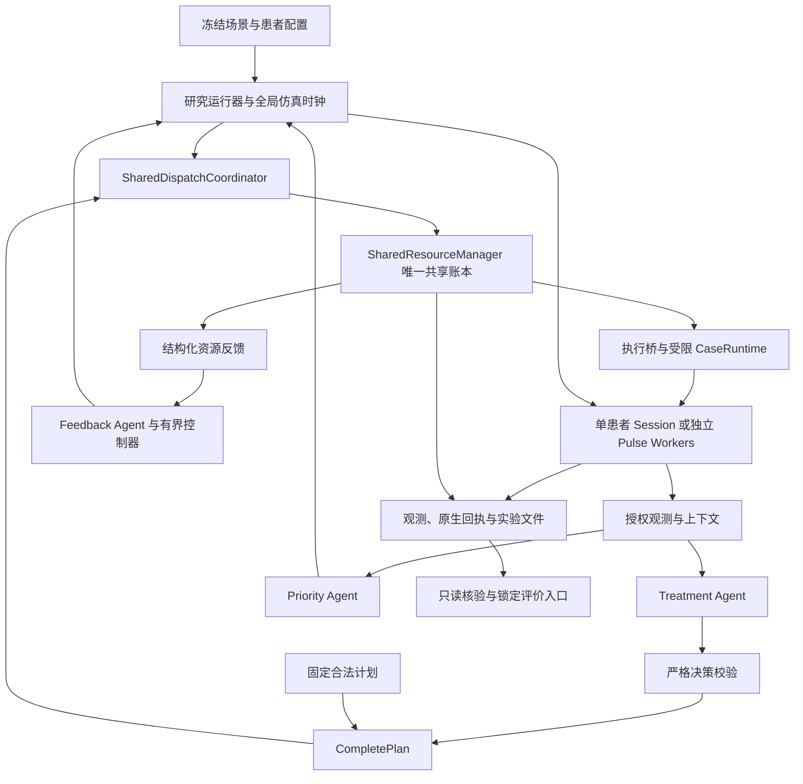

# 301 V2 项目文档报告

**项目主题：基于大语言模型多智能体的资源约束救治仿真研究**  
**项目路径：** `/home/private/project-301-v2`  
**编制日期：** 2026-10-27（America/Chicago）  
**报告依据：** 当前目录中的源码、配置、阶段文档、原始实验记录，以及本次执行的只读证据核验。

本报告面向首次接触项目的读者，介绍项目用途、功能范围、技术架构、运行流程与当前进展。文中的治疗、患者和资源均按项目的仿真研究语境解释；涉及具体伤情和动作时，描述的是代码中的固定研究配置。

## 1. 项目概述

301 V2 是一个个人硕士科研工程，研究方向是 **LLM-based Multi-Agent Systems（基于大语言模型的多智能体系统）**。它将模型决策、共享医疗资源管理和 Pulse 生理仿真连接起来，研究多个模拟患者竞争有限资源时，系统如何提出救治方案、决定处理顺序、响应资源冲突，并保留可核对的执行证据。

例如，两个模拟患者都需要一名救护人员，但共享资源池只有一个 `medic` 令牌。系统需要确定谁先获得资源，让另一名患者在仿真中继续演化，在资源实际释放后决定是否重查、继续等待或暂缓。这个过程同时涉及决策合法性、资源占用、生理时间和结果记录。

项目已经具备固定伤情模型、十二动作计划合同、共享账本、双患者独立 Pulse 执行，以及分别验证的真实模型治疗决策、优先级排序和资源反馈能力。当前最完整的动态双患者治疗证据来自**固定反馈策略下的独立时序探索**；真实 Priority LLM 与真实 Feedback LLM 尚无在同一个 run 中联合完成动态双患者治疗的证据。

本工程与团队横向开发目录 `project-301` 独立演进。当前实现以 Python 包、命令行入口和实验产物为中心；Unity 联调属于另一个工程的职责。

### 1.1 项目基本信息

| 项目项 | 当前情况 |
|---|---|
| Python 包名与版本 | `core301`，`0.1.0` |
| 主要形态 | 本地科研运行时、命令行程序、测试与证据核验工具 |
| 生理仿真引擎 | Pulse 4.3.2，使用冻结构建及患者配置 |
| 基础伤情范围 | 十类受限单伤 |
| 复合伤情范围 | 五类固定组合及固定 A→B 治疗序列 |
| 完整动作合同 | 十二类动作，参数由固定执行配置控制 |
| 多患者实证范围 | 两个独立原生 Worker，共享一个中央资源账本 |
| 最新阶段 | M3-C2：真实资源反馈、独立动态时序探索 |
| 当前科研定位 | 可审计的工程实验基础，尚未形成通用多智能体优化方法或完整疗效比较结论 |

依据：[项目说明](../README.md)、[研究范围](RESEARCH_SCOPE.md)、[M3 完整研发总结](M3_ENGINEERING_IMPLEMENTATION_SUMMARY.md)。早期说明文件中的进度性表述需要结合后续阶段证据阅读。

## 2. 项目要解决的问题

项目围绕四类问题组织实现：

1. **让模型建议成为可执行计划。** 模型输出需要经过结构、动作范围、患者身份、资源版本和时间条件校验，才能进入后端。
2. **让多个患者使用同一份资源事实。** 计划之间可能竞争人员、耗材和设备，系统需要处理整组预留、使用、消耗、释放及冲突。
3. **让等待产生可观察的仿真后果。** 未获得资源的患者也要推进生理时间，不能只修改日志中的时间戳。
4. **让实验过程能够复核。** 从模型输入、原始响应、计划和调度，到原生动作、观测、资源事件和评价结果，都要能按身份与时间关联。

这些能力为后续研究协作策略、重规划、协作失败归因、基线比较和消融实验提供基础。当前项目中已有固定策略对照运行，但尚未形成系统性的 Benchmark 和消融研究体系。

## 3. 技术栈与项目组织

### 3.1 技术栈

以下版本来自本地项目声明与锁定文件。

| 技术 | 版本或方式 | 作用 |
|---|---|---|
| Python | 声明 `>=3.11`；本地虚拟环境实际为 3.11.15 | 运行研究代码 |
| setuptools | `pyproject.toml` 构建，editable 安装 | 包管理与命令行入口 |
| Pydantic | 2.12.3 | 严格数据合同、类型与业务约束校验 |
| ruamel.yaml | 0.19.1 | 配置读取 |
| OpenAI Python SDK | 2.54.0 | 连接项目配置的模型服务 |
| python-dotenv | 锁定为 1.2.4 | 加载项目级模型配置 |
| Pulse | 4.3.2，原生库与 Python 绑定 | 生理状态初始化、动作执行和观测 |
| NumPy / Protobuf | 2.4.6 / 5.29.2 | Pulse 相关运行依赖 |
| pytest | 8.4.2 | 合同、资源、运行时和回归验证 |
| JSON / JSONL / SHA-256 | 文件形式 | 实验结果、事件流和完整性校验 |

依赖入口：[pyproject.toml](../pyproject.toml)、[requirements.lock.txt](../requirements.lock.txt)。本地 `pulse` 是指向 `/home/private/pulse-4.3.2-301-runtime` 的符号链接；该目标在本次检查时存在。

### 3.2 目录结构

```text
project-301-v2/
├── src/core301/                Python 核心实现
│   ├── agent/                 治疗、优先级和反馈决策
│   ├── contracts/             V1/V2 数据合同
│   ├── context/               决策上下文和已知伤情投影
│   ├── dispatch/              调度、完整计划、共享资源管理
│   ├── pulse/                 Pulse 会话及动作、观测适配
│   ├── runtime/               V1、V2、V2.1 固定研究执行器
│   ├── research_runtime/      最小闭环与 M3 各阶段运行器、核验器
│   ├── evaluation/            原有兼容评价实现
│   └── observation_candidate_v2/ 新版观测契约及投影实现
├── config/                    正式复合配置、评价配置及 V1 兼容配置
├── tests/                     自动化测试
├── scripts/                   激活、Pulse 配置、验证与隔离检查
├── experiments/               实验记录规范和实际运行结果
├── research_artifacts/        冻结规则、模型、观测及历史验证证据
├── research_baseline/         完整性清单、迁移及清理审计
├── validation/                早期清理阶段的验证产物
├── docs/                      架构、研究边界、阶段说明与验证结果
├── data/                      ITM 命名的原始与筛选 JSON 数据
├── engine-stable/             保留的局部引擎场景资产
├── patient-test/              当前未见普通文件的兼容目录
└── pulse -> 外部 Pulse 运行时
```

本次静态统计：`src/core301` 有 **136 个 Python 文件、9,924 行物理文本**；`tests` 有 **35 个 Python 文件、5,678 行物理文本**。计数包含空行、注释和 `__init__.py`，不包含外部 Pulse 代码，不能直接作为功能规模或测试用例数。

`experiments/results` 下发现 **16 份 run_summary.json**，其中包含成功、离线、阻断和探索运行。`scenarios`、`baselines`、`ablations` 三个目录当前仍只有占位文件；固定策略实现与部分对照结果实际位于源码和 `results` 中。

## 4. 伤情、动作与观测范围

### 4.1 十类基础伤情

| 代码标识 | 项目中的含义 |
|---|---|
| `external_hemorrhage` | 外部出血 |
| `abdominal_internal_hemorrhage` | 腹腔内出血 |
| `open_pneumothorax` | 开放性气胸 |
| `closed_tension_pneumothorax` | 闭合性张力性气胸 |
| `hemothorax` | 血胸 |
| `respiratory_muscle_impairment` | 呼吸肌功能受损 |
| `impaired_alveolar_exchange` | 肺泡气体交换障碍 |
| `dehydration` | 脱水 |
| `carbon_monoxide_exposure` | 一氧化碳暴露 |
| `environmental_hypoxia` | 环境低氧 |

各类伤情只允许冻结配置中的患者、部位、严重度或环境、动作参数与时间协议。模型名称相同，不代表可以任意改变这些条件。

权威配置：[TEN_INJURY_CONFIGURATIONS.json](../research_artifacts/v2_restricted_engineering_baseline_v1.0/TEN_INJURY_CONFIGURATIONS.json)；执行注册表：[restricted_registry.py](../src/core301/runtime/v2/restricted_registry.py)。

### 4.2 五类固定复合伤

| 复合场景 | 组成 | 配置中的固定处理顺序 |
|---|---|---|
| 胸部穿透性复合伤 | 开放性气胸 + 血胸 | 封闭敷料 → 血胸控源 → 胸管 |
| 钝性胸腹复合伤 | 腹腔内出血 + 张力性气胸 | 内出血控源 → 补液 → 针刺减压 |
| 爆炸致出血与呼吸功能障碍 | 外出血 + 呼吸肌受损 | 外出血控源 → 补液 → 插管 → 机械通气 |
| 战场火灾与吸入性功能障碍 | CO 暴露 + 肺泡交换障碍 | 移除暴露 → 补充氧气 |
| 密闭空间受困复合伤 | 环境低氧 + 脱水 | 移除暴露 → 补液 |

表中顺序是研究配置的固定 A、B 动作束，不是本报告提出的临床处理建议。复合伤也有自己的时间与准入条件，不能直接沿用单伤验证结论。

来源：[v2_1_battle_composite_patterns.yaml](../config/v2_1_battle_composite_patterns.yaml)。

### 4.3 十二类完整计划动作

| 动作代码 | 仿真功能 |
|---|---|
| `control_external_bleeding` | 外出血源控制代理 |
| `fluid_resuscitation` | 固定配置补液 |
| `transfusion` | 固定配置输血 |
| `control_internal_bleeding` | 内出血源控制代理 |
| `occlusive_dressing` | 封闭敷料 |
| `needle_decompression` | 针刺减压 |
| `control_hemothorax_bleeding` | 血胸出血源控制代理 |
| `chest_tube` | 胸管引流 |
| `intubation` | 气管插管 |
| `mechanical_ventilation` | 机械通气 |
| `supplemental_oxygen` | 补充氧气 |
| `remove_from_exposure` | 修改暴露环境 |

十二动作已进入 `CompletePlan` 合同和共享资源需求映射。当前通用研究执行桥实际只接受 **RightLeg、severity=0.4 的单动作外出血控源场景**；既有专用执行器对其他冻结场景的支持，需要与这一新闭环的覆盖范围分开理解。

三类控源动作通过修改伤情源实现研究代理；环境移除通过改变环境实现。`inhaled_albuterol` 虽有保留代码和资产，尚未开放为正式十二动作之一。

来源：[complete_contracts.py](../src/core301/dispatch/complete_contracts.py)、[catalog.py](../src/core301/dispatch/shared_resources/catalog.py)、[bridge.py](../src/core301/research_runtime/bridge.py)。

### 4.4 模型可以看到什么

M3 的真实决策接口明确投影五项基础生理指标：心率 HR、呼吸频率 RR、脉搏血氧 SpO₂、收缩压 SBP、平均动脉压 MAP。数据带单位、缺测状态和采样时间，再按角色加入授权伤情、计划摘要或资源快照。

内部伤情严重度、机制诊断、未来轨迹和评价器内部信息不进入这些 M3 模型请求。这样可以核查模型是否只使用当时允许获得的证据。

项目另有十五指标新版观测契约与实现。其冻结档案仍记载 `user_acceptance=PENDING`、`runtime_activated=false`；部分新闭环使用了相关投影或评价结构，并不代表所有 Runtime 已切换。

来源：[complete_decision.py](../src/core301/agent/complete_decision.py)、[resource_feedback.py](../src/core301/agent/resource_feedback.py)、[观测版本档案](../research_artifacts/observation_v2_contract_freeze_v1.0/VERSIONS.json)。

## 5. 系统架构与关键模块

### 5.1 分层关系

下图表示模块及接口关系。Treatment、Priority、Feedback 三类真实模型能力目前分别在不同实验分支验证，图中关系不表示已经完成三角色联合实证。



系统的控制边界是：**LLM 提出建议，确定性后端决定建议能否执行，原生回执与观测记录实际发生的结果。**

### 5.2 核心模块职责

| 模块 | 主要职责 | 代表源码 |
|---|---|---|
| 决策合同 | 治疗草案、排序、反馈的严格解析与准入 | [complete_decision.py](../src/core301/agent/complete_decision.py)、[priority_decision.py](../src/core301/agent/priority_decision.py) |
| 模型 Provider | 调用配置的模型服务，保存请求、原文和 usage | [complete_provider.py](../src/core301/agent/complete_provider.py)、[feedback_provider.py](../src/core301/agent/feedback_provider.py) |
| 完整计划 | 保留患者、run、计划、动作身份，校验范围与串行依赖 | [complete_contracts.py](../src/core301/dispatch/complete_contracts.py) |
| 共享资源账本 | 库存、预留、使用、消耗、释放、冲突、版本和幂等 | [manager.py](../src/core301/dispatch/shared_resources/manager.py) |
| 共享调度协调器 | 将计划与资源确认、队伍、运输及设施生命周期衔接 | [shared_integration.py](../src/core301/dispatch/shared_integration.py) |
| 固定研究执行器 | 执行伤情和动作的范围、时间、能力及资源准入 | [case_runtime.py](../src/core301/runtime/v2/case_runtime.py)、[V2.1 runtime.py](../src/core301/runtime/v2_1/runtime.py) |
| 完整计划执行桥 | 绑定原计划和运行时身份，转交现有执行器，回写资源事实 | [bridge.py](../src/core301/research_runtime/bridge.py) |
| 多患者宿主 | 患者编排、时钟同步、资源竞争与事件记录 | [m3b_runner.py](../src/core301/research_runtime/m3b_runner.py) |
| 原生 Worker | 每个患者在独立进程中持有 Pulse Engine | [pulse_worker.py](../src/core301/research_runtime/pulse_worker.py) |
| 反馈与时序扩展 | 等待、重查、暂缓、停止，以及独立 180/181 秒协议 | [m3c2_runner.py](../src/core301/research_runtime/m3c2_runner.py)、[m3c2_timing.py](../src/core301/research_runtime/m3c2_timing.py) |
| 评价与证据核验 | 调用冻结规则入口，检查 SHA、身份、时序和资源因果关系 | [evaluation.py](../src/core301/research_runtime/evaluation.py)、[m3c2_verify.py](../src/core301/research_runtime/m3c2_verify.py) |

### 5.3 共享资源机制

资源模型区分耗材、可复用资源及权限条件。耗材包括补液袋、血袋和操作套件；可复用资源包括人员、呼吸机及供氧设备等；某些动作还要求研究权限或环境条件。它们是代码中的研究令牌，实际临床规格、资质与占用时长仍有未决项。

M2-A 的 `SharedResourceManager` 是单进程、线程安全的内存权威。多患者共用同一个实例；Pulse Worker 不各自复制一份可分配库存。关键机制包括：

- **整组预留：** 先计算完整计划所需资源，再统一确认，避免部分占用后才发现剩余条件不足。
- **版本与幂等：** 请求携带预期资源版本和幂等键；资源变化后的重查需要新版本与新请求，重复请求不能重复分配。
- **执行与释放分离：** 原生动作被接受，不自动等于资源可释放；需要对应的完成、停止或可复用证据。
- **不确定状态保留：** 超时或执行结果未知时，相关资源继续隔离，不能凭取消或关闭仿真直接归还。
- **资源守恒：** 校验总量及可用、预留、在用、不可用数量的一致性。

账本中的两项基本守恒关系为：

```text
当前总量 = 初始总量 + 补充量 - 消耗量 - 损失量
当前总量 = 可用量 + 预留量 + 在用量 + 不可用量
```

当前没有数据库持久化和跨进程恢复能力。证据文件用于审计，不能直接视作可恢复执行状态的事务数据库。

### 5.4 双患者与仿真时间

M3-B 使用 `spawn` 创建两个独立 Worker，每个 Worker 持有自己的 Pulse Engine。宿主维护中央全局仿真时间，在关键边界同步推进并核对两个患者实际到达的时间。

模型 API 的墙上耗时不会自行折算为患者生理等待。资源等待是否发生，要由中央时钟、资源事件和患者观测共同证明。现有双患者实验使用相同冻结男性初态，因此已经验证的是两个独立实例及其状态隔离，尚不能推出不同人群或异质患者的验证结论。

## 6. 已完成阶段与证据

### 6.1 M1/M2：资源和完整计划基础

| 阶段 | 已完成内容 |
|---|---|
| M1 | 动作、研究资源和能力需求映射，记录尚未确认的临床需求 |
| M2-A | 统一共享资源账本，版本、幂等、预留、使用、消耗、释放与冲突 |
| M2-B | 共享调度协调器，衔接既有队伍、车辆、设施及任务生命周期 |
| M2-C | 十二动作 `CompletePlan`、完整调度合同、明确的兼容桥接及资源传递 |

资源与动作模型的详细说明见 [M1/M2 指南](M1_M2_MEDICAL_RESOURCE_SYSTEM_GUIDE.md)。指南中的“未来 M3”进度判断属于其编写时点，需要由下表补充。

### 6.2 M3：真实决策与执行逐步接入

| 阶段 | 实际验证能力 | 关键结果与边界 |
|---|---|---|
| 最小研究闭环 | 固定单患者计划 → 共享资源 → Pulse → 观测 → 评价入口 | 执行链路通过；正式评价 `NOT_EVALUABLE` |
| M3-A | 一次真实 Treatment LLM 决策经 CompletePlan 进入 Pulse | `M3A_REAL_AGENT_EXECUTION_PASS`；限单患者、单候选外出血控源动作 |
| M3-B | 两个独立 Pulse Worker、共享时钟、真实资源竞争与等待 | `M3B_DUAL_PATIENT_PARTIAL`；A 治疗 1 次、B 0 次，B 后续治疗被旧时间协议阻断 |
| M3-C1 | 真实 Priority LLM 的排序改变实际资源申请和执行身份 | 聚合验收 `M3C1_REAL_AGENT_PRIORITY_PASS`；等待患者仍未治疗，单 run 保留 PARTIAL |
| M3-C2 真实反馈 | 真实资源冲突 → Feedback LLM → 等待 → 释放唤醒 → 暂缓 | `M3C2_REAL_AGENT_FEEDBACK_PASS`；真实分支为 WAIT→DEFER，A1/B0，优先级固定 |
| M3-C2 时序探索 | 固定反馈策略、新时间协议、两患者依次获得资源并执行 | `M3C2_DUAL_PATIENT_DYNAMIC_EXECUTION_PASS`；A1/B1，LLM 调用 0 次，正式时序疗效仍未验证 |

M3 真实模型实验记录的请求与响应模型标识为 `gpt-6-sol`，这是所配置服务记录的标识。M3-A 调用一次治疗模型，M3-C1 调用一次排序模型，M3-C2 真实反馈调用两次反馈模型；它们属于不同 run。

来源：[M3-A](m3a_real_treatment_agent/README.md)、[M3-B](m3b_dual_patient_runtime/README.md)、[C1 聚合验收](m3c1_priority_decision/validation/acceptance.json)、[C2 分项验收](m3c2_feedback_decision/validation/acceptance.json)。

### 6.3 用一次资源竞争说明系统行为

M3-C2 的两个代表性原生实验都采用两名相同伤情患者和唯一 `medic` 资源，但使用不同决策来源和时间协议。

| 仿真时间 | 真实反馈实验 | 独立时序探索 |
|---|---|---|
| 0 秒 | 两个独立患者初始化 | 相同 |
| 60 秒 | 分别施加冻结的右腿外出血 | 相同 |
| 180 秒 | A 获配并治疗，B 申请得到 `RESOURCE_IN_USE`；真实模型选择等待 | 相同资源冲突；固定策略选择等待 |
| 181 秒 | A 的控源证据确认，资源释放；真实模型因旧协议不准许此时治疗而暂缓 B | 固定策略重查；资源重新确认后，B 按独立新协议治疗 |
| 182 秒 | B 继续未治疗观察 | B 控源确认，释放资源 |
| 480 秒 | A1/B0，两患者各 301 帧观测 | A1/B1，两患者各 301 帧观测 |

独立探索协议只接受 **180、181 秒两个离散候选时点**。181 秒资源释放是本研究代理按后续采样确认的结果，不能解读为真实处置只需要一秒。

反馈合同定义了四种控制行为：`KEEP_PLAN_AND_WAIT`、`RECHECK_RESOURCES`、`DEFER_INSUFFICIENT_EVIDENCE`、`STOP_UNEXECUTABLE`。目前真实 LLM 覆盖前述 WAIT、DEFER；RECHECK 的原生效果由固定策略探索验证，STOP 由离线测试验证。反馈接口当前不生成替代动作或通用多轮治疗方案。

## 7. 评价体系与实验产物

### 7.1 正式规则与评价资格

项目保留十四条锁定研究规则 `V2E-01` 至 `V2E-14`，版本标识为 `RESEARCH_RULESET_V1_LOCKED`。规则、参数和定义均使用 SHA 校验，计算继续调用原有算法依赖。

规则中的 E、P、I 对应有效、部分有效、无效的研究判定；其中两条为二分类定义。**只有满足可评价条件时才能给出这些结果。** 数据缺失、患者输入不适配或缺乏必要对照，应保留 `NOT_EVALUABLE`，不能按“无效”处理。

目前 M3 单场景路径已实际调用冻结评价器，但结果为 `NOT_EVALUABLE`，记录的直接错误包括 `MANIFEST_PATIENT_INPUT`。执行桥同时明确列出了 StandardMale 与原独立 Soldier 输入的适配问题、缺少匹配对照分支、证据合同与观测结构不完全对应等缺口。

独立动态时序探索不具备原冻结治疗时点的正式评价资格，保留 `M3C2_TIMING_NOT_VALIDATED`。因此，资源分配成功、原生动作执行成功和生理机制确认，都需要与正式疗效结论分开报告。

正式规则入口：[最终规则表](../research_artifacts/treatment_effect_rules_v2_candidate_v0.1/treatment_effect_rules_v1_final/FINAL_RULE_TABLE_V1.0.json)；接入实现：[research_runtime/evaluation.py](../src/core301/research_runtime/evaluation.py)。原 `core301.evaluation` 是另一条兼容评价链，不能与十四规则入口混用。

### 7.2 实验记录结构

不同阶段产物略有差异，典型记录包括：

| 产物 | 用途 |
|---|---|
| `run_manifest.json`、`run_summary.json` | 场景、模式、身份、配置、最终运行状态 |
| 模型请求、响应与决策 JSON/JSONL | 原始输入输出、模型标识、Prompt SHA、调用次数及 usage |
| `complete_plan.json` 等计划文件 | 核对模型草案、宿主计划和下游收到的计划是否一致 |
| 调度记录与 `resource_events.jsonl` | 检查资源请求、冲突、版本、使用和释放 |
| `clock_trace.jsonl`、`global_events.jsonl` | 检查患者时钟同步及事件顺序 |
| 患者目录中的观测、原生动作与执行回执 | 确认指定患者实际执行了什么、何时发生及后续状态 |
| `evaluation_result.json` | 评价器是否调用、可评价状态及证据缺口 |
| `SHA256.json` 或 `sha256_manifest.json` | 检查归档文件完整性 |

只读核验器除了检查 SHA，还核对身份、真实响应与解析结果、观测来源、资源占用因果、治疗次数和时钟。失败和阻断运行也保留在结果目录中；目录存在本身不代表实验成功。

### 7.3 数据目录的当前情况

本次按 JSON 顶层记录数检查了 `data` 目录中的五份文件：

| 文件 | 顶层记录数 |
|---|---:|
| `data/raw/itm_example_dataset.json` | 95 |
| `data/raw/itm_eval1k_dataset.json` | 884 |
| `data/raw/itm_eval10k_dataset.json` | 8,687 |
| `data/filter/itm_eval1k_with_intervention_dataset.json` | 272 |
| `data/filter/itm_eval10k_with_intervention_dataset.json` | 2,735 |

抽查的记录结构包含 `specification`、`injury_exec_status`、`pulse_injuries`、`visits` 等字段；原始数据首条记录还含 `final`，筛选数据首条记录含 `death`。文件名中的 `1k/10k` 与当前实际条目数不同，应以文件内容为准。

在本次检索的 `src`、`scripts`、`tests` 和说明文档中，未找到这些文件名或目录的直接引用。因此只能确认数据文件已经存放于项目内，尚不能认定其已接入 M3 实验主流程，也不能据此确认其来源、生成或筛选方法。

## 8. 运行与复核方式

### 8.1 激活现有环境

```bash
cd /home/private/project-301-v2
source scripts/activate.sh
python --version
```

激活脚本同时设置项目源码、Pulse Python 绑定和原生库的路径。当前工程依赖项目根目录中的配置与证据文件，迁移时应保留完整源码和必要资产。

### 8.2 查看资源调度演示

```bash
python -m core301.dispatch.shared_resources.demo
python -m core301.dispatch.shared_demo
python -m core301.dispatch.complete_demo
```

这些入口使用明确的研究 fixture 和固定或 Mock 决策，展示真实共享账本的预留、释放、竞争与完整计划传递，无需真实模型凭据。

### 8.3 运行离线研究入口

```bash
python -m core301.research_runtime.m3a_runner --mode offline_test
python -m core301.research_runtime.m3b_runner --mode offline_test
python -m core301.research_runtime.m3c1_runner --mode offline_test --priority-mode fixed_B_first
python -m core301.research_runtime.m3c2_runner --mode offline_test
```

离线入口会生成新的实验目录。M3-A 主要检查草案和计划；双患者离线模式使用 Fake Worker 与真实 M2 资源管理，产物不能作为原生 Pulse 生理证据。运行器支持 `--run-id`，已有目录会拒绝复用。

### 8.4 只读核验已有实验

```bash
python -m core301.research_runtime.m3a_verify experiments/results/m3a_real_treatment_agent/m3a-real-agent-001
python -m core301.research_runtime.m3b_verify experiments/results/m3b_dual_patient/m3b-dual-native-001
python -m core301.research_runtime.m3c2_verify experiments/results/m3c2_feedback_decision/m3c2-real-feedback-001
python -m core301.research_runtime.m3c2_verify experiments/results/m3c2_feedback_decision/m3c2-timing-exploratory-001
```

这些入口检查已归档数据，不重新调用模型、运行治疗或计算疗效，是了解现有证据最直接的方式。

### 8.5 原生与真实模型入口

| 目标 | 入口及模式 | 模型调用 |
|---|---|---|
| 单患者真实治疗决策 | `core301.research_runtime.m3a_runner --mode real_agent_native` | 每个新 run 最多一次 |
| 固定计划双患者执行 | `core301.research_runtime.m3b_runner --mode dual_native` | 无 |
| 真实患者排序 | `core301.research_runtime.m3c1_runner --mode dual_native --priority-mode llm_priority` | 每个新 run 最多一次 |
| 真实资源反馈 | `core301.research_runtime.m3c2_runner --mode feedback_native` | 每个新 run 最多两次 |
| 独立动态时序探索 | `core301.research_runtime.m3c2_runner --mode timing_exploratory` | 无，使用固定反馈策略 |

上表模块需通过 `python -m` 启动。真实模型模式读取项目 `.env` 或环境变量中的 `OPENAI_BASE_URL`、`OPENAI_API_KEY`、`OPENAI_MODEL`；配置项见 [.env.example](../.env.example)。相关 Provider 采用有界调用并保留失败事实，不自动替换为成功计划。本次报告编制没有运行上述原生或真实模型实验。

安装提供的 `core301` 命令仍指向旧 V1 CLI，不能直接当作 M3 总入口。M3 应使用对应的 `research_runtime` 模块。

### 8.6 环境重建与验证脚本

按项目已有说明，跨机器重建方式为：

```bash
python3.11 -m venv .venv
.venv/bin/python -m pip install -r requirements.lock.txt
.venv/bin/python -m pip install --no-build-isolation --no-deps -e .
.venv/bin/python scripts/configure_pulse.py /path/to/compatible/pulse-4.3.2
source scripts/activate.sh
```

Pulse 需要与冻结证据对应的兼容构建；仅有相同版本号并不足以确认原生库一致性。

`bash scripts/validate.sh` 会执行 M2 核心集合、完整非 integration 回归、三个 Demo、完整性检查、Pulse 初态 smoke 和路径隔离检查，并写入 `validation/`。它不运行 M3 的全部真实模型与原生实验，因此不能作为这些实证结果的替代。本次未运行该脚本，避免将历史验证日志混成当前结果。

## 9. 测试与本次实际核验

### 9.1 已归档的测试结果

| 验证记录 | 已归档结果 |
|---|---|
| 根 `validation/all_unit.log` | 1,028 passed，26 deselected，属于早期清理阶段 |
| M3-A 最终全量回归 | 1,077 passed，26 deselected |
| M3-B 最终全量回归 | 1,101 passed，26 deselected；使用 `full_regression_final.log` |
| M3-C1 全量回归 | 1,134 passed，26 deselected |
| M3-C2 全量回归 | **1,182 passed，26 deselected，0 failed，6 warnings** |

各阶段数量是累计测试结果，不能相加。M3-B 目录还保留一次修复前的失败日志，应与最终日志区分。M3-C2 的 26 个 native integration 用例被排除；独立原生实验通过不等于这 26 个测试已经执行。

主要测试领域包括严格合同、动作依赖、资源守恒、幂等与并发条件、患者隔离、时钟同步、Unknown 隔离、反馈控制和证据篡改拒绝。

日志入口：[根回归](../validation/all_unit.log)、[M3-A](m3a_real_treatment_agent/validation/full_regression.log)、[M3-B 最终回归](m3b_dual_patient_runtime/validation/full_regression_final.log)、[M3-C1](m3c1_priority_decision/validation/full_regression.log)、[M3-C2](m3c2_feedback_decision/validation/full_regression.log)。

### 9.2 本次报告编制时的验证

本次实际执行了 **6 组只读核验，覆盖 8 个已归档 run，全部通过**：

| 核验对象 | 核验的文件条目数 | 本次结果 |
|---|---:|---|
| 最小闭环 `external-source-control-native-002` | 31 | PASS |
| M3-A `m3a-real-agent-001` | 38 | PASS，决策来源核验通过 |
| M3-B `m3b-dual-native-001` | 57 | PASS，原运行结论仍为 PARTIAL |
| M3-C1 真实排序与固定 A/B 两份原生对照 | 63 / 61 / 61 | 聚合验收 PASS |
| M3-C2 `m3c2-real-feedback-001` | 66 | PASS，真实 WAIT→DEFER、A1/B0 |
| M3-C2 `m3c2-timing-exploratory-001` | 65 | PASS，固定 WAIT→RECHECK、A1/B1 |

这里的 PASS 表示当前项目核验器接受归档证据的完整性和所检查的语义关系，不增加原实验的验证范围。本次没有重新运行全量 pytest、Pulse 治疗、模型 API 或疗效重评分，也未读取项目 `.env` 的凭据内容。

## 10. 当前限制与后续方向

| 当前边界 | 对项目使用和后续研究的影响 |
|---|---|
| 实际新闭环仍集中于单一外出血场景 | 十二动作合同的覆盖面大于真实 Treatment LLM 和执行桥的覆盖面 |
| 真实模型角色分别验证 | 后续需要建立同一 run 内的角色衔接，才能研究联合协作效果 |
| 仅有两个相同初态患者的多患者实证 | 尚缺异质患者、更多患者、多动作、多资源情境 |
| 动态时序只探索 180/181 秒 | 任意延迟、长期排队和不同释放政策需要独立协议与证据 |
| 正式评价资格不足 | 当前可研究执行一致性与控制行为，不能给出正式疗效优势结论 |
| 新十五指标未全 Runtime 激活 | 扩展输入前需要明确字段授权、缺测和版本迁移语义 |
| 共享账本为内存实现 | 进程中断后的持久化恢复、分布式资源权威仍需建设 |
| V1 兼容路径仍存在 | 旧 CLI、合同、Prompt 和配置与新路径应明确区分 |
| 实验组织尚未体系化 | 已有阶段验证不能替代重复实验、系统性基线和消融比较 |
| ITM 数据尚无明确接线证据 | 需要补充来源、筛选方式与场景映射，才能纳入实验流程 |

基于当前实现，后续较有价值的推进顺序是：先统一项目入口与状态文档，再打通合法范围内的多角色联合运行，建立贯通决策、资源和原生执行的证据链；随后补齐评价资格、任务差异和基线配置，开展预先声明的重复与消融实验。

这些是报告提出的后续建议，本次没有实施算法扩展或修改历史实验。

## 11. 文档阅读建议与状态冲突说明

当前根 README、研究范围、基线文件和 `experiments/README.md` 保留了较早阶段的“真实完整输出尚未接入”“没有实验结果”等表述。当前源码和 M3 原始结果已经超出这些进度说明；例如，实验目录现有 16 份运行汇总，真实单动作 Treatment 接入和反馈分支也已存在。

阅读时应分别确定两类事实：冻结配置和规则文件决定**允许的研究范围**；当前源码、实际 run 和独立验收决定**已经完成的工程能力**。后续局部实验通过不会自动扩大原冻结范围，也不会把其他角色的独立验证合成为一次联合实验。

建议按以下顺序阅读：

1. 本报告：建立项目全貌与当前能力边界。
2. [M3 完整研发总结](M3_ENGINEERING_IMPLEMENTATION_SUMMARY.md)：了解真实决策、双患者、优先级和反馈的细节。
3. [V2 正式工程基线](V2_ENGINEERING_BASELINE.md)：核对冻结模型、规则与版本；其中进度性段落按历史时点理解。
4. [M1/M2 医疗资源系统指南](M1_M2_MEDICAL_RESOURCE_SYSTEM_GUIDE.md)：了解资源、完整计划和调度。
5. [M3-C2 阶段说明](m3c2_feedback_decision/README.md)与[分项验收](m3c2_feedback_decision/validation/acceptance.json)：查看最新真实反馈及独立时序结论。
6. [兼容依赖审计](LEGACY_DEPENDENCY_AUDIT.md)：了解旧合同、配置及资产生命周期为何仍然保留。

本报告新增为独立总览文档，保留原说明、源码、冻结配置和实验记录，方便读者对照历史证据。
