# 科研系统架构与真实连接状态

> 2026-10-19 M3-B 更新：两个隔离原生Worker、中央共享账本与同步时钟已真实验证；A合法治疗，B资源恢复后因180秒协议阻断，整体 M3B_DUAL_PATIENT_PARTIAL，真实等待推进已验证。全量回归1101通过，详见 [双患者报告](m3b_dual_patient_runtime/README.md)。

> 2026-10-19 M3-A 更新：新增真实 Treatment draft → CompletePlan → 既有执行闭环接口，离线回归 1077 passed；真实 gpt-6-sol 单次决策已进入 Pulse，状态 M3A_REAL_AGENT_EXECUTION_PASS，正式评价 NOT_EVALUABLE。详见 [本轮报告](m3a_real_treatment_agent/README.md)。下文为此前基线记录；当前单场景接入与验证范围以本轮报告为准。

实线表示已有代码路径；虚线表示未接入或未验证。两套执行/调度路径目前没有统一事务闭环。

```mermaid
flowchart TD
    F[冻结单伤/复合配置] --> I[伤情初始化与固定研究路由]
    I --> P[Pulse 4.3.2专用执行适配]
    P --> O[当前生理观测读取]
    O --> C[Context构建]
    C --> T[Treatment Agent V1]
    T --> V[V1八动作计划]
    V --> E[旧执行器及评价链路]
    E --> P
    V --> B[显式兼容桥接]
    X[固定研究fixture完整计划] --> CP[CompletePlan 十二动作合同]
    B --> CP
    T -. M3-A尚未实现 .-> CP
    CP --> D[Resource Scheduling Agent]
    D --> Q[SharedDispatchCoordinator]
    Q --> M[SharedResourceManager 统一医疗账本]
    Q --> L[旧MedicalTeam/车辆/机构容量生命周期]
    M --> R[预留结果或结构化资源冲突]
    R -. M3-B尚未实现 .-> T
    Q -. 完整计划未接Pulse .-> P
    P -. 完整方案评价未集成 .-> A[冻结十四规则原AST/离线证据适配]
    P -. 新十五指标契约未全量激活 .-> N[冻结新版观测schema]
    U[研究宿主的时钟与可信事件] --> Q
```

`runtime/v2/research_router.py`和`runtime/v2_1/runtime.py`保留固定准入、研究资源、参数与执行日志。它们的专用历史执行能力不能推出M2-C CompletePlan已经接入这些执行器。

`dispatch/service.py`和`providers.py`提供调度决策，后端协调器重新验证版本、ETA/事件/地点以及完整资源需求。SharedResourceManager是统一医疗资源权威；旧ResourceManager只保留既有队伍/运输/设施的语义桥接和兼容入口。资产物理身份独立性必须显式成立，不新增一套重复库存。

资源接受回执与真实消耗是不同事实；unknown执行继续隔离，已耗不因取消回滚。M3应在结构化冲突与Treatment Agent之间扩展反馈，稳定ID和幂等语义继续由可信后端维持。本轮未新增反馈策略。

临时兼容层：真实Treatment Agent → V1 Context/八动作合同 → 旧执行/显式桥接；其两份YAML从config/compatibility/v1读取。正式V2模型和此兼容输入分别管理，旧六模式不是正式五复合。Unity属于独立横向项目，不在本图承诺科研工程与其已连接。未来实验按experiments/README.md记录场景、方法、种子、资源、轨迹和失败事实；空目录不表示已有算法。
