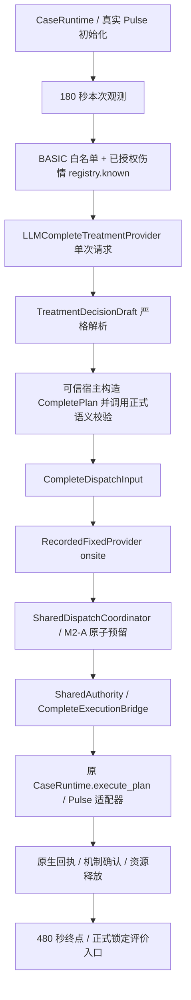

# 架构与权责

M3-A 通过旧 runner 的可选 `treatment_workflow` 接入。指定 workflow 时不调用 `make_plan`，启动时 plan 与 resource authority 均为空；真实观测后生成合法模型计划，才绑定 SharedAuthority 和执行桥。旧固定计划入口保持兼容。

模型只选择动作、目标并给出简短解释或拒绝。宿主分配所有身份、固定 scope/severity、策略和串行依赖；模型不能接触库存写接口。CompletePlan 复用 `301.treatment.complete.1`，十二动作正式合同保持不变；本轮新 draft 的执行白名单只含已验证控源动作。没有旧八动作转换。

resource fixture 仍是同地点 medic=1；M2-A 是唯一医疗账本。Fixed 调度只提出 onsite，不改变动作。原执行桥仍检查任务 ready、原预留、当前源、执行时序和未知回执。没有第二套 Pulse 执行器、库存或评价算法。

模型输出/解析/合同失败均在调度前停止。API、格式、目标、顺序、额外字段、暂缓/拒绝和 CompletePlan 失败保留阶段与异常；无固定计划回退。资源不足保留原 dispatch_result；未知治疗沿用原 journal/隔离，不盲目重试。
