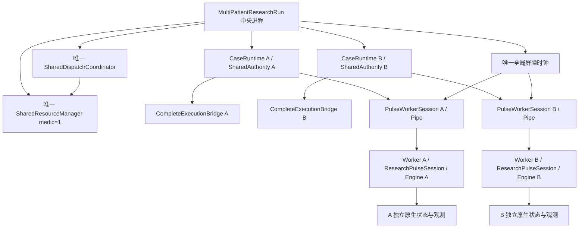

# 双患者架构与隔离

本轮使用两个 `multiprocessing.get_context('spawn')` Worker 进程。中央 Orchestrator 不加载原生 Engine；每个 Worker 只创建一个既有 ResearchPulseSession → PulseSession → PyPulse.Engine，持有唯一 patient_id 与独立日志路径。Worker 不持有资源账本、Coordinator 或 Agent。

现有 Python 封装每次构造独立 Engine 对象，但未提供原生绑定线程安全及全局状态隔离的证明。因此不以两个 Python 对象推断安全，也不在线程中共享原生引擎。spawn 将原生地址空间隔离；父进程顺序发命令，Worker 单线程处理。基线文件可以只读共享，运行状态和日志不能共享。

中央复用原 CaseRuntime 的 build_context、execute_plan、advance、journal 和机制确认；复用原执行桥、适配器、M2 原子事务。只将原 prepare 的固定 0→60→180 阶段拆开由中央同步：正式 CasualtyInput/validate_injury_scope、原 injury adapter、原 session 初始化和 SHA 检查不变。新模块内设置 registry/_prepared 是与当前 CaseRuntime 的窄内部接口；未改旧 Runtime 或单患者 Runner。

隔离 Smoke 不治疗。A 单独推进并施伤，B 的完整解析后状态不变、时刻仍为0；两者随后分别施伤并同步180秒；关闭A后B仍可推进到181秒。探索阶段的单独推进用于证明隔离，不是正式全局时钟实验。正式实验所有调度、治疗、采样事件只能在两者同步的屏障后处理。

首次 Smoke 比较序列化字符串时失败，原因是 JSON 字段顺序；第二次使用完整解析对象比较，通过。没有忽略任意生理字段或以 ID 变化代替隔离证明。原始失败目录保留。

进程隔离没有证明不同人群或不同人体基础模型的独立验证。两个患者都使用同一冻结 StandardMale 基线，SHA不改。
