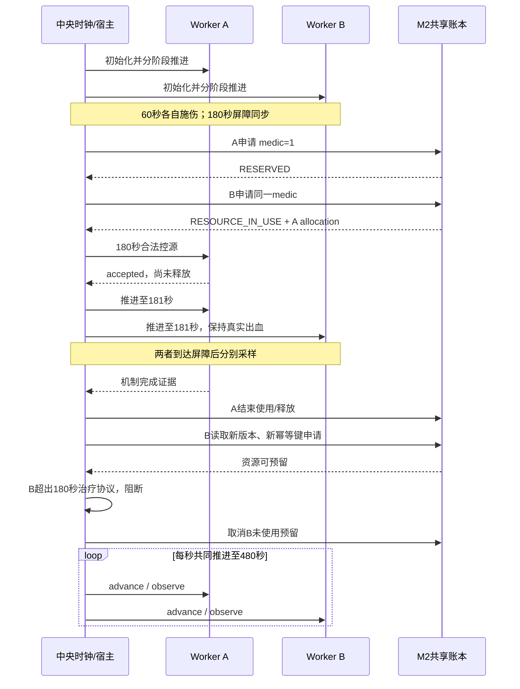

# 全局时间、事件顺序和同步

唯一逻辑时钟 `global_simulation_time_s` 位于中央进程；患者的 Pulse 浮点时间是独立读数，资源操作使用不早于当前各实例读数的时刻，容差为现有 1e-6 秒。真实墙上耗时仅写入 worker_commands.jsonl，不用于推进生理状态。

固定事件：0秒初始化、60秒施伤、180秒两个计划就绪和竞争、181秒首次治疗后1秒采样/机制确认、480秒终点。181不是临床占用时长，而是复用既有每秒采样路径的首次确认点。未验证0.02秒最早释放，更不声称控源需要1秒临床操作。

每次 advance_to：先核对所有患者处于当前全局边界，再顺序推进两个独立 Worker 到目标；全部成功回执后才提交新全局时间。虽然计算在墙上顺序发生，但屏障内部不处理资源或临床事件，最多相差一个采样步的未提交内部进度。某一推进失败则记录每个实例最后已确认时间，停止全局实验，不回滚或伪称两者同步。

拒绝倒退、非有限时间、超过480、跨过未处理的固定事件；调度和治疗之前再次核对屏障。pending_events 是固定场景事件列表，不是通用 DAG。2000条事件预算是执行限制，不能解释为医学时间。

等待分两段：资源等待180→181（1秒），随后181→480为治疗协议阻断后的未治疗观察，不再称为资源等待。无 wall-clock→Pulse 转换，B不因资源被拒绝而被冻结，也不被标记为治疗失败。
