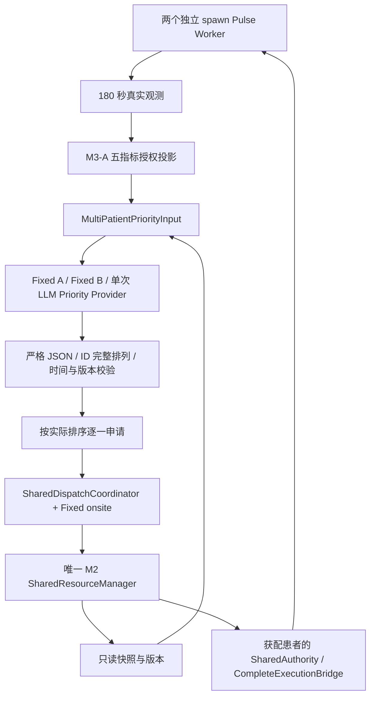
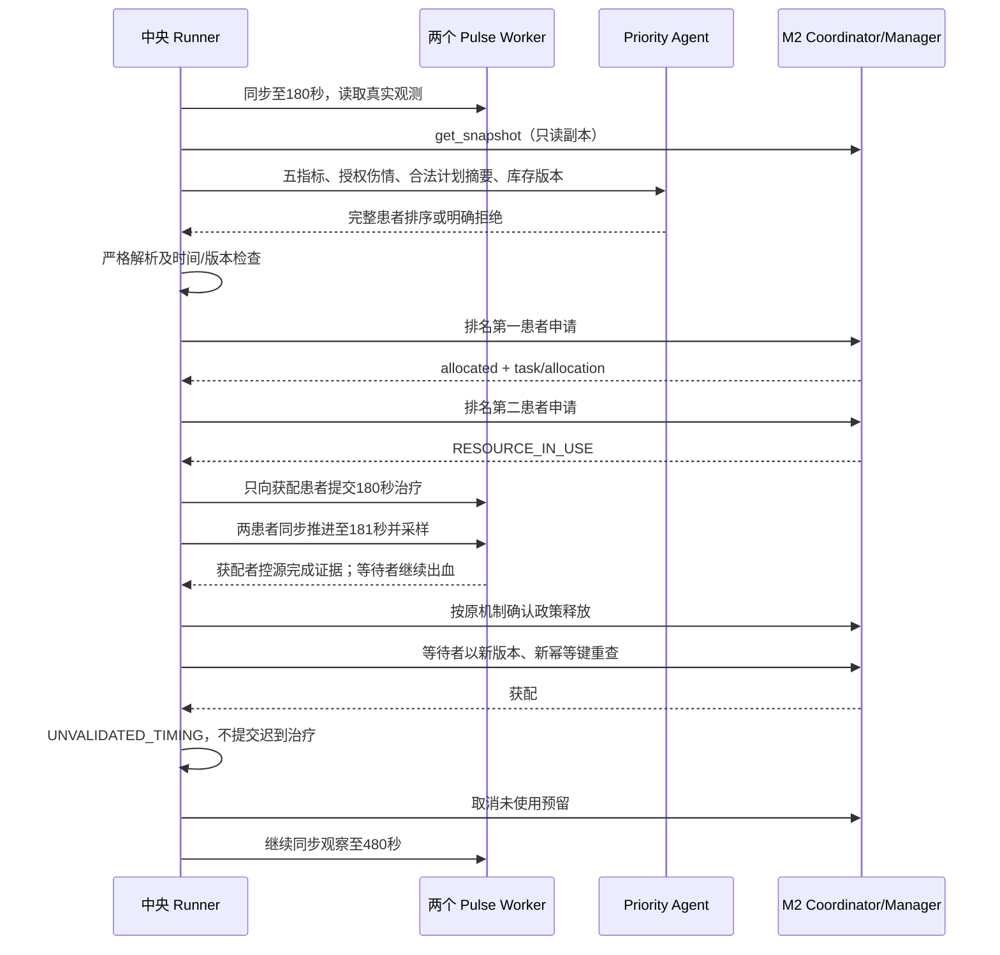

# M3-C1 架构

M3-C1 在 180 秒作一次优先级决定；两名患者继续使用既有合法 CompletePlan，onsite 提案继续由 FixedDispatchProvider 生成。未修改 DispatchProposal、M1 映射、M2 原子事务、治疗参数和正式评价规则。

输出合同 `301.resource.priority.m3c1.1` 必须包含 schema_version、run_id、simulation_time_s、resource_state_version、decision_type、ordered_patient_ids、reasoning_summary、refusal_reason。严格类型与禁止额外字段；重复 JSON key、非 JSON、重复/未知/缺失患者、过期版本、错误时间及模型拒绝均阻断。解释文本不授权动作。拒绝记录保留，不自动改成 A 优先。

输入由可信 builder 构造，复用 M3-A `agent_input` 的 HR/RR/SpO₂/SBP/MAP 白名单、单位、缺测状态和采样时间。仅授权 external_hemorrhage / RightLeg；计划摘要从 CompletePlan 提取动作和目标，需求读取 Catalog；不传 severity、内部机制、未来观测或评价结果。Provider 仅持 JSON 数据，不持账本对象。输入类内部患者和快照使用字典表示，隐私边界在白名单 builder，而非任意外部输入的递归 Schema 验证。

新 Provider 复用既有配置加载和 OpenAI 兼容调用方式，独立 Prompt；每实例最多一次请求、SDK 重试为0、60秒超时。保存完整服务响应、请求/响应模型、真实 usage（缺失为null）、Prompt版本和SHA。失败只保存类型/状态码，不保存任意异常字符串。

旧 `MultiPatientResearchRun.episode()` 的 A/B 常量替换为 `selected/waiting`；默认 `priority_order()` 返回历史 A/B。新 `PriorityResearchRun` 覆盖优先级准入，同一 episode 执行三个模式。原 execute()、身份绑定、Unknown隔离、幂等、180秒限制及181秒释放流程复用。旧核验器保留，新只读核验器从实际决策推导获配者与等待者，逐级核对原始响应、请求、资源、Worker和回执。

新增源码：

- `src/core301/agent/priority_decision.py`：输入/输出合同、Provider协议、白名单 builder、严格解析、FixedPriorityProvider。
- `src/core301/agent/priority_provider.py`：LLMPriorityDecisionProvider。
- `src/core301/agent/prompts/priority_decision_m3c1.md`：独立排序 Prompt。
- `src/core301/research_runtime/m3c1_runner.py`：PriorityResearchRun、新入口与证据。
- `src/core301/research_runtime/m3c1_verify.py`：单run只读核验。
- `src/core301/research_runtime/m3c1_accept.py`：真实LLM与两种原生固定策略的聚合验收。
- `tests/m3c1/test_priority.py`：合同、HTTP Mock、失败关闭、双向闭环测试。

修改源码仅 `src/core301/research_runtime/m3b_runner.py`：共享 episode 角色参数化及等待时长按等待者读取。未修改其他原有源码。
