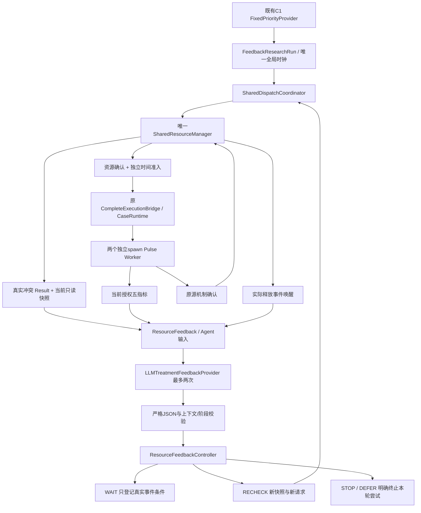
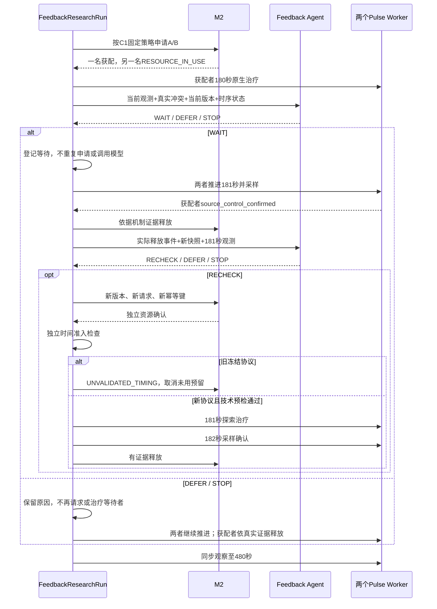

# 反馈控制与双患者运行

实际模型可以STOP/DEFER，图中条件分支不是固定期待答案。timing_exploratory使用明确标记FixedFeedbackProvider测试独立时序，不将其包装成真实模型。

## 合同与控制

`agent/resource_feedback.py`：ResourceFeedback含run/patient/plan/decision身份、全局时间、计划状态、未执行动作、真实M2 Result、conflict_codes/resource_ids/blocking_allocation_ids、当前版本、资源是否实际变化、触发事件序号、下次合法检查条件、时间协议状态、允许操作、未决执行事实。历史冲突版本与当前快照版本分别保存。

TreatmentFeedbackDecision为`301.treatment.feedback.m3c2.1`，强制回传上述身份、时间、当前版本及四种decision_type、解释和拒绝原因。重复key、额外字段、替代动作、时序参数、患者/计划/时刻/版本不符和当前阶段不允许的操作均拒绝。解释不作为执行参数。

输入为当前等待患者的五指标、真实单位/缺测/采样时间、已授权RightLeg伤情、合法单动作摘要、真实反馈和M2快照。新的白名单投影支持180/181的当前帧，不改变M3-A原180秒投影。未授权Severity、隐藏机制、未来观测、评价信息均不送模型。Runtime仍可读取其原有安全监测字段，权限不因此扩展到Agent。

KEEP_PLAN_AND_WAIT只注册资源事件。相同患者/触发事件不能二次消费；两次总决策后拒绝继续；释放事件必须来自中央事件列表且匹配当前版本。RECHECK重新读取快照并使用SharedAuthority的新request/idempotency_key；不能复用失败请求。STOP只取消RESERVED未用资源；IN_USE/QUARANTINED保留，不能恢复已消费资源或清空Unknown。DEFER保留原因，本轮不自动继续采样驱动LLM调用。当前只在180冲突和181真实释放事件各至多调用一次，不实现通用重规划。

Provider复用已有配置读取与OpenAI兼容SDK，独立Prompt，不修改M3-A/C1。SDK重试0、timeout60、最多2调用、每次请求max_tokens=1000。输入UTF-8字节数加请求输出token数按保守本地预算计费，累计上限24000单位；这不是实付token估算。真实usage按服务返回保存（缺失null），真实输出token请求上限总计2000；不声称可控制未知服务的tokenizer。API异常仅记录类型/状态码，失败不切换Fixed。

## 执行复用与文件清单

新增：

- `src/core301/agent/resource_feedback.py`：ResourceFeedback、TreatmentFeedbackDecision、授权输入、严格校验、FixedFeedbackProvider。
- `src/core301/agent/feedback_provider.py`：LLMTreatmentFeedbackProvider及有界请求证据。
- `src/core301/agent/prompts/resource_feedback_decision_m3c2.md`：独立Prompt。
- `src/core301/research_runtime/m3c2_timing.py`：协议定义、DynamicTimingCaseRuntime。
- `src/core301/research_runtime/m3c2_runner.py`：ResourceFeedbackController、FeedbackResearchRun、自动技术预检、三模式入口。
- `src/core301/research_runtime/m3c2_verify.py`：独立只读因果/身份/时间/SHA核验。
- `tests/m3c2/test_feedback.py`：反馈、时序、作用与保护测试。

修改仅：`runtime/v2/case_runtime.py`提取默认180秒时间检查方法，在独立新协议时写真实协议身份；`research_runtime/m3b_runner.py`增加默认CaseRuntime类选择和默认180秒Runner方法。旧默认行为不变。M3-C1优先级语义、M1/M2、Worker、Bridge、适配器、参数、伤情配置、14规则及历史run不修改。

正式执行仍唯一走CompleteExecutionBridge→原CaseRuntime.execute_plan→原TreatmentAdapter→原Worker。动态子类只覆盖时间/更窄范围准入，不复制原生执行代码、不改变仿真时钟、不绕过资源/监测/源/幂等/Unknown检查。
