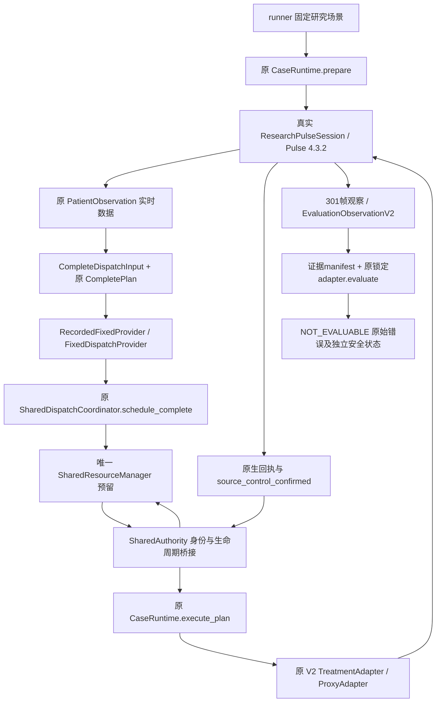

# 真实数据流与身份关联

新增代码在 `src/core301/research_runtime/`，不重组既有模块。

## 身份所有权

|字段|生成/消费方|关联方式|
|---|---|---|
|run_id|Runner生成，或CLI显式唯一名称|Pulse Runtime、CompletePlan、M2 Request、观测、评价、目录一致|
|patient_id|run_id派生的病例身份|全部合同一致；与原生StandardMale名称分别保存|
|scenario_id|固定external_rightleg04_source_control_v1|manifest及summary；不授权任意伤情参数|
|plan_id|完整计划宿主生成|共享账本权威引用，保存在原执行记录resource_reservation.shared_plan_id|
|action_instance_id|完整计划宿主生成|M2请求/分配、execution_events、原执行记录resource、评价结果一致|
|runtime plan_id/action_id|既有CaseRuntime内部生成|SharedAuthority记录别名，既有journal保留；不建立第二份计划/库存权威|
|allocation_id|原SharedResourceManager生成|原执行记录resource.allocation_ids指向同一共享分配|
|simulation_time_s/at_s|真实Pulse当前时间|资源请求、执行回执、观测、结束释放均引用该时钟|

`SharedAuthority`只保存身份绑定和回执，不维护stock/holds副本。旧executor接收V2动作命令投影，CompletePlan本体始终保留；其scope、ID、顺序和依赖由新桥接先验证，不能通过旧八动作合同降级或丢掉元数据。

## 数据来源

- 真实Pulse：初态、施伤结果、治疗accepted、活动源及诊断、生理样本、时间、终态、脉冲事件快照、Pulse日志。
- 原后端执行器：固定协议payload、单源校验、journal、source_control_confirmed。源控制是已有研究代理，没有另建模拟止血算法。
- 研究fixture：medic×1、scene地点/权限/能力、onsite固定调度决策、无车辆/队伍/设施实例。不是临床物资或真实人员资质。
- 真正运行的共享manager：原子预留、begin、执行事实、释放、数量守恒和版本，非打印预设输出。
- 正式评价适配器：实际子进程返回NOT_EVALUABLE和MANIFEST_PATIENT_INPUT；M/F未计算，无疗效占位等级。

## 导出

run_manifest、treatment_plan、resource_events、execution_events、observations、evaluation_result、run_summary齐备。另保留Provider实际输入、任务结果、两次原执行回执、原生动作结果、初态/治疗前/终态、受控EvaluationObservation、评价manifest/命令/stdout/stderr、runtime journal及Pulse日志。`SHA256.json`覆盖其余31个文件，校验清单自身不递归哈希。

PatientObservation的公开字段与Evaluation诊断分离：传给Fixed Provider的是实际patient_observation；内部诊断、原生状态、事件和评价结果不放进Agent上下文。输出的完整observations.jsonl为研究证据文件，不是直接发送给Agent的消息。
