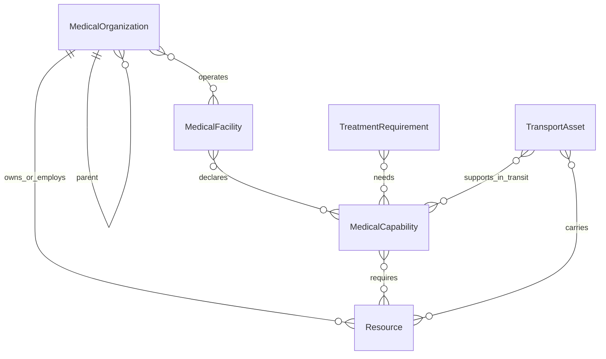

# 301医疗资源与能力模型V1.0：M1设计

状态：PROPOSED，2026-10-19。仅静态模型、接口和语义设计，不包含M2实现。现有证据与医学未知项分别见[盘点](CURRENT_ACTION_INVENTORY.md)、[动作映射](ACTION_RESOURCE_MAPPING.md)。S编号沿用盘点；本文所有新字段均为建议，不冒充当前已实现契约。

## 1. 建模结论与依据

资源是可计数、定位、占用或消耗的对象；能力是这些对象在条件满足时能提供的服务。组织表示归属与协作，地点表示实际执行空间，两者必须分开。一个团队可到不同地点，一个地点可由多个组织共同提供服务；拥有设备不等于有可用能力。

已核对[官方AJP-4.2，Edition A Version 1，July 2026](https://assets.publishing.service.gov.uk/media/6a5e04dba3c718d2556d08b3/AJP_4_2_EdA_V1_NATO.pdf)：6.2（正文45页/PDF67页）区分专业人员与受训练装备监督的其他人员；6.14–6.15（47页/PDF69页）讨论Role及能力配置；6.20–6.22（49–50页/PDF71–72页）说明连续救治不要求固定逐级路径。7.1–7.2（51页/PDF73页）区分医疗后送与非医疗监督搬运；7.7、7.12–7.13（53–54页/PDF75–76页）涉及运输人员、路线及设施能力/容量。8.3–8.6、8.11–8.12（57–59页/PDF79–81页）涉及物料储运、特殊物资、维修和库存规划。以上仅支持建模维度，不提供301逐动作人数、用量或时间标准。

据此提出以下项目设计推论（PROPOSED）：以能力条件选择地点；Role仅作可选标签；设备、耗材、人员、设施容量分开核算；运输资产和途中照护能力分开表示；批次有效期、存储条件和设备故障可导致名义库存不可用。本轮不搬入完整NATO组织层级、患者流系统或医疗后勤平台。

## 2. 通用约定

- ID为不空字符串，引用在同一run内解析；静态定义引用同时带model_version。跨运行不得共享占用记录，除非未来明确引入外部权威库存，本轮无此设计。
- `EvidenceValue<T> = {value: T|null, status, evidence_refs: string[], scope_kind, note}`。status为CONFIRMED/PROPOSED/PENDING_EXPERT_REVIEW/UNKNOWN；scope_kind为research_fixture/clinical_design/external_principle。来源包含路径+符号或URL+条款，可附SHA。状态作用于具体字段/断言，不能只给整张表一个CONFIRMED。
- `null`=待确认/未知，不是0、无限量或不适用；不适用用独立`applicability=not_applicable`并说明证据。必填键不能因未知而消失。
- 数量为非负有限number，实体台/人/包用整数；始终伴unit（person、device、kit、bag、mL、L、slot等）。不自动换算血液unit和500mL袋。不同规格/批次不能仅按名称加总。
- 时间为同一run的仿真秒，`*_at_s`是时刻，`*_duration_s`是时长；有效期日期使用显式带时区的现实时间，若与推演时钟关联须由场景给出epoch映射。不能把.02秒tick或观察窗口当处置时间。
- 位置沿用x/y/z，新增coordinate_frame_id、unit；解剖side/compartment独立保存为target，不能作为场景坐标。

## 3. 六类静态实体

下表“必填”指M1配置结构必须有键；可空值仍需状态与来源。未列真实库存默认量。

### Resource：基础资源定义及场景资源身份

人员逐人、设备逐台、耗材按同种同规格同批次建池；研究阶段可用显式聚合人员池，但不能由池数推断资质。Resource既不承载能力结论，也不复制一份患者私有库存。

| 字段 | 类型/约束 | M1用途 |
|---|---|---|
| resource_id, model_version, resource_type_id | string，必填 | 稳定实例/池与目录身份 |
| kind | personnel/equipment/consumable，必填 | 设施容量与运输资产单独关联，不重复计数 |
| name, specification | string；规格EvidenceValue<object> | 品名、物质/产品/型号，不从Pulse复合物猜临床制品 |
| accounting_mode | unit/pool/continuous_supply | 台/人、袋/批次池、氧气等持续供应 |
| use_mode | consumable/reusable/mixed | mixed必须拆硬件与消耗品子项，禁止双重扣减 |
| quantity_unit | string，必填 | 与数量一致，不隐式转换 |
| owner_organization_id | ID或null | 资产归属；不等同当前位置 |
| initial_location | LocationRef或null | 显式初始位置，未知不能自动视为在场 |
| initial_total | EvidenceValue<number> | 场景赋值，不等于临床要求数量 |
| mobility | EvidenceValue<fixed/mobile/transportable> | 设备可移动不等于运输中可运行 |
| qualification_refs, skill_refs | EvidenceValue<ID[]> | 人员适用；含发证/技能范围、有效期与监督条件；空未知不视为通过 |
| technical_constraints | EvidenceValue<object> | 接口、电源、气源、兼容参数、并发容量 |
| lot_id, expires_at, storage_constraints | EvidenceValue字段 | 耗材/药品/血液批次与储运；温度范围未查证不填 |
| release_policy_ref, consumption_policy_ref | ID或null | 引用动作需求中的占用/消耗规则，未知不自动释放 |
| evidence_refs | string[] | 精确支持哪些字段 |

人员有效资质不等于当前可用；设备在场不等于完好；资源所属单位不等于资源所在地点。当前状态在第5节维护。

### MedicalCapability：医疗能力

| 字段 | 类型/约束 | 含义 |
|---|---|---|
| capability_id, version, name | string | 本版12个动作级能力，见映射表 |
| domain | hemorrhage/chest/airway/respiration/infusion/exposure | 仅展示分组，无隐含资源继承 |
| clinical_scope | EvidenceValue<object> | 允许对象/术式/环境/限制；不替代Pulse执行范围 |
| alternatives | RequirementSet[] | 有证据的可选实现组合；本轮不确认现实等效替代 |
| supported_action_refs | ID[] | 关联TreatmentRequirement，不能只靠名称匹配 |
| evidence_refs | string[] | 能力定义及限制来源 |

RequirementSet = `{set_id, scope_kind, all_of: RequirementItem[], evidence_refs}`。同一set内AND，多个set之间OR；整个组合缺少必要项时不能满足能力。为轻量化不允许任意递归表达式；配套依赖摊平或引用一个明确的子能力，静态检查禁止环。两能力共同引用同一设备时按需求的共享规则核算，不能为每个能力凭空生成设备。

RequirementItem = `{requirement_item_id, category, selector, quantity: EvidenceValue<number>, unit, required: EvidenceValue<bool>, phase, use_mode, compatibility_constraints, location_constraints, evidence_refs}`。category为resource/skill/facility_condition/capacity/permission；selector按类型、规格、技能及必要版本筛选。未确认required并非false：返回待确认原因。研究permission与现实credential分两类，禁止混用。

### MedicalOrganization：医疗组织

| 字段 | 类型/约束 | 含义 |
|---|---|---|
| organization_id, name, kind | ID/string；team/unit/institution | 团队/单位/机构身份 |
| parent_organization_id | ID或null | 单父级归属；必须无环，不先建复杂编制系统 |
| member_resource_ids | ID[] | 人员归属；设备另按owner关联 |
| declared_capability_ids | ID[] | 名义能提供的能力，非实时可用性 |
| evidence_refs | string[] | 来源或PROPOSED |

团队不是另一份“人员库存”。把队伍当整体分配时，应锁定实际成员/装备或显式聚合池，二者不可同时可用。动态部署地点保存在运行态；不能将organization_id当facility_id。

### MedicalFacility：救治地点

| 字段 | 类型/约束 | 含义 |
|---|---|---|
| facility_id, name, kind | ID/string；scene/aid_point/institution | 包含可表示现场的地点，不强制每项动作在医院 |
| position | LocationRef | 坐标系与坐标 |
| operator_organization_ids | ID[] | 一个地点可由多个组织支持 |
| declared_capability_ids | ID[] | 名义供给，仍须核对实际资源组合 |
| conditions | EvidenceValue<object> | 操作空间、电源、供气、储存等，必要性来自需求 |
| capacity_definitions | `{capacity_id, category, unit, initial_total: EvidenceValue<number>}[]` | 初期只实现确有依据的接收容量；床位/操作位不能自动等同 |
| role_label | string或null | 可选文献分类，不参与动作硬编码准入 |
| evidence_refs | string[] | 设施条件证据 |

设施总接收容量沿用S12的reserved+admitted不能超capacity语义。能力专用槽位若与总床位重叠，明确同一capacity_id或共享组，避免两边各允许一次超额接收。

### TransportAsset：运输资源

| 字段 | 类型/约束 | 含义 |
|---|---|---|
| transport_asset_id, name, platform_kind | ID/string | 救护车或其他平台，初期可仅保留ground |
| owner_organization_id | ID或null | 归属 |
| capacity_definition | EvidenceValue<object> | 患者席位/担架位；MR5的一车1人只是历史Demo约束 |
| crew_requirement_set_id | ID或null | 驾驶、搬运、医疗陪护分别表达，不能推定有医生 |
| in_transit_capability_ids | ID[]及EvidenceValue状态 | 途中医疗照护，空/未知不声称MEDEVAC能力 |
| equipment_resource_ids | ID[] | 车载设备仍引用同一基础资源，不能复制库存 |
| compatibility_constraints | EvidenceValue<object> | 载荷、固定接口、途中设备运行条件 |
| initial_location, evidence_refs | LocationRef、string[] | 初始位置与来源 |

运行态补availability、position、active_task_id、乘载占用与route/ETA引用。本轮不设计路径算法；`remove_from_exposure`不默认需要TransportAsset，也不默认可满足MEDEVAC。

### TreatmentRequirement：业务救助动作需求

| 字段 | 类型/约束 | 含义 |
|---|---|---|
| requirement_id, version, action_type | ID/string | 与现有准确action_type对应，正式12条至少各一条 |
| scope_kind | research_fixture/clinical_design | 双层需求，不让研究令牌替代医学需求 |
| execution_scope_ref | path+profile/version/hash | S01/S14/执行器固定范围，只引用不重写 |
| required_capability_ids | ID[] | 对应能力组合 |
| target_constraints | object | side/compartment/伤情源身份要求 |
| depends_on, conflicts_with | action_type[]及条件 | 源控制先于支持、插管先于通气等；保留来源，不能翻译为普遍临床禁忌 |
| resource_sets | RequirementSet[] | 精确研究需求或待核定临床需求 |
| duration_model | `{setup_s, procedure_s, support_s, cleanup_s}: EvidenceValue<number>` | 未知均null；支持可持续到明确停止事件 |
| consumption_events | object[] | allocate/open/start/deliver等，不把动作accepted视为全量给入 |
| release_conditions | EvidenceValue<object> | 各人员、设备、容量分别释放；研究保守占用不是现实时间标准 |
| location_conditions | EvidenceValue<object> | 同地、可达、有效安全环境等 |
| evidence_refs | string[] | 每项约束依据 |

## 4. 关联与可用性



以上是语义关系图；实际资源组合通过RequirementSet引用，不额外建复杂平台服务。ResourceLocation在运行态指向现场、facility或transport三者之一，位置变更不改变归属。

能力判断为三值：SATISFIED / UNSATISFIED / INDETERMINATE。只在所有必要条件已知且满足、位置可用、时段内资源可分配时返回SATISFIED；已知库存不足为UNSATISFIED；资格/数量/时长/地点证据未知为INDETERMINATE。评估不占用。没有自动医学批准或额外审批流程；待确认只是明确的数据缺口。

一个设备可以支持多个能力，但同一时刻不能超容量占用；一个人可以持多技能，但技能条目不会变成多个人。顺序动作可复用同一人员，必须有确定结束/释放条件；持续监护是否占用需核定。复合伤整组需求按动作实例和目标聚合，耗材相加；设备/人员仅在证明不重叠时复用，不能沿用单病例max(holds)作为跨病例算法。

## 5. M1静态与M2动态最小边界

| 信息 | M1静态 | M2运行态 |
|---|---|---|
| 资源身份、规格、归属、单位、初始数量 | Resource及场景种子 | 不改身份；记实际总量变动 |
| 动作、Profile引用、依赖、需求表达 | TreatmentRequirement | 每次action_instance_id实际绑定与状态 |
| 资质/存储/设备配套条件 | 要求、初始证据 | 当前有效性、吊销、过期、故障与位置 |
| 能力/设施/组织/运输关系 | 名义定义 | 实际部署与能力评估结果，不缓存为永远可用 |
| 量、位置、状态 | 仅初值 | 剩余、预留、占用、消耗、隔离、损耗 |
| 时间 | 时间单位与待确认时长模型 | 开始、结束、预留失效、持续支持事件 |

M2最小运行态建议只有三个主记录：

1. `ResourceStateRecord {run_id, resource_id, state_version, total_qty, available_qty, reserved_qty, in_use_qty, unavailable_qty, consumed_qty, lost_qty, received_qty, location, operational_state, updated_at_s}`。初始总量基于M1显式场景，未知则不得假定可分配。
2. `Allocation {allocation_id, run_id, patient_id, plan_id, action_instance_id, requirement_id, resource_id, quantity, unit, phase, status, start_at_s, expected_end_at_s, actual_end_at_s, expires_at_s, submission_status, release_condition_ref, last_event_id}`。每个绑定独立，计划完成不自动释放持续支持。
3. `ResourceEvent {event_id, idempotency_key, operation, allocation_id, quantity_delta, unit, at_s, expected_version, receipt_ref, reason}`。记录消耗、故障、释放与纠偏事实，供恢复/冲突说明；不是本轮实现的完整状态机。

设施capacity与transport席位用同一Allocation语义，但目标是capacity_id/transport_asset_id（通过`target_kind`区分），禁止将一张床在资源表和容量表双重出售。共享权威按run_id维护，patient_id只是归属查询键，不能为每名伤员复制HostResources。

### 数量恒等式与状态

- `total_qty`定义为当前仍受管理的剩余实体/物料量；`initial_total + received - consumed - lost = total_qty`；`available + reserved + in_use + unavailable = total_qty`。这些量非负，所有变更原子核算。
- 一次性物料投入后进入consumed并减少total，**不能同时留在in_use数量**；Allocation可保持已投入/待交付状态以追踪实际入体未知。氧气等连续供应按经核实的用量分次消耗，开始时可预留有依据的数量；无时长/余量证据不擅算可持续时间。
- 可复用设备/人员从available→reserved→in_use，释放后才回available。故障或不确定释放转unavailable；unavailable包括故障、隔离、维护等互斥分类，不能重复扣减。物料已报废记lost，不再计unavailable。
- operational_state可为AVAILABLE、PARTIALLY_ALLOCATED、RESERVED、IN_USE、EXHAUSTED、FAULTED、MAINTENANCE、QUARANTINED、UNKNOWN。池可能部分可用，不能靠单个状态替代数量；EXHAUSTED仅对消耗池总量0适用，忙碌设备不是耗尽。
- 状态与数量一致性由M2保证。预留到期只释放未开始的预留，已开始/不确定执行不得按超时自动归还。人员重复分配还须满足位置、资格有效期与占用时段。

## 6. M2接口建议（非已实现API）

统一请求头：`{run_id, request_id, idempotency_key, expected_state_version, at_s}`；变更还需allocation/plan/patient/action实例关联。同一幂等键同payload返回原结果，不同payload返回IDEMPOTENCY_CONFLICT。旧ResourceAuthority的snapshot/reserve/begin/acknowledge/release_unused可作为适配参考，不直接把单病例fixture改成全局状态。

| 接口 | 最小输入 | 返回及语义 |
|---|---|---|
| get_snapshot | run_id、可选resource/location过滤 | snapshot_version、资源/容量/位置；只读、不锁库存 |
| evaluate_requirements | plan引用、patient_id、需求版本、目标、候选地点、请求时段、snapshot_version | 三值结果、满足候选及具体缺口；没有预留副作用 |
| reserve | 已评估需求、具体资源绑定、quantity/unit、时段、版本 | allocation_ids/new_version或整组失败；单事务全有或全无，避免半组资源被占 |
| begin_usage | allocation_id、action_instance_id、expected_version | 重新核验权限/资格/库存/位置；按已定义消费节点投入，不提交Pulse本身 |
| record_execution | action_instance_id、accepted/rejected/unknown、receipt_ref、已知消耗 | 接收执行事实；accepted不等于全部入体或疗效成立 |
| release_unused | plan_id/未开始allocation列表、reason | 仅未用预留可返还；持续设备占用保持 |
| release_usage | allocation_id、停止/交接/清理证据 | 依据资源释放条件结束占用；条件未知返回INDETERMINATE |
| record_resource_change | resource_id、故障/恢复/接收/消耗事实、版本 | 原子更新并提供受影响allocation_ids；不自动重规划 |

M2并发要求是接口约束而非调度算法：同一快照下两个伤员竞争唯一设备，只有一个预留提交成功；另一个收到版本冲突或不足，且资源不负数。reserve成功不是未来必然可执行，begin须重查。禁止直接把LLM的数量或能力声明写入权威库存。

结构化失败示例（仅说明格式，数量不表示医学要求）：

```json
{
  "run_id": "RUN-demo", "request_id": "REQ-demo",
  "outcome": "UNSATISFIED", "state_version": 8,
  "conflicts": [{
    "code": "RESOURCE_IN_USE", "patient_id": "PAT-B",
    "action_instance_id": "ACT-B-MV", "action_type": "mechanical_ventilation",
    "requirement_id": "research-mv-v1", "resource_id": "VENT-demo",
    "required_qty": 1, "available_qty": 0, "unit": "device",
    "blocking_allocation_ids": ["ALLOC-A-MV"],
    "expected_release_at_s": null,
    "evidence_refs": ["S08:COSTS.mechanical_ventilation"],
    "detail": "另一伤员持续占用，结束时刻待确认"
  }]
}
```

最小原因码：RESOURCE_SHORTAGE、RESOURCE_IN_USE、LOCATION_MISMATCH、QUALIFICATION_UNVERIFIED、CAPABILITY_UNAVAILABLE、DEPENDENCY_UNMET、INCOMPATIBLE_RESOURCE、FACILITY_CAPACITY_EXCEEDED、RESOURCE_FAULTED、CONSTRAINT_UNKNOWN、STALE_SNAPSHOT、IDEMPOTENCY_CONFLICT、EXECUTION_UNCERTAIN。每项带requirement_item_id、期望/实际值（未知为null）、证据与影响分配。可另设`retryable`，但它不触发自动重试/抢占/改方案。

### 取消与失败语义

| 事件 | 未开始预留 | 已投入耗材 | 已开始人员/设备 | 后续事实 |
|---|---|---|---|---|
| 开始前取消 | 原子释放 | 无 | 无 | 记录cancelled，重试同键不再释放 |
| begin前资格/位置变化 | 终止该组未开始预留并记录 | 无 | 保留其他已开始项 | 返回具体缺口，不隐式再次治疗 |
| 部分执行后取消/失败 | 释放未使用部分 | 不回滚；已打开/去向未知按记录处理 | 需停止/交接事实，不能因异常即释放 | 报告PARTIAL及已执行实例 |
| Pulse拒绝 | 未开始部分可释放 | 是否已开包按实际消费事件，不因accepted=false自动退库 | 复用资源需确认未连接/已停用 | 保留原始回执 |
| 回执丢失/超时 | 不确定项不返还 | 不确定量隔离或记已投入，禁止重复扣/重复执行 | 隔离占用，等待事实核对 | EXECUTION_UNCERTAIN，不能把失败等同未执行 |
| 持续支持正常结束 | 释放剩余预留 | 已消耗仍保留 | 满足停止、脱离、清理条件才释放 | actual_end_at_s与证据 |

资源总账与Pulse不能假装一个可回滚事务；先记录投入/提交关联，再记录回执。M2需能够从已记录事实恢复，不靠重放治疗来消除不确定性；具体存储选型留待M2。

## 7. 对接现有系统与下一阶段最小范围

M1不修改任何既有Agent/Runtime/合同。后续M2可新增版本化资源服务和适配器：从权威共享快照投影旧8字段ResourceState供旧接口使用，明确这是有损视图；V2.1 HostResources由后端分配收据派生，禁止每病例手动复制相同总库存。实际集成前须解决旧调度ActionType仅V1、暴露专用计划及复合bundle的不同形状，保留各自Profile与执行限制。

首轮M2开发对象建议为“一个run内共享资源+原子预留/投入/释放+冲突事实”，无需新增Agent、全套组织平台或转运算法。医学未知不阻止设计文档完成，但不能成为静默成功的运行条件；可先用显式research_fixture场景验证工程机制。

后续验收情景：两伤员争同一呼吸机不超配；顺序人员复用与同时占用区分；库存不足整组不预留；取消未用库存返还而已耗不返；未知回执不重复执行；持续设备不随plan结束释放；设施满位拒绝；同设备在车载/设施视图中仅计一次；未知资质返回INDETERMINATE；过期/故障/位置变更使旧快照失效。以上只是M2验收设计，本轮没有实现或运行这些测试。
